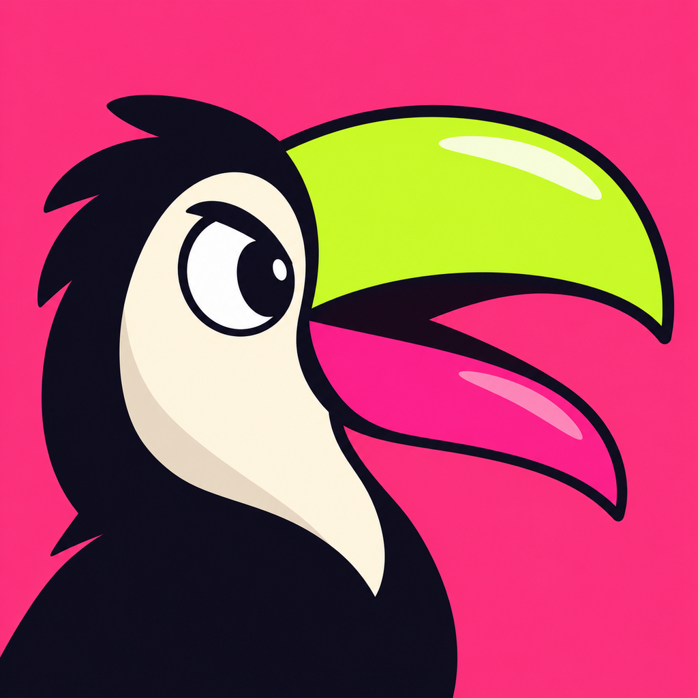
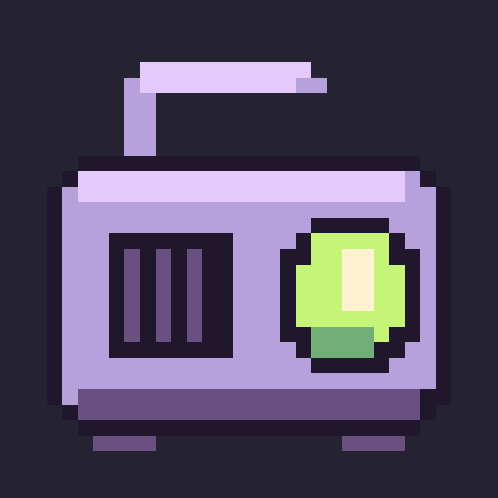
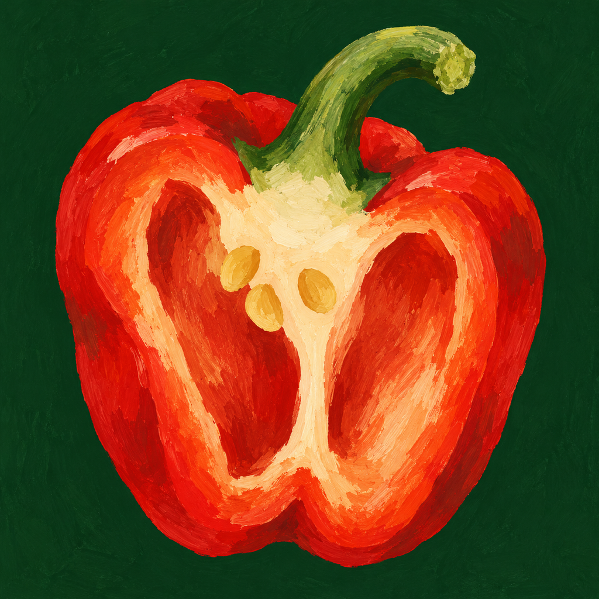
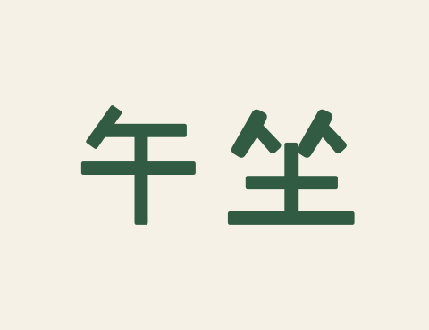
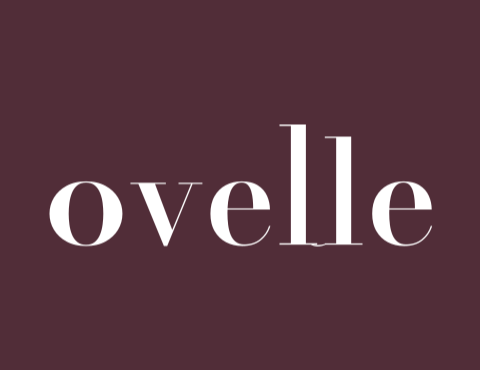
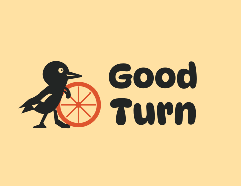
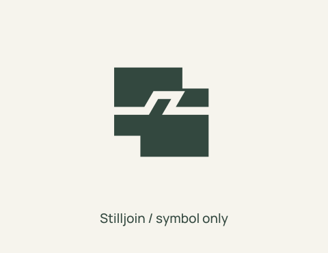

# Imprint

**Names, logos, and app icons for your next project.**

Imprint is an agent skill for independent app developers and creators. Design an icon for your next app, find a product name, or create a logo for your company or studio. Start with one asset or develop them together, from exploring directions to preparing usable files.

**English** | [简体中文](README.zh-CN.md) · [Quick start](#quick-start) · [App icons](#app-icons-for-independent-developers) · [Name + logo](#from-brief-to-identity) · [Gallery](#gallery) · [FAQ](#faq)

<p>
<a href="examples/icons/cases/04-echo.png"></a><a href="examples/icons/cases/23-itinerary.png"></a><a href="examples/icons/cases/18-radio.png"></a><a href="examples/icons/cases/09-harvest.png"></a><br>
<a href="examples/logos/cases/wu-zuo.png"></a><a href="examples/logos/cases/ovelle.png"></a><a href="examples/logos/cases/good-turn.png"></a><a href="examples/logos/cases/stilljoin.png"></a>
</p>

Selected fictional designs made with Imprint. Click a design to inspect it, or [browse the full galleries](#gallery).

## Quick start

Use an agent that can load skills and create files. Visual tasks also need image-generation or vector-editing tools, depending on the artwork.

Install from a terminal with Node.js and npm available:

```bash
npx skills add Frost-96/imprint
```

Choose your agent and install location when prompted. Alternatively, copy the entire [`skills/imprint/`](skills/imprint/) folder, including its references, into your agent's skills directory.

Then start with the part you need:

**An icon for your app**

> Use Imprint to design an icon for the iOS focus timer I'm building. I want something warm and playful that is easy to recognize on the home screen. Show me a few distinct directions, then refine my choice with small-size previews and icon exports.

**A name and logo**

> Use Imprint to name and design a logo for a desktop tool that helps independent sound designers organize field recordings. It should feel precise, practical, and have a little personality. Start with naming directions, then help me compare visual approaches.

Imprint asks for missing details that affect the design, presents candidates with reasons and trade-offs, then refines your choice and prepares files. You choose the final name and artwork unless you ask the agent to choose for you. Attach references or existing assets if you have them.

## Why Imprint

- **Give your app a recognizable icon.** Explore its subject, silhouette, color, and finish, then inspect it at small sizes and in home-screen or Dock previews. [Explore the icon workflow](#app-icons-for-independent-developers).
- **Find a name and logo with a reason to choose.** Naming candidates and logo directions come with their strengths and trade-offs. [See the Notch shortlist](examples/notch/README.md#name-the-idea).
- **Work on the part you need.** Request a name, a logo, an app icon, or a combination. Existing names and assets stay fixed unless you ask to change them. [Find a prompt for your task](#more-ways-to-use-imprint).
- **Take the work into your project.** Receive icon masters and requested size variants, or editable logo sources and exports, with previews and usage guidance. [See the deliverables](#what-you-receive).

## App icons for independent developers

Building your first app, preparing a release, or updating an existing icon? Start with what your app does, who uses it, and its target platform. You can design just the icon or develop an app name and icon together. An existing logo is optional.

| Stage | What you work on |
| --- | --- |
| Explore directions | Compare concepts in character, graphic, illustrated, dimensional, or pixel styles, guided by your app and references |
| Refine in context | Adjust silhouette, color, detail, and visual weight; inspect small-size, home-screen, Dock, or launcher previews for the target platform |
| Prepare app assets | Get a high-resolution master, source files, PNG exports, and requested size variants; specify native platform packages when needed |

Bring a screenshot, an existing icon, or a style reference to get started. [Browse 24 app-icon examples](examples/icons/wall.webp) or [inspect individual icons](examples/icons/cases/).

## From brief to identity

**Notch — a fictional field-recording catalog.** The brief called for an English name and a logo for finding useful moments among recorded takes.

| Name explored | Design rationale | Trade-off |
| --- | --- | --- |
| **Notch** · selected | A short name tied to marking a point for later | Could suggest an audio filter |
| Set Aside | A natural phrase for saving a useful find | Could imply postponement |
| Waypost | A place to return to | Could suggest navigation |
| Takebook | A practical record of recorded takes | More descriptive, less distinctive |

The visual study compared a symbol, lettering, and a symbol with the name. The selected logo pairs measured lettering with three recording strips, each marked at a different point.

[](examples/notch/README.md)

[Follow the brief, comparisons, and refinement](examples/notch/README.md) · [Download the example files](examples/notch/notch-example.zip)

## Gallery

Fictional designs made with Imprint in Codex using GPT-6-Astra. Explore different forms, materials, and styles.

<details>
<summary><strong>24 app icons</strong> — character, graphic, illustration, dimensional, and pixel styles</summary>

[](examples/icons/wall.webp)

[Open the full icon wall](examples/icons/wall.webp) · [Browse individual icons](examples/icons/cases/)

</details>

<details>
<summary><strong>24 brand logos</strong> — lettering, symbols, characters, and combinations</summary>

[](examples/logos/wall.png)

[Open the full logo wall](examples/logos/wall.png) · [Browse individual logos](examples/logos/cases/)

</details>

Bring a reference, combine styles, or ask Imprint to suggest directions suited to your project.

## More ways to use Imprint

<details>
<summary><strong>App icons</strong> — your first app, a redesign, or a name and icon together</summary>

**Refresh an existing app icon**

> Use Imprint to redesign the icon for my Android reading app. Keep its name and signature blue. Use the attached icon and app screenshots as context, and help me compare a few directions in launcher and small-size previews.

**App name and icon**

> Use Imprint to name a macOS tool for comparing test runs and design its app icon. Include Dock and small-size previews. Choose and refine the strongest direction, including the final name and artwork.

**Explore a style**

> Use Imprint to explore a few app icons in the attached cartoon style, with different silhouettes and expressions.

</details>

<details>
<summary><strong>Naming</strong> — a shortlist or a name with a logo</summary>

**Naming only**

> Use Imprint to name a shared cooking journal for families. Give me a Chinese and English shortlist with pronunciation, meaning, and trade-offs.

**Company name and logo**

> Use Imprint to name my independent publishing studio and design its logo. I want a thoughtful, slightly playful identity but have no visual direction yet. Help me compare options before refining a design.

</details>

<details>
<summary><strong>Logos</strong> — an existing name or a complete identity</summary>

**Wordmark for an existing name**

> Use Imprint to design a wordmark for my studio, Still Margin. Keep the name and use lettering only. It should feel calm and precise; show me different lettering approaches.

**Name, logo, and app icon**

> Use Imprint to create a name, logo, and app icon for a band rehearsal app. It should feel warm and energetic. Let me choose the name and concept before refinement.

</details>

## What you receive

Delivery follows the scope you request:

| Task | Deliverables |
| --- | --- |
| App icon | High-resolution master, actual source format, PNG exports, requested size variants, and platform-context and small-size previews |
| Naming | A shortlist or selected name, pronunciation, meaning, rationale, and trade-offs |
| Logo | Editable vector source, SVG and PNG exports, applicable color/black/reversed versions, and usage guidance |
| Combined work | App name and icon, name and logo, or all three, with shared visual direction and usage guidance as applicable |

Some app-icon treatments have raster-only sources. Request native platform packages if you need them. Shortlists and visual trials can be delivered on their own. See the [sample files](examples/notch/README.md#inspect-the-delivery) and [full workflow](skills/imprint/SKILL.md).

## FAQ

<details>
<summary>Can I start with just an app icon?</summary>

Yes. Tell Imprint what your app does, its target platform, and the feeling you want. A prototype, screenshots, or references can help. Keep an existing name or ask for naming alongside the icon; a company identity or separate logo is not required.

</details>

<details>
<summary>Do I need to know design terminology?</summary>

Describe your audience, desired feeling, and intended use. If the direction is open, Imprint offers concrete options: styles and subjects for an app icon, or symbols, lettering, and combinations for a logo. It works in your conversation language; specify languages and markets for naming.

</details>

<details>
<summary>Can I keep my existing name or logo?</summary>

Yes. Say what should stay fixed and what you want to develop. A new app icon can share your brand's character without using the same artwork. Existing choices are reused.

</details>

<details>
<summary>Can the agent choose for me?</summary>

Yes, when you explicitly delegate the choices. Otherwise, you choose the final name and artwork. You can also stop at a shortlist or visual comparison. Asking for a recommendation leaves the final choice with you.

</details>

<details>
<summary>Does installing the skill include image generation?</summary>

The skill supplies the workflow and design guidance. Your agent must provide the tools for the requested work, including image generation for raster concepts and vector creation/rendering for editable logos. Check those capabilities before starting a visual task.

</details>

## Feedback and license

[Open an Issue](https://github.com/Frost-96/imprint/issues) with your task, agent/model, expected result, and what happened. Examples of both successful work and rough edges help improve the skill. If Imprint helps you, a [Star](https://github.com/Frost-96/imprint) is welcome.

[MIT](LICENSE) © 2026 Imprint contributors. Third-party fonts, images, and other materials retain their own licenses.
