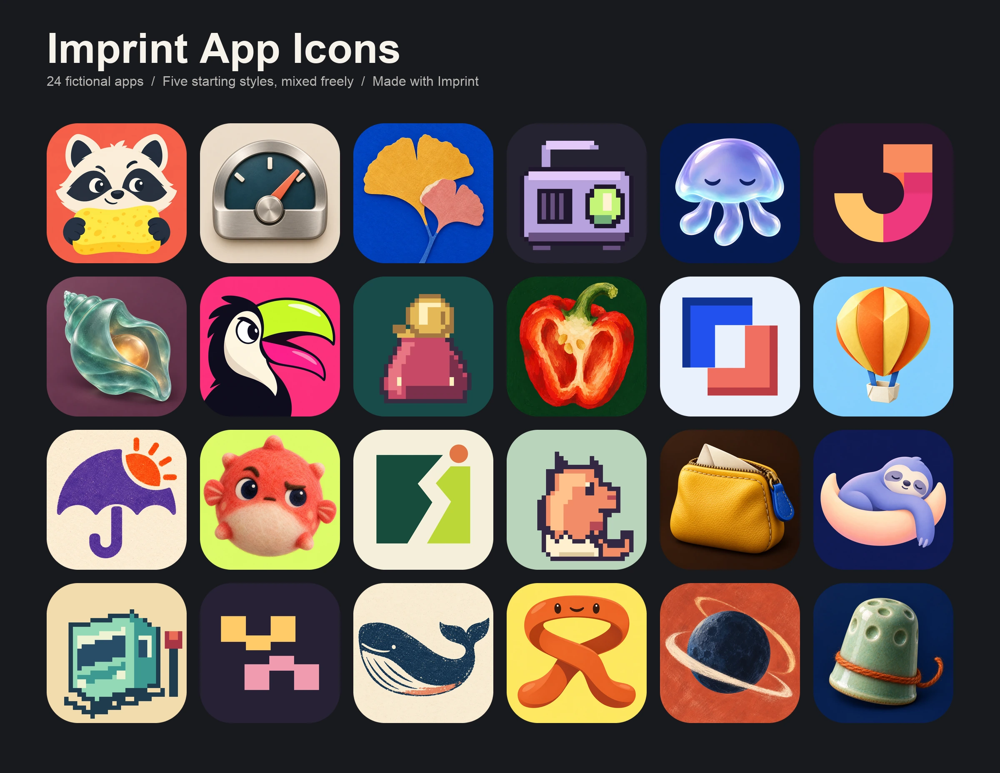
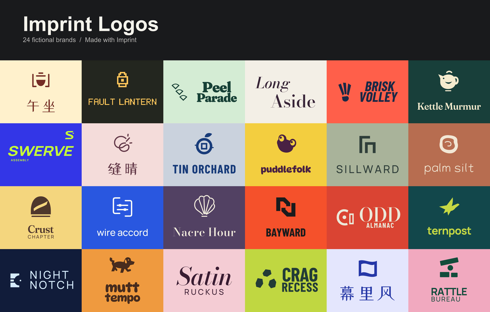

# Imprint

**English** | [简体中文](README.zh-CN.md)

An agent skill for designing product names, logos, and app icons. Build a complete identity or focus on one part of an existing brand.

[](examples/icons/wall.webp)

App icons generated with Imprint, spanning cartoon characters, flat graphics, illustration, dimensional materials, pixel art, and mixed styles. [View the icon wall](examples/icons/wall.webp).

[](examples/logos/wall.png)

Logos generated with Imprint. [View the logo wall](examples/logos/wall.png).

## Install

```bash
npx skills add Frost-96/imprint
```

Or copy [`skills/imprint/`](skills/imprint/) into your agent's skills directory.

## Get started

Tell your agent to use Imprint, describe your product and audience, and say what you need. Include any style references or existing assets you want to keep.

**Complete identity**

> Use Imprint to create a name, logo, and app icon for a band rehearsal app. It should feel warm and energetic. Let me choose the name and concept before refinement.

**Naming only**

> Use Imprint to name a shared cooking journal for families. Give me a Chinese and English shortlist with pronunciation, meaning, and trade-offs.

**Name and app icon**

> Use Imprint to name a macOS tool for comparing test runs and design its app icon. Include Dock and small-size previews. Choose and refine the strongest direction.

**App icon for an existing brand**

> Use Imprint to design an iOS app icon for my existing brand. Keep the name and logo, and use the attached assets as context.

**Explore a style**

> Use Imprint to explore a few app icons in the attached cartoon style, with different silhouettes and expressions.

Styles can combine: a character can be drawn, sculpted in felt, or built from pixels. Bring a reference or ask Imprint to suggest directions suited to your product.

Imprint works in your conversation language. You can choose between concepts yourself or ask the agent to select and refine a direction.

## How it approaches the work

- **Start with the product.** Define the audience, personality, and intended use before choosing a visual direction.
- **Explore before refining.** Compare distinct concepts, then develop the selected one.
- **Build for the medium.** Logos begin with monochrome structure. App icons use shape, color, and material, checked at small sizes and in context.
- **Deliver usable files.** Verify sources and exports, with guidance on where and how to use them.

Naming, logos, and app icons can be developed separately or together. Existing names and assets stay fixed unless you ask to change them. See the full [workflow](skills/imprint/SKILL.md).

## What you receive

Depending on your request:

- Brand positioning, personality, and naming rationale.
- Editable logos, wordmarks, and color and monochrome versions.
- App-icon masters, exports, size variants, and previews.
- Color, typography, spacing, and usage guidance.

## Tools and scope

Imprint provides the workflow; your agent needs image generation, vector editing, file access, and browsing tools for the relevant tasks. Name and visual-conflict searches are preliminary screening, not trademark clearance.

## License

[MIT](LICENSE) © 2026 Imprint contributors. Third-party fonts, images, and other materials used in a design task retain their own licenses.
