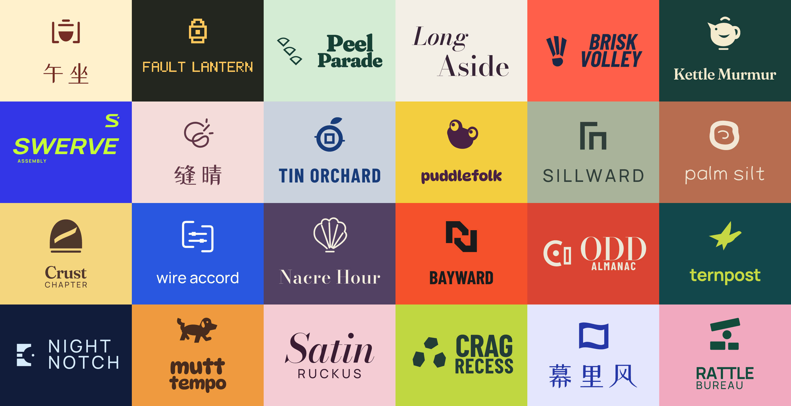
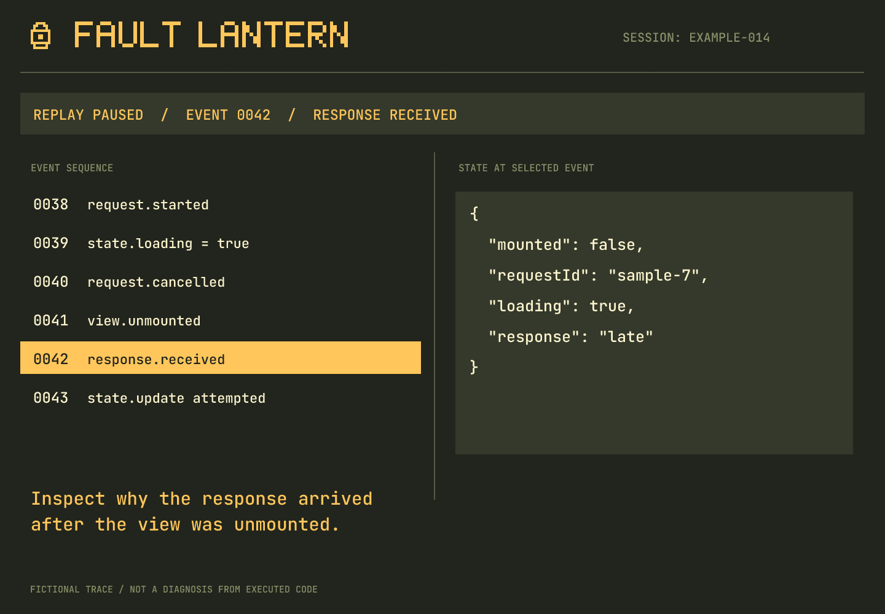
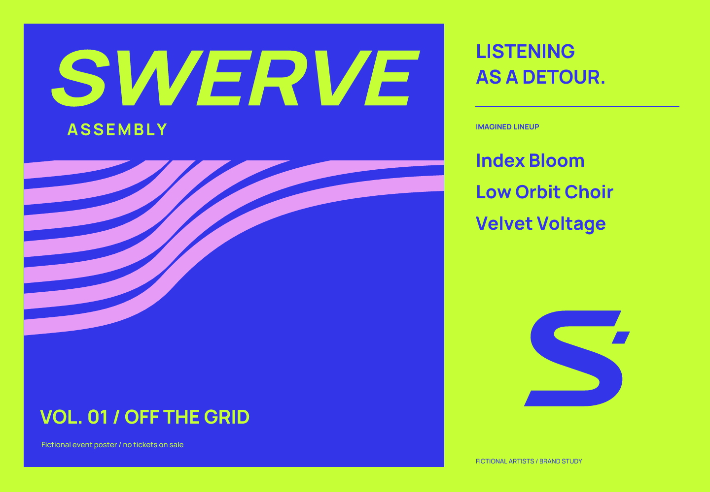
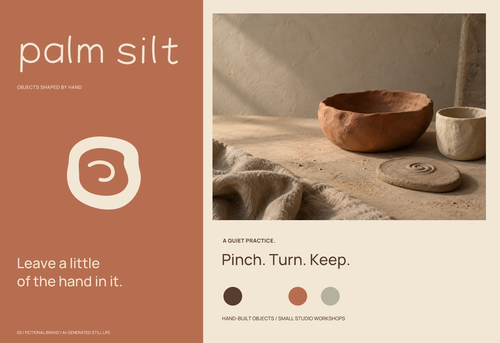

# Imprint

[English](README.md) | **简体中文**

一个用于设计产品品牌形象的 skill，涵盖需求梳理、命名、Logo、应用图标与可编辑资产交付。

Imprint 从产品的用途、服务的人群和希望传达的感受出发，形成一致的名称与视觉形象。你可以用它从零建立品牌，也可以只完善已有品牌的某个部分。

[](examples/README.zh-CN.md)

24 份虚拟简报，实际产出的设计。浏览[完整案例与可编辑资产](examples/README.zh-CN.md)，或先看下方的[四个精选案例](#精选案例)。

## 安装

直接安装：

```bash
npx skills add Frost-96/imprint
```

手动安装时，将 [`skills/imprint/`](skills/imprint/) 文件夹复制到你的 agent 的 skills 目录。该文件夹包含 `SKILL.md`、`agents/` 和 `references/`。

## 开始使用

告诉你的 agent 使用 Imprint，并说明你在做什么、面向谁、希望传达什么感受，以及需要哪些交付物。如果有要保留的名称、资产或已确认的决定，也一并提供。

**完整品牌形象**

> 使用 Imprint，为一个面向业余乐队的排练计划应用设计品牌形象。希望它温暖、有活力、值得信赖。我需要英文名称、Logo 和应用图标。先让我选择名称和概念，再进行精修。

**只做命名**

> 使用 Imprint，为一个家庭共享烹饪日志命名。探索亲切、有趣的中文和英文名称，给出候选名单、读音、理由、取舍，以及你查到的名称冲突。

**用已有 Logo 制作应用图标**

> 使用 Imprint，把附件中的 Logo 转成应用图标。保留现有名称和品牌识别，针对图标画布调整构图，并检查它在浅色、深色背景和小尺寸下的表现。

Imprint 会使用你的对话语言；命名语言与目标市场由简报决定。你可以设置时间或候选数量上限，自己选择方向，也可以让 agent 自行选择并解释推荐理由。

## 精选案例

这四个案例使用 Imprint 实际完成，覆盖命名、概念探索、矢量绘制与尺寸检查。产品和使用情境是虚构的，应用图片为展示设计效果的示意图。

### Puddlefolk — 好奇的户外伙伴


面向家庭的自然观察日志，需要一个能出现在观察卡、贴纸和手机屏幕上的友善角色。青蛙方向从蜗牛与纯字标方案中胜出；圆润的 DynaPuff 字体赋予名字活泼的语气。

全身角色缩小后会丢失细节，因此另画了保留高低眼特征的简化头像，并提供独立的 16 px 版本。这个案例展示了如何根据使用位置调整角色，同时保留辨识特征。

[阅读案例](examples/puddlefolk/README.zh-CN.md) · [比较概念](examples/puddlefolk/exploration/concepts.png) · [查看尺寸检查](examples/puddlefolk/verification/sizes.png)

### Fault Lantern — 照亮出错的那个事件



一个虚拟的事件捕获与调试工具，需要与调查过程有关的品牌形象。选定的灯笼只保留一个亮点，搭配手绘 5×7 像素字形，以及深色背景上的琥珀色。

早期磁带方案看起来太像游戏手柄。围绕灯笼重画标记后，名字与图形的联系更清楚；界面示意再将这个想法延伸到选中事件的视图。示例中的事件数据是人工构造的，不代表已经实现回放引擎。

[阅读案例](examples/fault-lantern/README.zh-CN.md) · [比较概念](examples/fault-lantern/exploration/concepts.png) · [查看 SVG 源文件](examples/fault-lantern/sources/)

### Swerve Assembly — 随节奏转弯的视觉



这是一个电子音乐活动与独立发行品牌概念，简报强调不安分的节奏和集体感。宽阔倾斜的字标、转弯的 S 标记，以及酸性黄绿与蓝色的对比，将这种性格带入活动海报。

字标基于 Manrope 调整间距、比例和倾斜角。较小的“Assembly”一行决定了实际使用下限：完整 Logo 建议至少 320 px 宽，更小的位置可以使用独立标记。

[阅读案例](examples/swerve-assembly/README.zh-CN.md) · [比较概念](examples/swerve-assembly/exploration/concepts.png) · [查看海报](examples/swerve-assembly/previews/application.png)

### Palm Silt — 把手的痕迹留下来



手捏陶器与工作室课程品牌，希望传达温暖和看得见的手工触感。手绘单线字标、不规则压痕标记，以及赭陶色和奶油色，将制作过程转化为品牌形象。

小尺寸方案最初去掉了内侧压痕，结果只剩一个普通圆环。恢复更短、更粗的内侧曲线后，标记保住了自己的特征。搭配的陶器静物图由 AI 生成；Logo 本身是可编辑的矢量图形。

[阅读案例](examples/palm-silt/README.zh-CN.md) · [查看精修过程](examples/palm-silt/exploration/refinement.png) · [查看 SVG 源文件](examples/palm-silt/sources/)

[完整案例集](examples/README.zh-CN.md)收录全部 24 个案例，包括设计决定、源文件、导出和局限说明。每个案例都提供英文和简体中文文档。

## 工作方式

从零设计品牌时，流程依次经过产品理解与策略、命名、视觉概念、黑白构造、配色、图标适配和交付。只做某一部分时，会采用相关阶段，并延续已经确认的决定。

- **先策略，再视觉。** 先明确品牌性格及其与产品的关系，再选择视觉方向。
- **先概念，再精修。** 探索不同想法，在简报范围内完善最合适的方向。
- **先黑白，再效果。** 先解决形状、间距与平衡，再添加色彩或表面处理。
- **按使用位置设计。** 为应用图标、导航和其他场景做适配，检查实际图形在相应尺寸下的表现。
- **核验交付。** 检查可编辑源文件和导出，并明确尚未完成的工作或未解决的问题。

除非你授权修改，已有名称、资产和已确认的选择都会保留。完整流程见 [SKILL.md](skills/imprint/SKILL.md)，详细指引见 [references/](skills/imprint/references/)。

## 你会得到什么

交付物取决于你要求的范围。完整品牌设计可以包含：

- 品牌定位、性格与命名依据。
- 可编辑的 Logo 源文件、适用的字标和组合标，以及黑白、反白版本。
- 应用图标、小尺寸适配、导出与场景预览。
- 配色与字体建议、留白和最小尺寸规则，以及使用示例。
- 设计取舍、初筛发现与剩余局限的记录。

只做命名时，交付以文字为主。视觉任务需要实际图形和可用文件；把图片嵌入 SVG，不等于交付可编辑的矢量 Logo。

## 工具与范围

Imprint 提供设计流程，具体工具由你的 agent 提供：图像生成用于位图概念，矢量编辑与渲染用于可编辑图形，图像检查和文件访问用于核验，浏览工具用于外部调研。可用工具决定了任务能完成哪些部分。

名称和图形冲突搜索属于初步筛查，不等于商标核准或原创性证明。设计评价仍是判断；受众辨识度与市场成效，需要设计流程之外的证据。

## 许可证

[MIT](LICENSE) © 2026 Imprint contributors。设计任务中使用的第三方字体、图片和其他素材仍遵循各自的许可证。
