# 案例集

[English](README.md) | **简体中文**

使用 Imprint，根据不同简报设计的 24 个虚拟品牌。名称、受众、产品和场景为虚构设定；图形、可编辑文件和设计迭代是实际产出。应用图片为展示效果的示意图，其中使用 AI 生成图像的部分已在案例中注明。

## 精选案例

- [Puddlefolk](puddlefolk/README.zh-CN.md) — 自然观察日志、青蛙角色与适合小图标的简化头像。
- [Fault Lantern](fault-lantern/README.zh-CN.md) — 调试工具、灯笼标记与手绘像素字形。
- [Swerve Assembly](swerve-assembly/README.zh-CN.md) — 以倾斜字标和海报图形为核心的电子音乐品牌。
- [Palm Silt](palm-silt/README.zh-CN.md) — 手绘字标与不规则压痕构成的陶艺品牌。

## 浏览全部 24 个案例

点击标志或名称即可阅读案例。每个案例都提供英文和简体中文文档。

<table>
  <tr>
    <td align="center" width="16%"><a href="wu-zuo/README.zh-CN.md">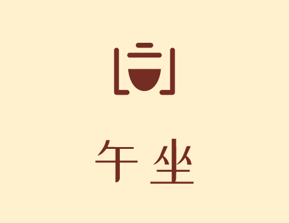 午坐</a></td>
    <td align="center" width="16%"><a href="fault-lantern/README.zh-CN.md">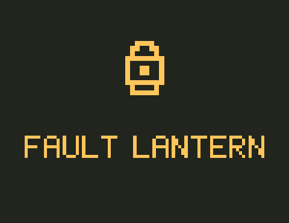 Fault Lantern</a></td>
    <td align="center" width="16%"><a href="peel-parade/README.zh-CN.md">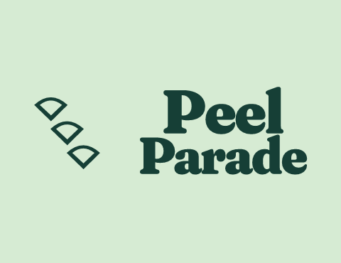 Peel Parade</a></td>
    <td align="center" width="16%"><a href="long-aside/README.zh-CN.md">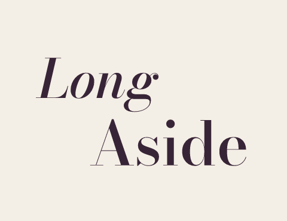 Long Aside</a></td>
    <td align="center" width="16%"><a href="brisk-volley/README.zh-CN.md">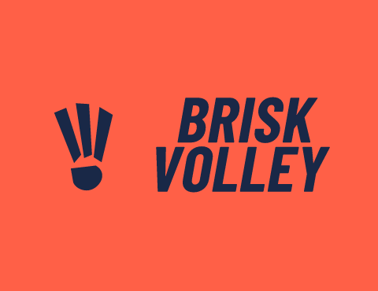 Brisk Volley</a></td>
    <td align="center" width="16%"><a href="kettle-murmur/README.zh-CN.md">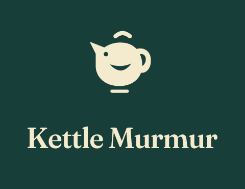 Kettle Murmur</a></td>
  </tr>
  <tr>
    <td align="center" width="16%"><a href="swerve-assembly/README.zh-CN.md">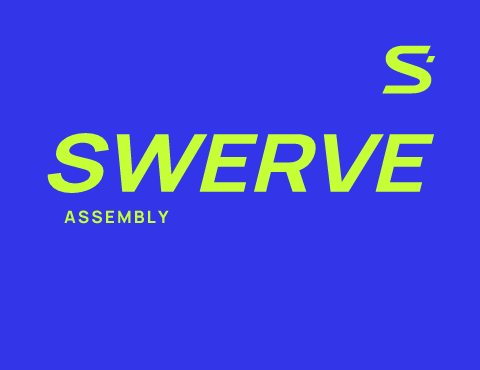 Swerve Assembly</a></td>
    <td align="center" width="16%"><a href="fengqing/README.zh-CN.md">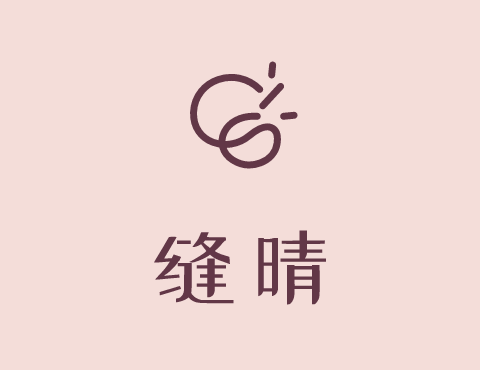 缝晴</a></td>
    <td align="center" width="16%"><a href="tin-orchard/README.zh-CN.md">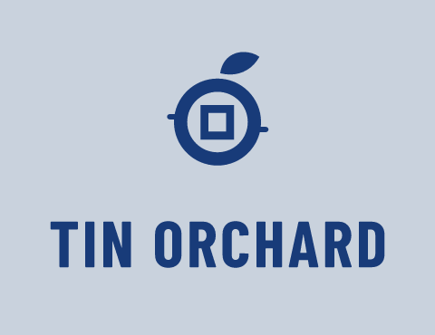 Tin Orchard</a></td>
    <td align="center" width="16%"><a href="puddlefolk/README.zh-CN.md">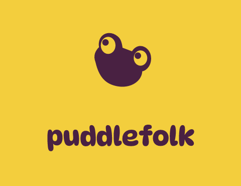 Puddlefolk</a></td>
    <td align="center" width="16%"><a href="sillward/README.zh-CN.md">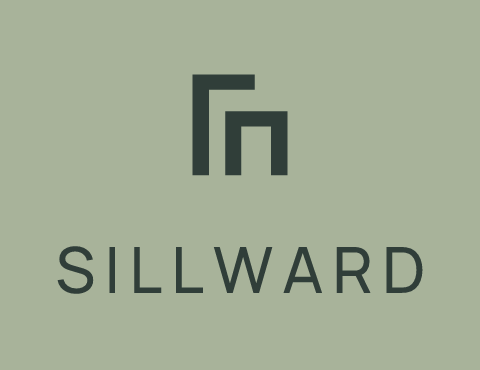 Sillward</a></td>
    <td align="center" width="16%"><a href="palm-silt/README.zh-CN.md">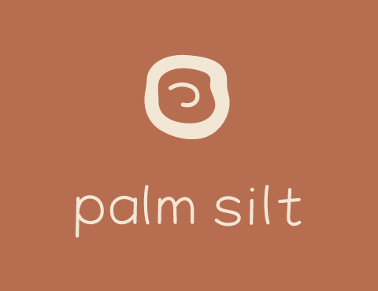 Palm Silt</a></td>
  </tr>
  <tr>
    <td align="center" width="16%"><a href="crust-chapter/README.zh-CN.md">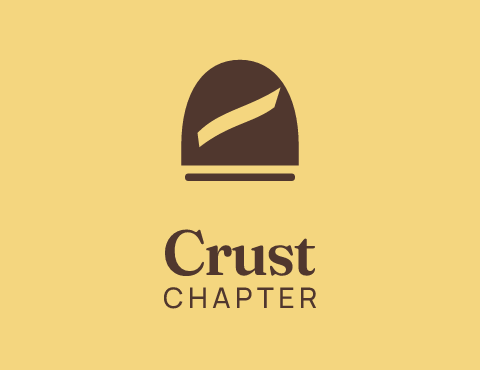 Crust Chapter</a></td>
    <td align="center" width="16%"><a href="wire-accord/README.zh-CN.md"> Wire Accord</a></td>
    <td align="center" width="16%"><a href="nacre-hour/README.zh-CN.md">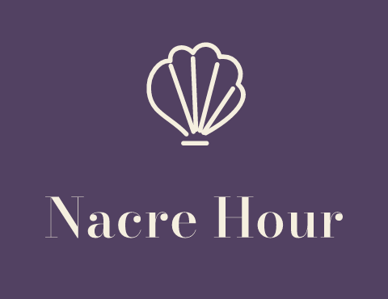 Nacre Hour</a></td>
    <td align="center" width="16%"><a href="bayward/README.zh-CN.md">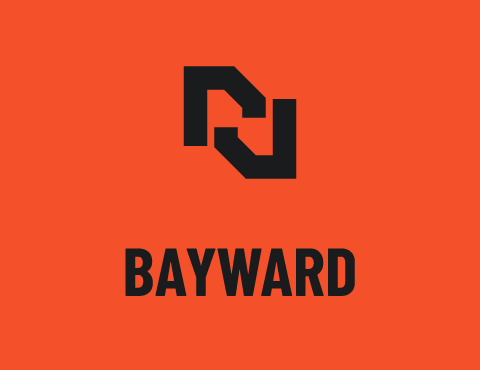 Bayward</a></td>
    <td align="center" width="16%"><a href="odd-almanac/README.zh-CN.md">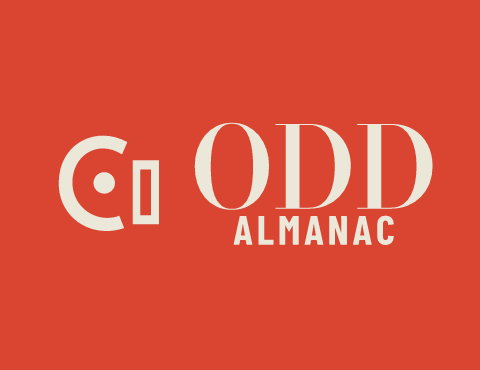 Odd Almanac</a></td>
    <td align="center" width="16%"><a href="ternpost/README.zh-CN.md">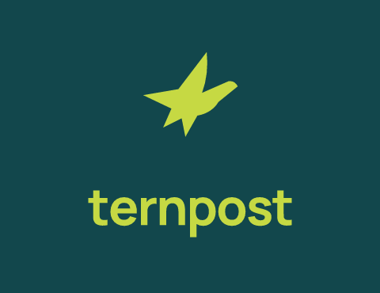 Ternpost</a></td>
  </tr>
  <tr>
    <td align="center" width="16%"><a href="night-notch/README.zh-CN.md">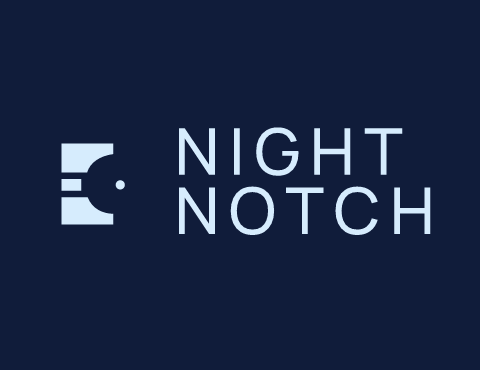 Night Notch</a></td>
    <td align="center" width="16%"><a href="mutt-tempo/README.zh-CN.md">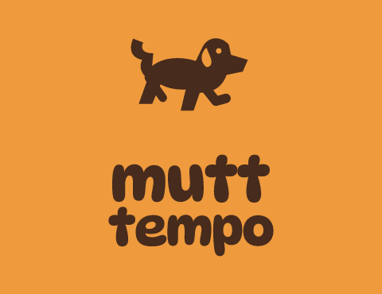 Mutt Tempo</a></td>
    <td align="center" width="16%"><a href="satin-ruckus/README.zh-CN.md">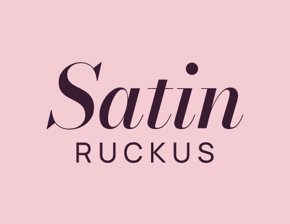 Satin Ruckus</a></td>
    <td align="center" width="16%"><a href="crag-recess/README.zh-CN.md">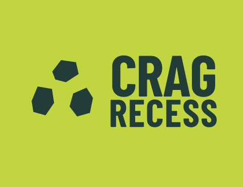 Crag Recess</a></td>
    <td align="center" width="16%"><a href="mu-li-feng/README.zh-CN.md">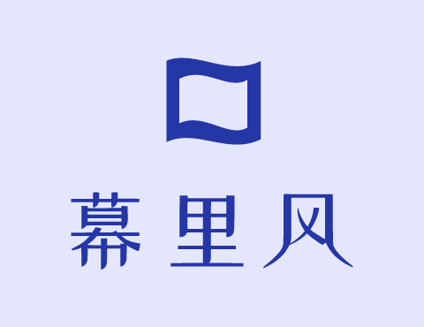 幕里风</a></td>
    <td align="center" width="16%"><a href="rattle-bureau/README.zh-CN.md">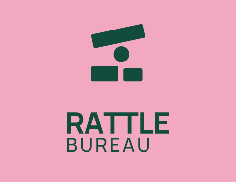 Rattle Bureau</a></td>
  </tr>
</table>

## 每个案例包含什么

每个文件夹均包含设计依据、概念与精修、可编辑 SVG 源文件、PNG 导出、预览、尺寸检查和相应的字体许可证。最早的七个案例包含应用示意，另外十七个聚焦命名与 Logo 设计。交付内容和建议尺寸随简报而有所不同。

核心 Logo 使用矢量路径和形状构造。应用预览中的位图素材已在案例说明中标明；基于现有字体的字标与手绘字形也做了区分。

名称搜索属于初步筛查，图形冲突核查仍不完整。这些案例展示设计过程和实际产出的文件，不代表商标核准、客户验证或市场成效。第三方字体仍遵循随附许可证。

[← 返回 Imprint](../README.zh-CN.md)
