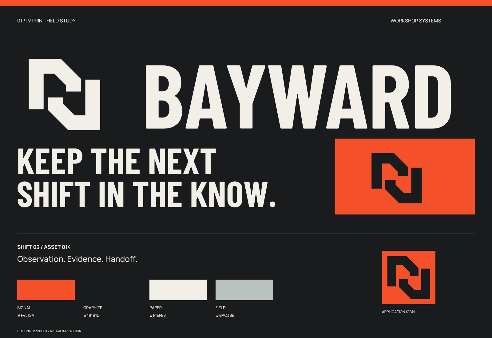

# Bayward — 虚拟案例 / 实际执行

[English](README.md) | **简体中文**

工业 / 紧凑 / 高对比。本案例于 2026-10-02 使用 Imprint 实际完成；产品、人物、记录、文章均为虚构，不代表真实客户或上线产品。

## 简报与策略

产品：车间设备维护与换班交接日志。面向小型制造车间的技术员与值班负责人。

问题：设备观察、维修记录与待处理事项分散在白板和消息中，下一班难以接续。

定位：**给车间下一班留下能接着处理的记录。**

价值范围：保留每次观察的证据、设备状态和下一位接手者；不承诺自动诊断或安全认证。

关键性格：可靠、接续、实用。使用场景：车间平板、设备卡片、桌面交接列表。

## 命名过程

先提出三个命名方向、六个候选，再筛选三个短名单：Bayward / Rivet Relay / Torque Ledger。

- 车间里的可靠向导：Bayward / Holdfast
- 把工作交到下一双手：Rivet Relay / Second Shift
- 设备留下的可读记录：Torque Ledger / Witness Bay

选择：Bayward / BAY-werd。用 bay（工位）与方向感的 ward 组织命名意象；这是本次创意解释，并非历史词源。

公开初筛：Rivet Relay 已有工作流自动化服务；Torque Ledger 已用于扭矩检查清单，辨识性不足，均未采用。Bayward 检索发现建筑公司及 Bayward Consulting 的既有使用线索，所以只保留为虚拟案例名称，不能称为已获准使用。

以上是有限公开检索。部分证据仅来自搜索返回内容，未全部完成页面复核；没有做商标可用性结论。图形检索尝试未形成足够可视证据，外部图形相似性审核仍不完整。

- [Rivet Relay 服务](https://rivetrelay.com/services/workflow-automation)
- [Torque Ledger 清单](https://safetyculture.com/library/construction/torque-ledger-pxl14y4dwg2r4iw1)
- [Bayward Builders 名录](https://www.bbb.org/us/ca/san-francisco/profile/general-contractor/bayward-builders-1116-965027)
- [Bayward Consulting 使用线索](https://www.infoguardsecurity.com/cybersecurity-consultants-experts/)

## 黑白方向与修正

A：相向构件；B：前进通道；C：折角记录。选择 A，因为它可以表达两个班次接续，同时不依赖扳手或齿轮。B 的箭头含义过于宽泛；C 更像普通文档工具。这个选择是设计判断，没有经过用户测试。

初稿构件连接处粘连，最终打开连接区域，分成两个清晰的实心构件。16 px 另用更宽的间隙。字标采用 Barlow Condensed Bold，并调整 AY、YW、WA 字对间距。

查看 [三个黑白方向](exploration/concepts.png) 与 [最终黑白适配](exploration/refinement.png)。初始概念和最终源文件有意保留差异，以展示真实取舍。

## 颜色与字体

石墨黑承担主体与阅读；信号橙用于入口与需要留意的区域；纸白用于记录面板；灰绿作辅助。橙色不表示设备经过安全认证。

| 角色 | 色值 |
| --- | --- |
| 主体 | `#191B1D` |
| 底色 | `#F1EFE8` |
| 强调 | `#F4512A` |
| 辅助 | `#BAC3BE` |

字标基于 **Barlow Condensed**，信息字体为 Manrope；使用现有字体的字形与定制间距，不宣称从零设计字体。字体来源锁定到 Google Fonts 仓库提交 `9710da1eacb3be272583c3224dcb70f9da6eadbb`。`fonts/sources.json` 记录源 URL、原文件 SHA-256、实例轴值和修改后名称。静态实例重命名为 Range 系列，随包附原始 SIL Open Font License；字体授权以随附 OFL 为准。

## 使用与交付

完整组合标建议至少 180 px 宽；独立构件至少 32 px，16 px 使用 small 版本。外部净空至少为标志总高度的 1/4。 这些最小值是本次渲染与目视检查的建议，并未经过受众实验。

- `sources/logo-*.svg`：主标志；color、black、white 三种。white 文件需要深色背景。
- `sources/wordmark-*.svg`：转曲字标；`wordmark-text.svg` 保留可编辑文字并嵌入字体，修改文字后仍需重新检查字距。
- `sources/mark-*.svg`：独立识别元素；`mark-small.svg` 是小尺寸适配。
- `sources/app-icon*.svg`：无预切圆角的通用方形图标，不是某个平台完整上架包。
- `exports/`：透明 PNG 标志，以及 1024、256、64、32、16 px 图标。
- `previews/`：视觉总览与一个真实生成的应用示意；界面不可操作。
- `verification/`：尺寸检查、源文件哈希、文字与转曲比对、导出一致性报告。
- `exploration/`：三个概念和黑白修正板。亲子案例另含图像生成原图与完整提示词。

不要拉伸、描边或给 logo 添加投影；不要把整体完整字标强缩到 16 px；避免将低对比的辅助色用于细小正文。SVG 中有基础图形和字形路径，核心标志未用嵌入位图冒充矢量。

## 验证结论与剩余问题

已检查 SVG 结构、实际渲染边界、黑白色值、透明背景、图标尺寸，以及文字版与转曲版的渲染对应；所有交付 PNG 均与对应 SVG 在相同尺寸重新渲染的结果逐字节一致。详见 [检查报告](verification/report.json)、[导出对应检查](verification/export-consistency.json)、[尺寸实图](verification/sizes.png)。

抽象构件仍可能与其他工业图形接近；目前没有完成充分的外部图形排重。

本次可以用来展示 skill 的流程和交付能力；不能把它表述为客户验证、商标批准或所有 agent 均已实测兼容。

[← 全部案例](../README.zh-CN.md) · [Imprint 主页](../../README.zh-CN.md)
