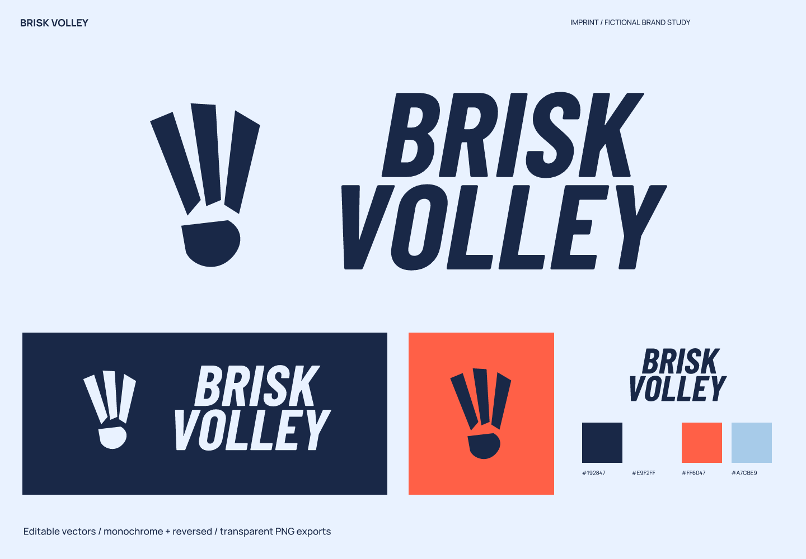
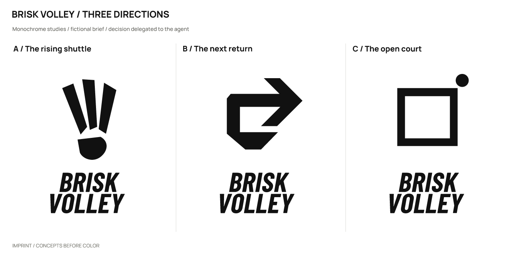
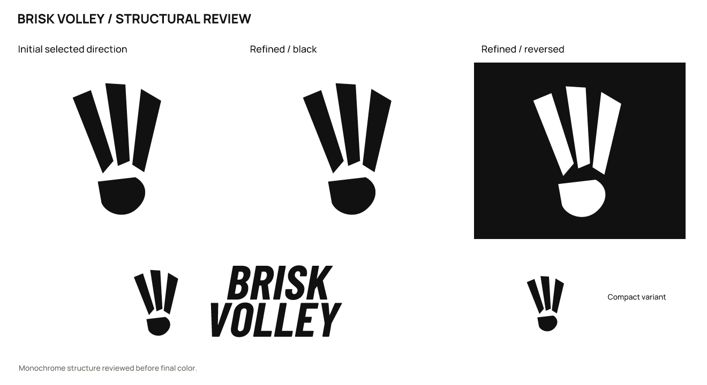

# Brisk Volley · Amateur badminton club

**English** | [简体中文](README.zh-CN.md)

> A fictional brief with actual design outputs. Products, audiences, and positioning are assumptions; there is no real client, audience testing, or business-outcome data.

## Positioning and naming

Level-matched badminton practice for adult beginners and people playing after work.

Positioning: **Play the next shot; you do not have to be an expert first.**

**Brisk Volley** (brisk VOL-ee) combines a lively pace with repeated returns, suggesting a game you can join after work.

Personality: motion, through slant and unequal endpoints; openness, through bright blocks instead of intimidating black sports graphics; directness, through heavy uppercase lettering.

Avoid: invented championships or records, aggressive animals, and cheap speed trails.

Naming territories: the shot — Brisk Volley / Next Rally; a social invitation — Court Company / Play After; light rhythm — Feather Tempo / Airbeat Club.

| Candidate | Rationale / strengths | Cost / risk |
| --- | --- | --- |
| Brisk Volley | Short and energetic. | Not specific to badminton; needs a descriptor. |
| Court Company | Friendly and social. | Common naming pattern in the category. |
| Feather Tempo | Clear lightness and rhythm. | Could sound like an arts organization. |

## Concepts and refinement

| Direction | Visual relationship | Main risk |
| --- | --- | --- |
| A / The rising shuttle | Three spread feathers gather into a slanted base. | Could look like a fan on its own. |
| B / The next return | A broad line turns back to express a return shot. | Resembles a generic turn or finance symbol. |
| C / The open court | A court boundary and a dot leaving its edge. | Resembles a map entry point. |

Selected **A**: separated feathers and a base establish a badminton context. B resembles a generic return symbol, while C is too broad a court diagram.

Refinement: Kept the gaps between feathers and the detached base. No decoration was added merely to manufacture an iteration when the silhouette was already clear.

The user authorized the agent to make the selection. This is not a real client or audience preference result. Symbols were constructed directly with SVG paths; wordmarks use licensed type with spacing adjustments and conversion to outlines, not an original typeface.

## Usage and files

- Primary ink `#192847`; light background `#E9F2FF`; accent `#FF6047`; supporting color `#A7CBE9`. Accents are for blocks or decoration and do not replace text-contrast checks.

- Wordmark: Barlow Condensed (bundled as RangeBayward). This uses licensed type, spacing, and outlined glyphs; it is not an original typeface. Font files, OFL licenses, and provenance are in [fonts](fonts/). Install the bundled fonts before editing the text version; prefer outlined artwork for general use.

- Recommended full-logo canvas width: **220 px** or more. Standalone symbol: **16 px** or more. The logo does not imply awards, rankings, or professional competition certification.

- Sizes refer to canvas width; keep the aspect ratio. Preserve the SVG’s built-in whitespace and leave at least 1/8 of the symbol width outside it. Use `mark-small.svg` at 32/16 px. Do not stretch, add shadows or outlines, or squeeze fine lettering into an avatar. Use white or light reversed artwork on dark backgrounds.

- `sources/`: color, black, and white logo compositions, outlined wordmarks and symbols, an editable text wordmark, and a small-size symbol.
- `exports/`: transparent PNGs. A 16 px export is a diagnostic sample; use it only where the recommendations above support that size.
- `previews/`: color and reversed presentations and avatar studies, not a platform submission icon package.
- `verification/`: actual-size images, source mappings, and rendering/export consistency results.

## Checks and limitations

Checked the three drawn monochrome directions, refinement, large-scale structure, 256 / 64 / 32 / 16 px symbols, the full logo at 220 px wide, and final light/dark presentations. Text and outlined versions were compared at 2400 px width, with a contour-overlap IoU of 1.00000000.

All 11 SVGs render without embedded bitmaps and have no font dependencies except the designated text version. All 23 final PNGs are byte-for-byte identical to fresh renders of the final SVGs. Passing file checks does not mean every tested size is suitable for use.

Name screening (2026-10-02): Results included ordinary phrase use in badminton writing. No same-name club was verified; the ordinary words may also make exclusive recognition harder.

These are the search and follow-up entry points used in the study. Results provide leads, not proof that no conflict exists.

- Query: `"Brisk Volley" badminton`; partial. [Source 1](https://swinton.dearnevalleyhistory.org.uk/article/badminton-at-swinton-congregational-church/) [Source 2](https://thepadelpaper.com/padel-haus-pitches-up-in-new-york/) [Source 3](https://www.padelful.com/en/rackets/adidas-drive-grey-3-4-2025)

Still unverified: trademark, domain, and social-handle availability; a complete external visual-similarity review; and real audience reading, spoken-spelling, and recall tests. No simulated human recognition results are claimed.

This study covers naming and logo design. A full brand manual, real product applications, and platform submission icon packages are outside its scope.

Executed with [skills/imprint/SKILL.md](../../skills/imprint/SKILL.md), SHA-256: `519e787cdf6277b2e9c5caeb64dbf3b3917a53bde0ee0dc433c4a35dd548fad3`. See the [brief, decisions, and search records](exploration/brief.json) and [editable vectors](sources/).

[← All examples](../README.md) · [Imprint](../../README.md)
