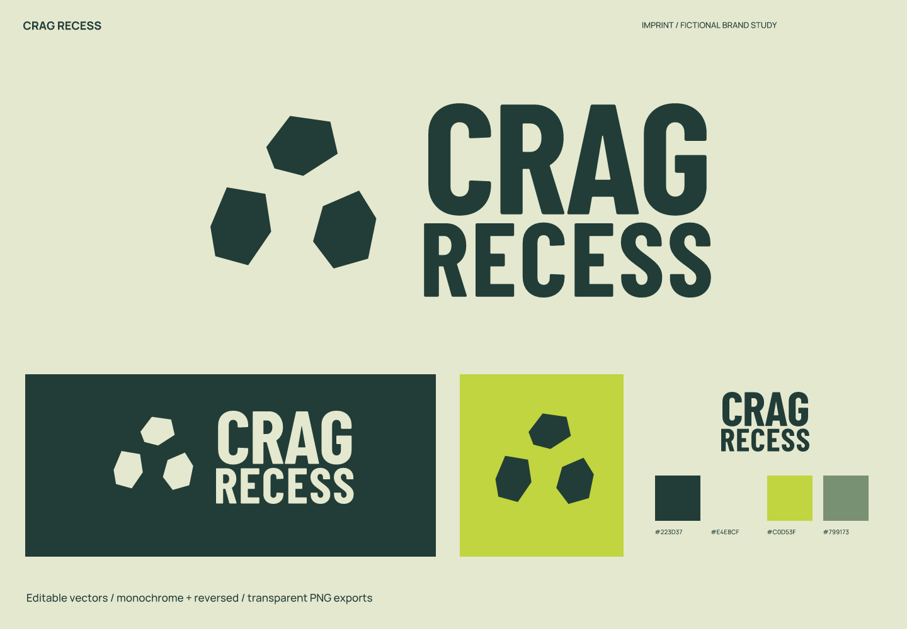
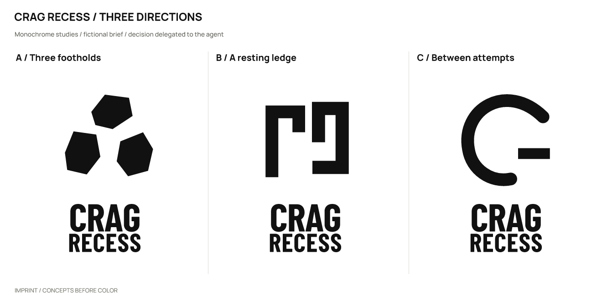
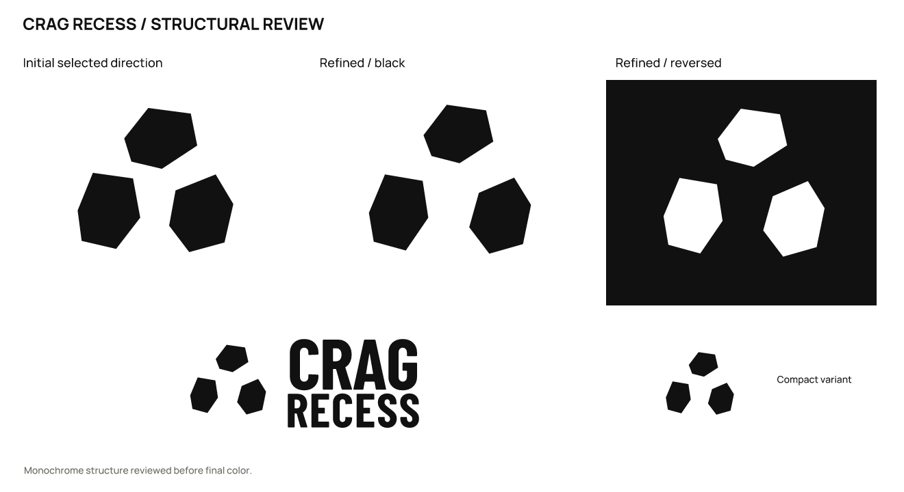

# Crag Recess · Adult climbing community

**English** | [简体中文](README.zh-CN.md)

> A fictional brief with actual design outputs. Products, audiences, and positioning are assumptions; there is no real client, audience testing, or business-outcome data.

## Positioning and naming

Small practice sessions and outdoor gatherings for beginner boulderers, allowing for trying, failing, and resting.

Positioning: **Take a difficult move seriously, and share practice comfortably.**

Personality: solid, through heavy facets; relaxed, without a competition badge; collective, through forms sitting alongside one another.

Avoid: triangular mountain badges, extreme-sports flames, and promises of reaching the summit.

Naming territories: difficulty and rest, risking outdoor-food associations; finding a foothold together, risking descriptiveness; playing with attempts, risking loss of the sports connection.

Selected: **Crag Recess** (krag REE-sess), pairing a rock face with a break to express a relaxed community around serious practice.

| Candidate | Strengths / intention | Cost / risk |
| --- | --- | --- |
| Crag Recess | A rock face and a break suggest a relaxed community around practice. | “Crag” may be unfamiliar to beginners; needs a climbing descriptor. |
| Crux Picnic | A hard move beside an easy rest. | “Picnic” first suggests food. |
| Footroom | Space for footholds and beginners. | Could suggest interior design. |
| Try Another | Encourages another attempt. | A generic phrase is hard to own. |

Searches for Crux Picnic returned a Double Crux Picnic event and Picnic Climbing leads. Another pair of images was chosen proactively; neighboring keywords were not treated as proof of a legal conflict.

## Concepts and refinement

| Direction | Visual relationship | Main risk |
| --- | --- | --- |
| A / Three footholds | Three irregular holds follow an offset path. | Could resemble a stone supplier in isolation. |
| B / A resting ledge | Two broad hooks suggest hanging and sitting back. | Resembles fasteners. |
| C / Between attempts | A thick arc and short bar form an open pause. | Could resemble a power or loading icon. |

Selected **A**: three distinct holds suggest a route of attempts and have fewer hardware associations than the broad hooks. They could still read as stones or patches on a ball in isolation.

Refinement: Moved the three holds slightly outward, increased negative space, and changed the facets to prevent them merging into one mass when reduced.

The user authorized the agent to make the selection. This is not a real client or audience preference result. Symbols were constructed directly with SVG paths; wordmarks use licensed type with spacing adjustments and conversion to outlines, not an original typeface.

## Usage and files

- Primary ink `#223D37`; light background `#E4E8CF`; accent `#C0D53F`; supporting color `#799173`. Use the dark version on light backgrounds and the reversed version on dark backgrounds.

- Wordmark: Barlow Condensed / RangeBayward. This uses licensed type, spacing, and outlined glyphs; it is not an original typeface. Font files, OFL licenses, and provenance are in [fonts](fonts/). Install the bundled fonts before editing the text version; prefer outlined artwork for general use.

- Recommended full-logo canvas width: **190 px** or more. Standalone symbol: **32 px** or more. Use the symbol from 32 px. At 16 px, only the basic three-part rhythm remains; standalone use is not recommended.

- Sizes refer to canvas width; keep the aspect ratio. Preserve the SVG’s built-in whitespace and leave at least 1/8 of the symbol width outside it. For a standalone wordmark, leave at least half the capital-letter height outside it. Do not stretch, add shadows or outlines, or squeeze fine lettering into an avatar. Use white or light reversed artwork on dark backgrounds.

- `sources/`: color, black, and white logo compositions, outlined wordmarks and symbols, an editable text wordmark, and a small-size symbol.
- `exports/`: transparent PNGs. A 16 px export is a diagnostic sample; use it only where the recommendations above support that size.
- `previews/`: color and reversed presentations and avatar studies, not a platform submission icon package.
- `verification/`: actual-size images, source mappings, and rendering/export consistency results.

## Checks and limitations

Checked the three drawn monochrome directions, refinement, large-scale structure, 1024 / 256 / 64 / 32 / 16 px symbols, the full logo at 190 px wide, and final light/dark presentations. Text and outlined versions were compared at 2400 px width, with a contour-overlap IoU of 1.00000000.

The SVGs render without embedded bitmaps. Main assets have no font dependencies except the designated editable text version.

Name screening (2026-10-02): The earlier name returned the Double Crux Picnic event and Picnic Climbing leads, prompting a change. Crag Recess returned the climbing area The Recess and route descriptions; these common climbing words still carry a search-distinction cost.

Queries: `"Crux Picnic"; "Crag Recess" climbing`. Date: 2026-10-02. The initial Exa queries and subsequent web searches are recorded in the [brief and search log](exploration/brief.json).

[Source 1](https://luma.com/uapm5l68) [Source 2](https://cruxlog.kr/posts/41702a5d143afa0f) [Source 3](https://www.mountainproject.com/area/106003510/the-recess)

Still unverified: trademark, domain, and social-handle availability; a complete external visual-similarity review; and real audience reading, spoken-spelling, and recall tests. No simulated human recognition results are claimed.

This study covers naming and logo design. A full brand manual, real product applications, and platform submission icon packages are outside its scope.

Executed with [skills/imprint/SKILL.md](../../skills/imprint/SKILL.md), SHA-256: `519e787cdf6277b2e9c5caeb64dbf3b3917a53bde0ee0dc433c4a35dd548fad3`. See the [brief, decisions, and search records](exploration/brief.json) and [editable vectors](sources/).

[← All examples](../README.md) · [Imprint](../../README.md)
