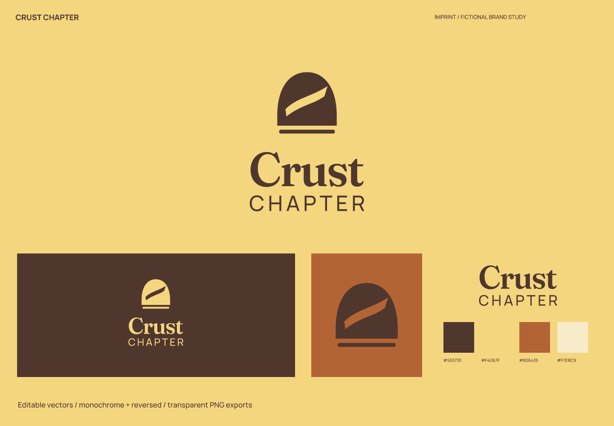
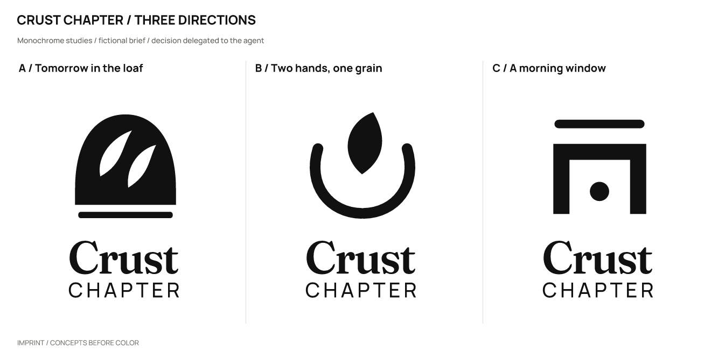
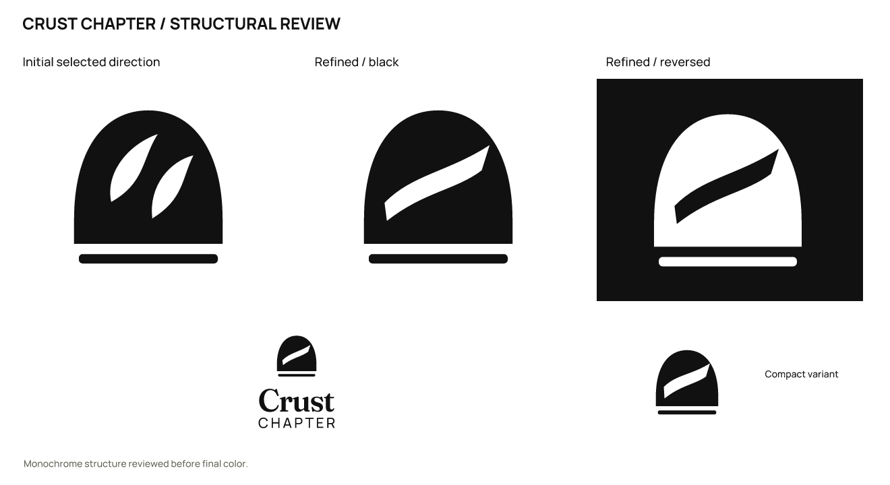

# Crust Chapter · 邻里发酵面包房

[English](README.md) | **简体中文**

> 虚拟品牌，真实产出的设计练习。产品、受众和定位为假设；不是客户项目，也没有经营或用户成效数据。

## 定位与名字

小批量制作日常发酵面包，面向街坊的早餐与带回家的晚餐。

把明天早上的一口，今天慢慢做好。

**Crust Chapter**（建议读法：krust CHAP-ter）。把每天切开的面包视为日常的一段；Chapter 是品牌比喻，不表示出版物。

品牌性格：温厚：宽底座与厚衬线；有节律：一道主切口；日常：麦芽黄和烘烤深色。

避免：健康或发酵时长虚构、法式王冠、到处铺满麦穗。

候选命名方向：准备明天：Morrow Grain / Early Keeping；切开的日常：Crust Chapter / Slice Company；炉边时间：Warm Interval / Oven Pause；复核后的替代方向：Crust Chapter。

| 候选 | 选择理由 / 优点 | 代价 / 风险 |
| --- | --- | --- |
| Crust Chapter | 把每天切开的面包视为日常的一段；Chapter 是品牌比喻，不表示出版物。 | Framer 上已有 Morrow & Grain 面包房模板，退出；Crust Chapter 保留日常烘焙意图，长度可用两行解决。 |
| Morrow Grain | 时间与材料联系自然 | morrow 偏书面 |
| Crust Chapter | 每天一片的意象 | 偏文学，延伸困难 |
| Warm Interval | 温和且有节奏 | 餐饮类别不清 |

Framer 上已有 Morrow & Grain 面包房模板，退出；Crust Chapter 保留日常烘焙意图，长度可用两行解决。

## 图形选择与精修

| 方向 | 关系 | 主要风险 |
| --- | --- | --- |
| A / 面包里的明天 | 圆拱面包由一道上扬割纹切开。 | 与通用面包图形存在类别相似。 |
| B / 双手托起一粒谷物 | 一枚种子被两条托起的弧围住。 | 容易靠近植物护理或环保品牌。 |
| C / 清晨的窗口 | 平顶炉口上方留出一条光线。 | 比 A 更偏建筑。 |

采用 **A**：圆拱面包比托种子的手更贴近街坊面包房；用日常物件而非王冠建立厚实感。

实际精修：初稿两道叶状割纹像一双眼睛；改为一道横向上扬割纹，保留底部稳定的烘烤层。

选择由用户授权 agent 自行决定；没有声称获得真实客户或受众的选择。图形由 SVG 路径直接构造；字标使用许可字体排字、调整间距后转曲，并非原创字体。

## 使用与文件

- 主图形 / 字色 `#50372E`；浅底 `#F4D67F`；强调色 `#B36435`；辅助色 `#F7EBC9`。强调色用于色块或装饰，不能代替文字对比度检查。

- 字标字体：Fraunces 的固定轴实例 WallFraunces；CHAPTER 使用 Manrope。字体文件、OFL 和来源见 [fonts](fonts/)。编辑文字版前安装随包字体；一般投放优先使用转曲版。

- 完整 Logo 建议画布宽度至少 **230 px**，图形独用建议 **16 px** 起；32/16 px 使用 `mark-small.svg`。尺寸按画布宽度计算，保持纵横比。

- 小版扩大割纹，不把两行字标强压进 16 px。

- 保留 SVG 自带留白，外部再留至少图形宽度的 1/8；不要拉伸、增加阴影、描边或把细字压进头像。深底用白色 / 浅色反白版本。

- `sources/`：图文组合、独立字标、独立图形的彩色 / 黑 / 白 SVG，以及文字版字标与小尺寸图形。

- `exports/`：透明背景 PNG。16 px 文件是实际诊断样本，只有达到上面的建议尺寸才作为推荐用法。

- `previews/`：配色与反白展示、头像示意。头像示意不等同于平台上架图标包。

- `verification/`：实际尺寸图、源文件映射、渲染与导出一致性结果。

## 已检查与仍未验证

已检查实际黑白概念、精修、大尺寸结构、256 / 64 / 32 / 16 px 图形、230 px 宽完整 Logo，以及成品的浅底 / 深底效果。字体文字版与转曲版在 2400 px 宽进行比较，轮廓覆盖 IoU 为 1.00000000。

11 份 SVG 均可渲染，无嵌入位图；除指定文字版外没有字体依赖。23 份正式 PNG 与最终 SVG 重新渲染结果逐字节一致。文件检查通过不代表所有测试尺寸都适合使用。

名称初筛（2026-10-02）：Framer 市场已有 Morrow & Grain 面包房模板，与本案同类，故放弃 Morrow Grain。Crust Chapter 的后续搜索未取得可核实的同名面包品牌结论。

以下是实际搜索 / 复核入口；搜索结果只提供线索，不能证明没有冲突。

- 查询：`"Morrow Grain" bakery`；部分核查。[来源 1](https://www.framer.com/marketplace/templates/morrow-grain/) [来源 2](https://framplates.com/morrow-grain) [来源 3](https://manitoba.canada-biz.org/251371-morrow_grain_co_ltd.htm)

- 查询：`Morrow & Grain Framer template`；部分核查。[来源 1](https://www.framer.com/marketplace/templates/morrow-grain/)

- 查询：`"Crust Chapter" bakery；"Crust Chapter"`；部分核查。未取得可引用页面。

未完成：商标、域名和社交账号可用性；完整外部图形相似性核查；真实受众认读、听写与记忆测试；完整品牌系统和平台上架包。

本轮范围为命名与 Logo 案例，完整品牌手册、真实产品应用和平台图标包不在本轮交付范围。

本案例执行当前仓库的 [skills/imprint/SKILL.md](../../skills/imprint/SKILL.md)，SHA-256：`519e787cdf6277b2e9c5caeb64dbf3b3917a53bde0ee0dc433c4a35dd548fad3`。简报、命名、选择依据与检索记录见 [结构化记录](exploration/brief.json)；可编辑矢量见 [sources/](sources/)。

[← 全部案例](../README.zh-CN.md) · [Imprint 主页](../../README.zh-CN.md)
