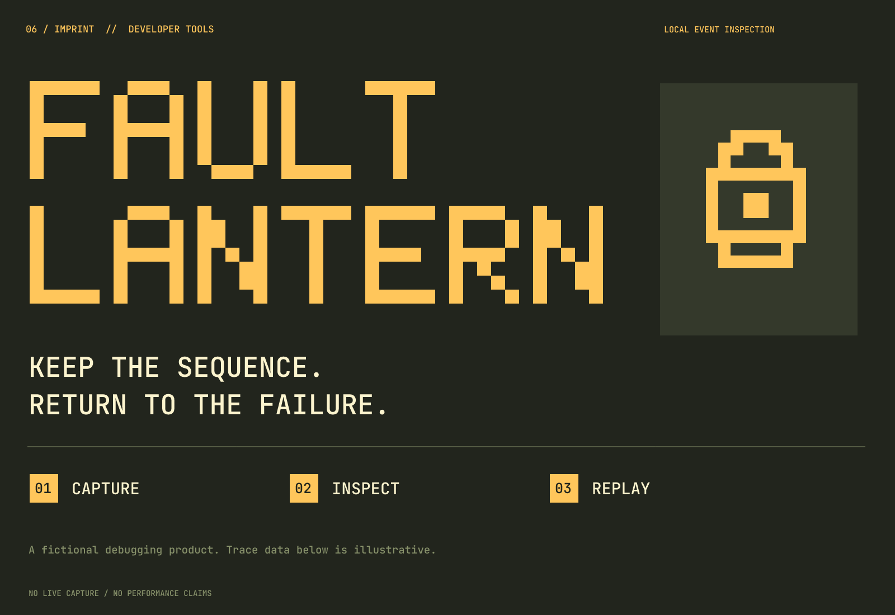

# Fault Lantern

**English** | [简体中文](README.zh-CN.md)

**Developer tool / pixel lettering / amber terminal**

A fictional brand study actually completed with Imprint on 2026-10-02. Products, people, activities, objects, records, articles, traces, interface examples, and UI are invented. They do not represent a real client, running software, or a launched physical product.

## Brief and positioning

Product: a brand concept for local development-event capture, state inspection, and asynchronous-failure replay, for developers investigating intermittent test failures or asynchronous state problems.

Positioning: **Keep the event sequence and return to where the failure happened.**

The brief assumes English naming and communication; multilingual brand localization was not completed. These are strategic choices, not market facts established through audience research.

Personality and visible decisions: inspectable → numbered events and explicit state; focused investigation → lantern and selected-event metaphor; direct → pixel construction and terminal hierarchy.

Avoid: AI magic claims, gamified monsters, and decorative code without purpose.

## Naming exploration and trade-offs

- Stored sequence: Replay Spool / Event Reel.
- A clue that remains: Stackwake / Trace After.
- Directed investigation: Fault Lantern / Error Beacon.

| Candidate | Specific strengths | Main cost | Decision |
| --- | --- | --- | --- |
| Fault Lantern | Clear problem category and a concrete object image. | Lantern has adjacent software uses; retain the full name. | Adopted as a fictional name. |
| Replay Spool | Easy to understand recording and replay. | Strongly descriptive software language; hard to distinguish in search. | Rejected. |
| Stackwake | Short, with a technical character. | Existing usage leads; “Stack” is broad. | Not selected. |

Selected spelling: **Fault Lantern**; suggested pronunciation: FAULT LAN-tern. Fault indicates the problem; Lantern suggests investigating by illuminating a specific event. It does not promise to find every root cause automatically.

Conflicting or weak candidates were not presented as final recommendations merely to fill a shortlist. The table retains the selection and rejection reasons.

Preliminary screening: Replay Spool was close to descriptive software terminology and existing commands, so it was rejected. Stackwake had music and software leads. Searches for Fault Lantern / Faultlantern did not establish directly matching software, but did surface adjacent LANtern network-diagnostics leads. The name remains unverified and is not shortened to Lantern.

Search date: 2026-10-02. Queries: `"Stackwake"`; `"Replay Spool"`; `"Fault Lantern"`; `"Replay Spool" debugger`; `"Replayspool"`; `"Fault Lantern" debugging software`; `"Faultlantern"`. General search and some Exa follow-ups were used. Some destination pages were represented only by search snippets and were not reviewed individually. Domain, social-handle, trademark-registration, and audience spoken-spelling checks were not performed.

- [Descriptive replay-spool command](https://github.com/TonicAI/distillery)
- [Stackwake same-name track](https://music.amazon.com/tracks/B0F9NXC1ND)
- [LANtern adjacent software lead](https://www.linkedin.com/posts/lanternnetworks_lantern-find-the-fault-know-the-fix-activity-7502455364697747456-FXiy)

## Concepts and construction

Final A is a pixel lantern with one bright point; B is a return arrow leading back to an event; C is a four-corner window framing an event. A was chosen because the object outline fits the name and can become a terminal status entry point. B looks like ordinary undo; C like a crop control. An early cassette idea was abandoned because it looked like a game controller.

The name changed from Replay Spool to Fault Lantern. The pixel outline was redrawn as a handle, chamber, single point, and base. Hand-drawn 5×7 pixel letterforms replace a font-based wordmark; internal seams under scaling were fixed and hard-edge rendering was specified. Ordinary interface text uses JetBrains Mono.

See the [three monochrome directions](exploration/concepts.png), [final monochrome refinement](exploration/refinement.png), and [actual-size images](verification/sizes.png). Initial concepts and final sources intentionally retain differences to show the decisions made. In developer-tool cases, files marked retired document abandoned names and symbols and are not final assets.

## Color and typography

Charcoal green-black forms the terminal background; amber highlights selected events and brand lettering; pale cream shows content; gray-olive carries secondary information. Avoid developing the pixel styling into a gaming mascot.

| Role | HEX |
| --- | --- |
| Primary text / outline | `#22251D` |
| Background | `#FCF4CE` |
| Accent | `#FFC65B` |
| Supporting | `#87916A` |

Fault Lantern’s wordmark uses hand-drawn pixel geometry. It is neither an existing font nor a complete font file. Manrope supplies ordinary information text; JetBrains Mono supplies code, state, and event text in the two developer-tool studies. Bundled fonts retain their respective SIL Open Font Licenses. Instances are renamed RangeBody, RangeBodyBold, and RangeTerminal as applicable. Source URLs, hashes, and axes are in `fonts/sources.json`, with licenses alongside them. Static instances come from a pinned Google Fonts commit; modifying a font does not mean designing it from scratch.

## Usage and deliverables

Leave at least one uppercase-letter height around the logo composition. Use the supplied icon canvas at 16 px and avoid arbitrary subpixel scaling. The minimum recommended full-logo width is **280 px**. These recommendations come from rendering and visual inspection, not audience experiments. Sizes refer to the canvas rather than the visible artwork; small-size support does not establish recall.

- `sources/logo-*.svg`: the main logo in color, black, and white. White artwork requires a dark background.
- `sources/wordmark-*.svg`: separate outlined lettering. Swerve Assembly and Wire Accord also include `wordmark-text.svg`.
- `sources/mark-*.svg` and `mark-small.svg`: standalone marks and the small-size adaptation.
- `sources/app-icon*.svg`: generic square icons without pre-cut rounded corners, not a complete platform submission package.
- `exports/`: transparent logo PNGs and icons at 1024, 256, 64, 32, and 16 px. Logo PNGs are 1200 px wide, with a separate minimum-size full logo. The 32/16 px icon exports use the small source.
- `previews/`: an identity overview and an application mockup; interfaces are not functional.
- `verification/`: size checks, source hashes, applicable text/outline comparisons, and export consistency reports.
- `exploration/`: three concepts, monochrome refinement, and retained earlier versions.

Keep proportions and internal whitespace. Do not stretch, outline, or add shadows to the logo, force the full wordmark into 16 px, or use low-contrast supporting colors for small body text. Core logos use shapes and letter paths, not embedded bitmaps masquerading as editable vectors. Pixel symbols are more stable when aligned to whole pixels.

## Verification and remaining limitations

All final source SVGs were rendered. Checks covered the absence of embedded bitmaps in core vector artwork, clipping at transparent asset edges, black/white values, icon dimensions, and opaque backgrounds. In this four-case batch, the two font-based wordmarks were compared with their outlined versions at 2400 px width; font-text comparison does not apply to the two hand-drawn wordmarks. Every final PNG is byte-for-byte identical to a fresh render of its SVG at the same size.

Visual inspection covered large artwork, application scenes, black/white and reversed versions, and icons at 256, 64, 32, and 16 px. The 1024 px icons were checked for dimensions and source correspondence; the source symbols were also inspected at large size. Reports: [structure and rendering](verification/report.json), [PNG correspondence](verification/export-consistency.json).

The pixel lantern could also be interpreted as a lighting or watch icon; the product description needs to establish the developer-tool context. The example trace is a constructed scenario, with no executed capture or replay engine and no performance benchmark.

External visual screening produced only a few category references and search leads, without a complete visual-similarity review. No claim is made of absolute originality, name clearance, or demonstrated market recognition. These limits do not prevent the delivered files from showing the design process.

[← All examples](../README.md) · [Imprint](../../README.md)
