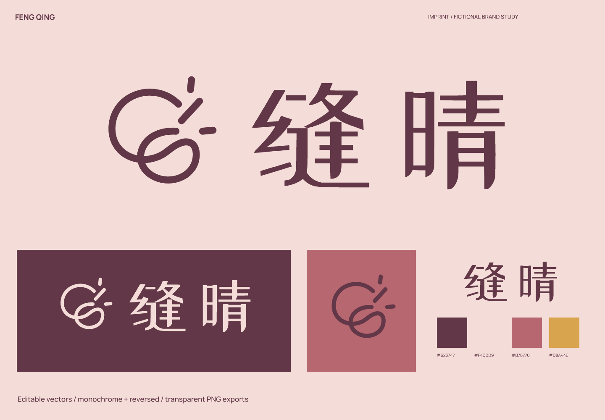
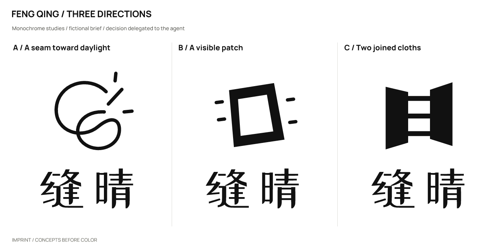
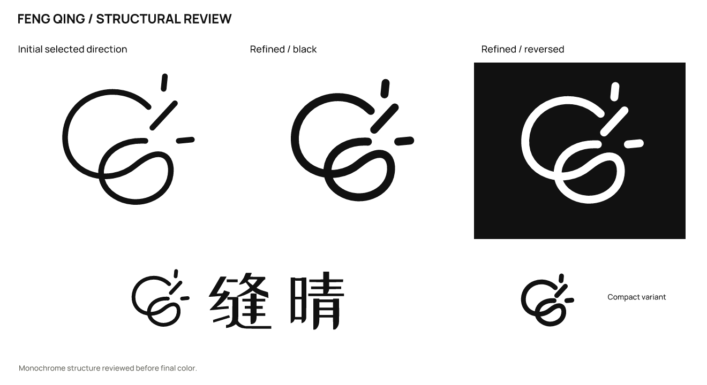

# 缝晴 · Clothing repair studio

**English** | [简体中文](README.zh-CN.md)

> A fictional brief with actual design outputs. Products, audiences, and positioning are assumptions; there is no real client, audience testing, or business-outcome data.

## Positioning and naming

Visible repairs and small sewing classes for people who want to keep wearing their old clothes.

Positioning: **Keep the repair visible, and keep wearing the everyday.**

**缝晴** (féng qíng) connects 缝, sewing or mending, with 晴, clear weather, to express the brighter feeling of clothes continuing in use.

Personality: patient, through a looping thread; optimistic, through an open sun; tactile, through the rhythm of Chinese letter strokes.

Avoid: promises of invisible, as-new repair, excessive rustic nostalgia, and crossed needle-and-thread tool icons.

Naming territories: the feeling after repair — 缝晴 / 衣然好; continuity of objects — 续衣间 / 留衣; practicing together — 针慢慢 / 补一会.

| Candidate | Rationale / strengths | Cost / risk |
| --- | --- | --- |
| 缝晴 | Two short characters connect mending and clear weather as a design intention. | Sounds similar to 风情; the written characters need confirmation in conversation. |
| 续衣间 | Easy to understand the service. | Strongly descriptive. |
| 补一会 | Relaxed and suitable for classes. | Does not fully cover an ongoing repair service. |

## Concepts and refinement

| Direction | Visual relationship | Main risk |
| --- | --- | --- |
| A / A seam toward daylight | A thread passes through an open sun and loops back. | Lines need more weight at small sizes. |
| B / A visible patch | An offset patch with short corner stitches. | Too close to a generic repair-service icon. |
| C / Two joined cloths | Three bridges connect the edges of two cloth pieces. | Resembles roads or electronic connections. |

Selected **A**: the open sun and looping line suggest life continuing after repair, better matching the name’s feeling than a patch icon.

Refinement: Thickened the main line and brought the whole contour inside the canvas. The rightmost and upper rays no longer approach the crop edges.

The user authorized the agent to make the selection. This is not a real client or audience preference result. Symbols were constructed directly with SVG paths; wordmarks use licensed type with spacing adjustments and conversion to outlines, not an original typeface.

## Usage and files

- Primary ink `#623747`; light background `#F4DDD9`; accent `#B76770`; supporting color `#D8A44E`. Accents are for blocks or decoration and do not replace text-contrast checks.

- Wordmark: ZCOOL XiaoWei. This uses licensed type, spacing, and outlined glyphs; it is not an original typeface. Font files, OFL licenses, and provenance are in [fonts](fonts/). Install the bundled fonts before editing the text version; prefer outlined artwork for general use.

- Recommended full-logo canvas width: **160 px** or more. Standalone symbol: **32 px** or more. Keep the Chinese wordmark at 160 px or wider. Do not squeeze the complex 缝 character into a small avatar.

- Sizes refer to canvas width; keep the aspect ratio. Preserve the SVG’s built-in whitespace and leave at least 1/8 of the symbol width outside it. Use `mark-small.svg` at 32/16 px. Do not stretch, add shadows or outlines, or squeeze fine lettering into an avatar. Use white or light reversed artwork on dark backgrounds.

- `sources/`: color, black, and white logo compositions, outlined wordmarks and symbols, an editable text wordmark, and a small-size symbol.
- `exports/`: transparent PNGs. A 16 px export is a diagnostic sample; use it only where the recommendations above support that size.
- `previews/`: color and reversed presentations and avatar studies, not a platform submission icon package.
- `verification/`: actual-size images, source mappings, and rendering/export consistency results.

## Checks and limitations

Checked the three drawn monochrome directions, refinement, large-scale structure, 256 / 64 / 32 / 16 px symbols, the full logo at 160 px wide, and final light/dark presentations. Text and outlined versions were compared at 2400 px width, with a contour-overlap IoU of 1.00000000.

All 11 SVGs render without embedded bitmaps and have no font dependencies except the designated text version. All 23 final PNGs are byte-for-byte identical to fresh renders of the final SVGs. Passing file checks does not mean every tested size is suitable for use.

Name screening (2026-10-02): Results were mostly isolated characters and low-relevance text; no same-name repair brand was verified. The shared pronunciation with 逢晴 is a design choice, with spoken-spelling testing still needed.

These are the search and follow-up entry points used in the study. Results provide leads, not proof that no conflict exists.

- Query: `"缝晴" 修补`; partial. [Source 1](https://tiku.youtike.com/question/3958939.html) [Source 2](https://www.paizi100.com/pinpai/qingfanyiju.html) [Source 3](https://zhtw.birmiss.com/%E7%8E%A9%E5%85%B7%E7%94%A8%E8%87%AA%E5%B7%B1%E7%9A%84%E9%9B%99%E6%89%8B%E4%BA%86%E8%81%96%E8%AA%95%E6%A8%B9%E4%B8%8A%E7%9A%84%E9%82%8A%E8%A7%92%E5%BB%A2%E6%96%99%EF%BC%9A%E5%A4%A7%E5%B8%AB%E7%8F%AD/)

Still unverified: trademark, domain, and social-handle availability; a complete external visual-similarity review; and real audience reading, spoken-spelling, and recall tests. No simulated human recognition results are claimed.

This study covers naming and logo design. A full brand manual, real product applications, and platform submission icon packages are outside its scope.

Executed with [skills/imprint/SKILL.md](../../skills/imprint/SKILL.md), SHA-256: `519e787cdf6277b2e9c5caeb64dbf3b3917a53bde0ee0dc433c4a35dd548fad3`. See the [brief, decisions, and search records](exploration/brief.json) and [editable vectors](sources/).

[← All examples](../README.md) · [Imprint](../../README.md)
