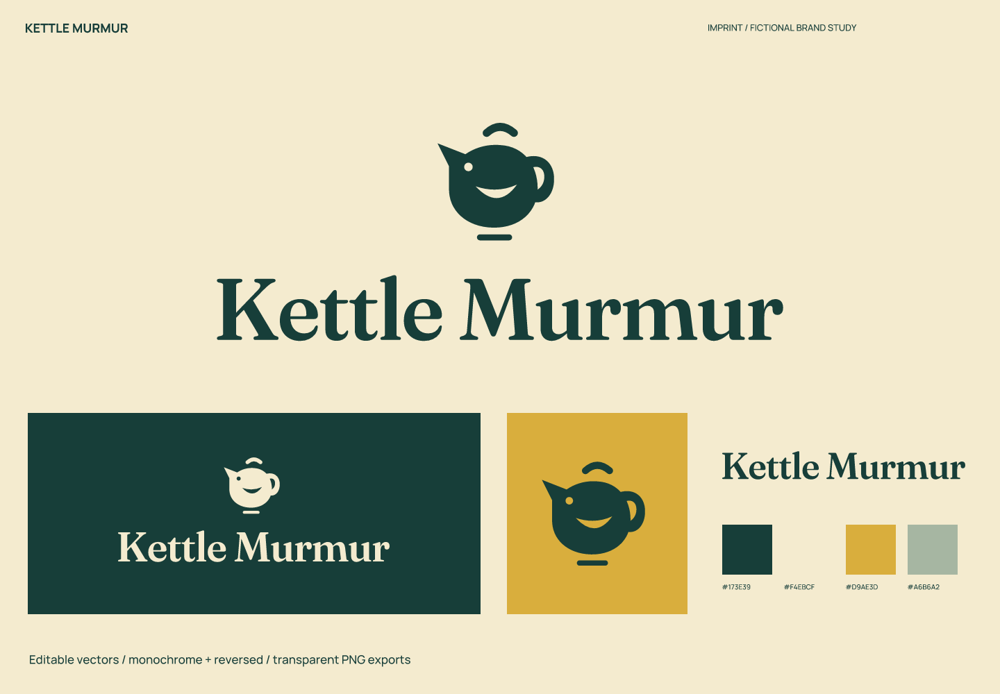
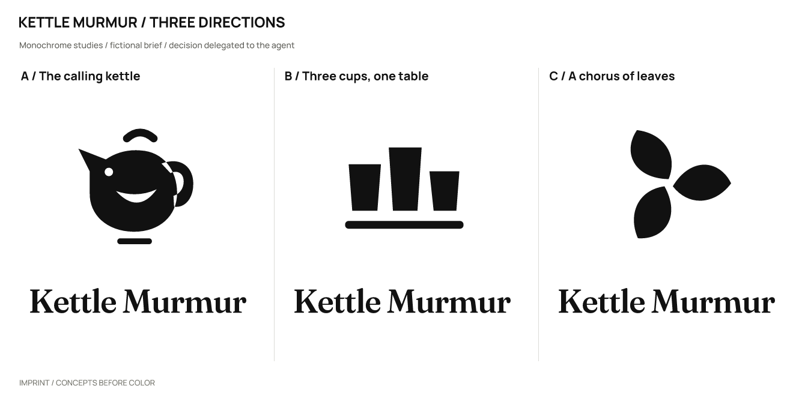
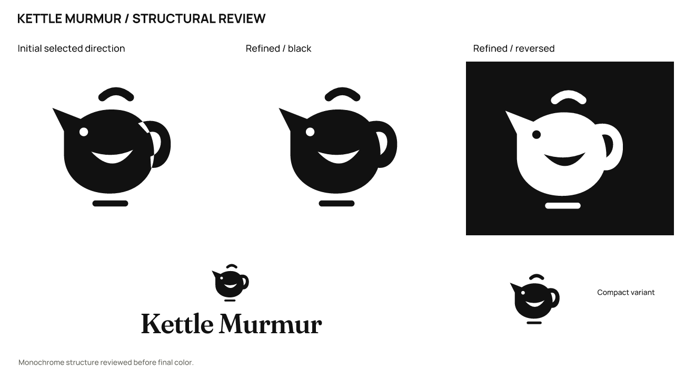

# Kettle Murmur · Small tea brand

**English** | [简体中文](README.zh-CN.md)

> A fictional brief with actual design outputs. Products, audiences, and positioning are assumptions; there is no real client, audience testing, or business-outcome data.

## Positioning and naming

Everyday loose-leaf tea and small tasting gatherings for people who enjoy inviting friends over.

Positioning: **A pot of tea, and a little time for conversation.**

**Kettle Murmur** (KET-uhl MUR-mer) shifts the idea from a choir to conversation around a pot. Sound is a metaphor for easy companionship.

Personality: hospitable, through a spout that appears to call out; unhurried, through spacious serif lettering; slightly odd, through a bird and kettle sharing an outline.

Avoid: royal luxury, claims of meditative benefits, and generic tea sprouts.

Naming territories: the sound of gathering — Kettle Choir / Table Chorus; an everyday pause — Steep Hour / Little Interval; companion objects — Second Cupboard / Guest Kettle; replacement after screening — Kettle Murmur.

| Candidate | Rationale / strengths | Cost / risk |
| --- | --- | --- |
| Kettle Murmur | Conversation around a pot; a sound metaphor for relaxed company. | The real Kettle Choir community project prompted a rename. Literary uses of “kettle murmur” still need review; availability is unverified. |
| Kettle Choir | A memorable contrast between an object and collective voices. | “Choir” has a spelling learning cost. |
| Table Chorus | Naturally suggests gathering. | A weaker connection to tea. |
| Steep Hour | Clearly connects tea and time. | Relatively descriptive. |

The real Kettle Choir community project prompted the change. The new phrase still has literary associations and has not been cleared for use.

## Concepts and refinement

| Direction | Visual relationship | Main risk |
| --- | --- | --- |
| A / The calling kettle | The spout becomes a calling bird, and the handle forms its tail. | The kettle/bird double reading needs simplification. |
| B / Three cups, one table | Three cups of different heights meet on one tray. | Could become a generic teaware-shop icon. |
| C / A chorus of leaves | Three leaves form an open, rotating crown. | Leaf arrangements are common in tea branding. |

Selected **A**: the calling bird and kettle share an outline with more warmth than an array of cups. The trade-off is a friendly tone rather than a serious teaware identity.

Refinement: The initial compound even-odd fill created an unintended white seam where the handle overlapped the body. Separate paths now place the handle behind the body.

The user authorized the agent to make the selection. This is not a real client or audience preference result. Symbols were constructed directly with SVG paths; wordmarks use licensed type with spacing adjustments and conversion to outlines, not an original typeface.

## Usage and files

- Primary ink `#173E39`; light background `#F4EBCF`; accent `#D9AE3D`; supporting color `#A6B6A2`. Accents are for blocks or decoration and do not replace text-contrast checks.

- Wordmark: WallFraunces, a fixed-axis instance of Fraunces. This uses licensed type, spacing, and outlined glyphs; it is not an original typeface. Font files, OFL licenses, and provenance are in [fonts](fonts/). Install the bundled fonts before editing the text version; prefer outlined artwork for general use.

- Recommended full-logo canvas width: **220 px** or more. Standalone symbol: **32 px** or more. At 16 px, the eye only supports the silhouette. Follow the rendered minimum-width recommendation for the full wordmark.

- Sizes refer to canvas width; keep the aspect ratio. Preserve the SVG’s built-in whitespace and leave at least 1/8 of the symbol width outside it. Use `mark-small.svg` at 32/16 px. Do not stretch, add shadows or outlines, or squeeze fine lettering into an avatar. Use white or light reversed artwork on dark backgrounds.

- `sources/`: color, black, and white logo compositions, outlined wordmarks and symbols, an editable text wordmark, and a small-size symbol.
- `exports/`: transparent PNGs. A 16 px export is a diagnostic sample; use it only where the recommendations above support that size.
- `previews/`: color and reversed presentations and avatar studies, not a platform submission icon package.
- `verification/`: actual-size images, source mappings, and rendering/export consistency results.

## Checks and limitations

Checked the three drawn monochrome directions, refinement, large-scale structure, 256 / 64 / 32 / 16 px symbols, the full logo at 220 px wide, and final light/dark presentations. Text and outlined versions were compared at 2400 px width, with a contour-overlap IoU of 0.99998999.

All 11 SVGs render without embedded bitmaps and have no font dependencies except the designated text version. All 23 final PNGs are byte-for-byte identical to fresh renders of the final SVGs. Passing file checks does not mean every tested size is suitable for use.

Name screening (2026-10-02): The original Kettle Choir name overlapped with The Kettle’s real community choir, so it was replaced. Searches for Kettle Murmur returned tea and literary phrase matches, without establishing availability.

These are the search and follow-up entry points used in the study. Results provide leads, not proof that no conflict exists.

- Query: `"Kettle Choir" tea`; Exa call failed; subsequent web fallback recorded below. No citable page was obtained.

- Query: `"Kettle Choir"`; partial. [Source 1](https://www.thekettle.ca/kettle-choir)

- Query: `"Kettle Murmur" tea`; partial. [Source 1](https://commonreader.wustl.edu/tea-cozy/)

Still unverified: trademark, domain, and social-handle availability; a complete external visual-similarity review; and real audience reading, spoken-spelling, and recall tests. No simulated human recognition results are claimed.

This study covers naming and logo design. A full brand manual, real product applications, and platform submission icon packages are outside its scope.

Executed with [skills/imprint/SKILL.md](../../skills/imprint/SKILL.md), SHA-256: `519e787cdf6277b2e9c5caeb64dbf3b3917a53bde0ee0dc433c4a35dd548fad3`. See the [brief, decisions, and search records](exploration/brief.json) and [editable vectors](sources/).

[← All examples](../README.md) · [Imprint](../../README.md)
