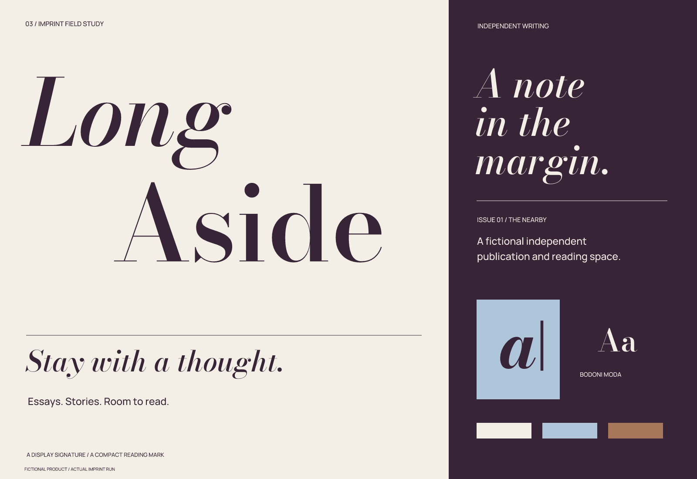

# Long Aside

**English** | [简体中文](README.zh-CN.md)

**Literary / wordmark-led / editorial whitespace**

A fictional brand study actually completed with Imprint on 2026-10-02. Products, people, activities, objects, records, articles, traces, interface examples, and UI are invented. They do not represent a real client, running software, or a launched physical product.

## Brief and positioning

Product: a digital publishing, reading, and version-note space for independent long-form essays and short stories, serving small literary journals, independent writers, and readers willing to slow down.

Problem: feeds fragment articles and make it hard for journals to maintain an editorial rhythm and a lasting, readable collection.

Positioning: **Give independent writing a reading space worth staying in.**

Value boundary: organize reading by issues and pieces, preserving author notes and version relationships. It does not replace editorial judgment or promise traffic revenue.

Key traits: lingering, independent, unhurried. Placements: journal covers, article pages, and mobile reading entry points.

## Naming exploration and trade-offs

Three naming territories produced six candidates, then a shortlist of Long Aside / Afterleaf / Paper Interval.

- An aside worth staying with: Long Aside / Minor Hours.
- A page that stays after reading: Afterleaf / Second Paper.
- Breathing space between pieces: Paper Interval / Dear Interval.

Selected: **Long Aside** (long uh-SIDE). An extended aside relates to an editorial position and slow reading. The full name has meaning, but a natural phrase has weaker search exclusivity.

Preliminary screening: Afterleaf was already used by software and was dropped. Long Aside appeared as an ordinary phrase in literary contexts; an Aside voice-notes app also existed, so the full name is retained rather than shortened to Aside. Paper Interval was more abstract and was not developed further. Domain, regional trademark, and comprehensive app-store checks were not completed.

These were limited public searches on 2026-10-02. Some evidence came only from search results and was not fully checked on the destination pages. No trademark-availability conclusion was reached. Image searches did not produce enough visual evidence, so external similarity review remains incomplete.

- [Existing Afterleaf app](https://www.afterleaf.app/)
- [Publisher using the phrase long aside](https://www.lianalevi.fr/foreign-rights/disoriental/)
- [Aside app](https://apps.apple.com/ph/app/aside-voice-notes-ai/id6758001568)

## Concepts and construction

A: offset italic and roman lines; B: a single-line editorial wordmark; C: brackets and an interval. A was chosen to express an aside through pauses and displacement between lines. B was too conventional, while C relied on very generic punctuation.

Increased the line gap and moved the second line right. Bodoni Moda changed from a finer display setting to wght 550, opsz 24 to strengthen thin strokes. The compact icon uses a heavier italic a and a marginal vertical line (wght 700, opsz 12), with a thicker line at 16 px. Reading-page navigation uses the compact mark and ordinary product-name text rather than squeezing the large wordmark into narrow navigation.

See the [three monochrome directions](exploration/concepts.png), [final monochrome refinement](exploration/refinement.png), and [actual-size images](verification/sizes.png). Initial concepts and final sources intentionally retain differences to show the decisions made. In developer-tool cases, files marked retired document abandoned names and symbols and are not final assets.

## Color and typography

Deep grape carries primary text; paper white forms the reading background; cool blue supports article illustrations and markers; copper brown is a small secondary accent.

| Role | HEX |
| --- | --- |
| Primary | `#382437` |
| Background | `#F4EFE6` |
| Accent | `#AFC5DA` |
| Supporting | `#A6775B` |

The wordmark uses **Bodoni Moda**, with Manrope for information. Existing letterforms and custom spacing are used; no original typeface is claimed. Font sources are pinned to Google Fonts commit `9710da1eacb3be272583c3224dcb70f9da6eadbb`. `fonts/sources.json` records source URLs, original SHA-256 values, instance axes, and modified names. Static instances were renamed to the Range family and include the original SIL Open Font License; the bundled OFL governs their use.

## Usage and deliverables

Use the full offset wordmark from **320 px** wide and the compact mark from **32 px**. Use the dedicated small version at 16 px. External clear space is at least one eighth of the total wordmark height, or one eighth of canvas width for the compact mark. These recommendations come from rendering and visual inspection, not audience experiments. Sizes refer to the canvas rather than the visible artwork; small-size support does not establish recall.

- `sources/logo-*.svg`: the main logo in color, black, and white. White artwork requires a dark background.
- `sources/wordmark-*.svg`: separate outlined lettering. `wordmark-text.svg` retains editable text with an embedded font; check spacing again after changing text.
- `sources/mark-*.svg` and `mark-small.svg`: standalone marks and the small-size adaptation.
- `sources/app-icon*.svg`: generic square icons without pre-cut rounded corners, not a complete platform submission package.
- `exports/`: transparent logo PNGs and icons at 1024, 256, 64, 32, and 16 px.
- `previews/`: an identity overview and an application mockup; interfaces are not functional.
- `verification/`: size checks, source hashes, applicable text/outline comparisons, and export consistency reports.
- `exploration/`: three concepts, monochrome refinement, and retained earlier versions.

Keep proportions and internal whitespace. Do not stretch, outline, or add shadows to the logo, force the full wordmark into 16 px, or use low-contrast supporting colors for small body text. Core logos use shapes and letter paths, not embedded bitmaps masquerading as editable vectors. Pixel symbols are more stable when aligned to whole pixels.

## Verification and remaining limitations

Checked SVG structure, actual render bounds, black/white values, transparent backgrounds, icon dimensions, and agreement between text and outlined versions. Every delivered PNG is byte-for-byte identical to its SVG freshly rendered at the same size. See the [check report](verification/report.json), [export comparison](verification/export-consistency.json), and [actual-size images](verification/sizes.png).

Editorial serif styling has strong category similarities. The icon may also read as “al”; it has weaker standalone recognition than the full name and needs to build familiarity alongside it.

This demonstrates the skill’s process and deliverables. It is not customer validation, trademark approval, or evidence that every agent has been tested for compatibility.

[← All examples](../README.md) · [Imprint](../../README.md)
