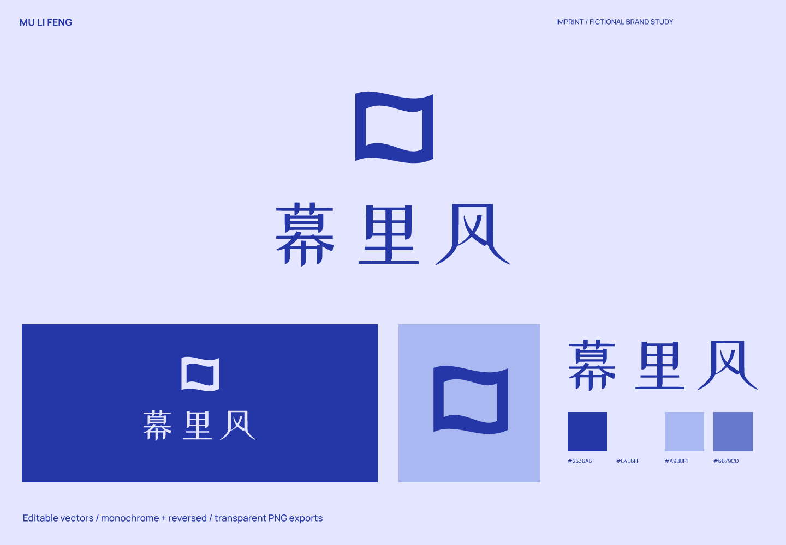
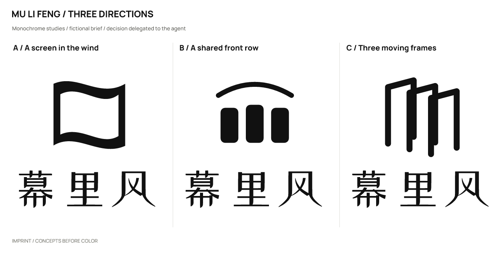
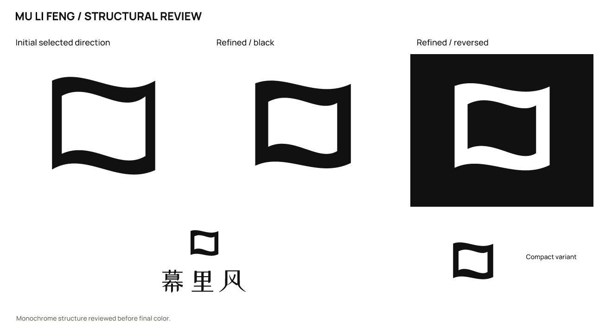

# 幕里风 · Traveling outdoor cinema

**English** | [简体中文](README.zh-CN.md)

> A fictional brief with actual design outputs. Products, audiences, and positioning are assumptions; there is no real client, audience testing, or business-outcome data.

## Positioning and naming

Outdoor film screenings for neighborhoods and small cultural venues, centered on place and watching together.

Positioning: **Bring the screen somewhere the wind can reach.**

Personality: light, through a curved screen; Chinese storytelling, through a short phrase-like name; open, through incomplete boundaries.

Avoid: film perforations, red-carpet trophies, and triangular play buttons.

Naming territories: screen and weather, risking accommodation associations; gathering temporarily, risking social-platform associations; leaving the cinema, risking an overly colloquial name.

Selected: **幕里风** (mù lǐ fēng), relating a screen to the wind in a way suited to outdoor screenings.

| Candidate | Strengths / intention | Cost / risk |
| --- | --- | --- |
| 幕里风 | A screen/wind relationship suited to outdoor cinema. | 幕 and 暮 sound the same; spelling from speech needs testing. |
| 借夜看 | Invites watching together at night. | A new colloquial combination needs learning. |
| 邻场 | Emphasizes temporary shared presence. | Very short and unclear about the category. |

## Concepts and refinement

| Direction | Visual relationship | Main risk |
| --- | --- | --- |
| A / A screen in the wind | A screen with curved top and bottom edges opens along a diagonal counter. | Could read as a sail or flag. |
| B / A shared front row | Three seats of unequal width sit around an arc. | A generic furniture or theater symbol. |
| C / Three moving frames | Three offset vertical frames suggest successive viewing. | More like pages or a motion-graphics tool. |

Selected **A**: a curved screen links projection with wind, fitting changing venues better than seats or film. A flag or sail reading remains possible.

Refinement: Reduced the outer silhouette and thickened its edges to keep the upper/lower curves and side frames continuous when reduced.

The user authorized the agent to make the selection. This is not a real client or audience preference result. Symbols were constructed directly with SVG paths; wordmarks use licensed type with spacing adjustments and conversion to outlines, not an original typeface.

## Usage and files

- Primary ink `#2536A6`; light background `#E4E6FF`; accent `#A9B8F1`; supporting color `#6679CD`. Use the dark version on light backgrounds and the reversed version on dark backgrounds.

- Wordmark: ZCOOL XiaoWei. This uses licensed type, spacing, and outlined glyphs; it is not an original typeface. Font files, OFL licenses, and provenance are in [fonts](fonts/). Install the bundled fonts before editing the text version; prefer outlined artwork for general use.

- Recommended full-logo canvas width: **180 px** or more. Standalone symbol: **16 px** or more. The opening survives at 16 px. Use the full Chinese logo from 180 px and do not squeeze the three characters into an avatar.

- Sizes refer to canvas width; keep the aspect ratio. Preserve the SVG’s built-in whitespace and leave at least 1/8 of the symbol width outside it. For a standalone wordmark, leave at least half the capital-letter height outside it. Do not stretch, add shadows or outlines, or squeeze fine lettering into an avatar. Use white or light reversed artwork on dark backgrounds.

- `sources/`: color, black, and white logo compositions, outlined wordmarks and symbols, an editable text wordmark, and a small-size symbol.
- `exports/`: transparent PNGs. A 16 px export is a diagnostic sample; use it only where the recommendations above support that size.
- `previews/`: color and reversed presentations and avatar studies, not a platform submission icon package.
- `verification/`: actual-size images, source mappings, and rendering/export consistency results.

## Checks and limitations

Checked the three drawn monochrome directions, refinement, large-scale structure, 1024 / 256 / 64 / 32 / 16 px symbols, the full logo at 180 px wide, and final light/dark presentations. Text and outlined versions were compared at 2400 px width, with a contour-overlap IoU of 0.99999689.

The SVGs render without embedded bitmaps. Main assets have no font dependencies except the designated editable text version.

Name screening (2026-10-02): Results were mostly film reviews containing related characters. No same-name screening brand was verified; confusion between 幕 and 暮 has not been tested with an audience.

Queries: `"幕里风" 放映; "幕里风"; "暮里风" 电影`. Date: 2026-10-02. The initial Exa queries and subsequent web searches are recorded in the [brief and search log](exploration/brief.json).

[Source 1](https://www.cinephilia.net/49841/)

Still unverified: trademark, domain, and social-handle availability; a complete external visual-similarity review; and real audience reading, spoken-spelling, and recall tests. No simulated human recognition results are claimed.

This study covers naming and logo design. A full brand manual, real product applications, and platform submission icon packages are outside its scope.

Executed with [skills/imprint/SKILL.md](../../skills/imprint/SKILL.md), SHA-256: `519e787cdf6277b2e9c5caeb64dbf3b3917a53bde0ee0dc433c4a35dd548fad3`. See the [brief, decisions, and search records](exploration/brief.json) and [editable vectors](sources/).

[← All examples](../README.md) · [Imprint](../../README.md)
