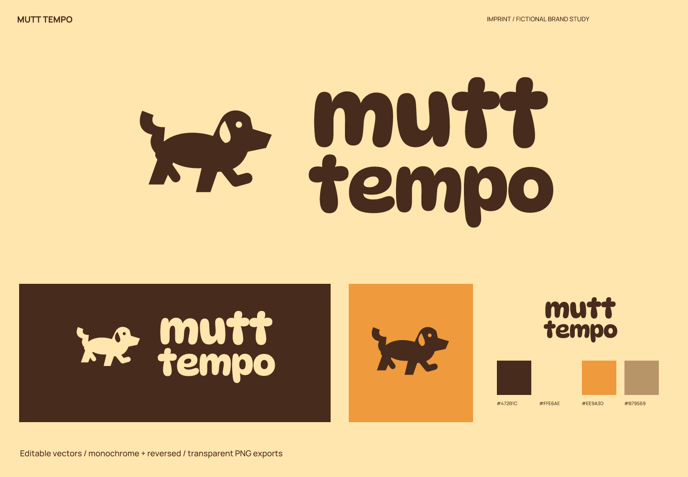
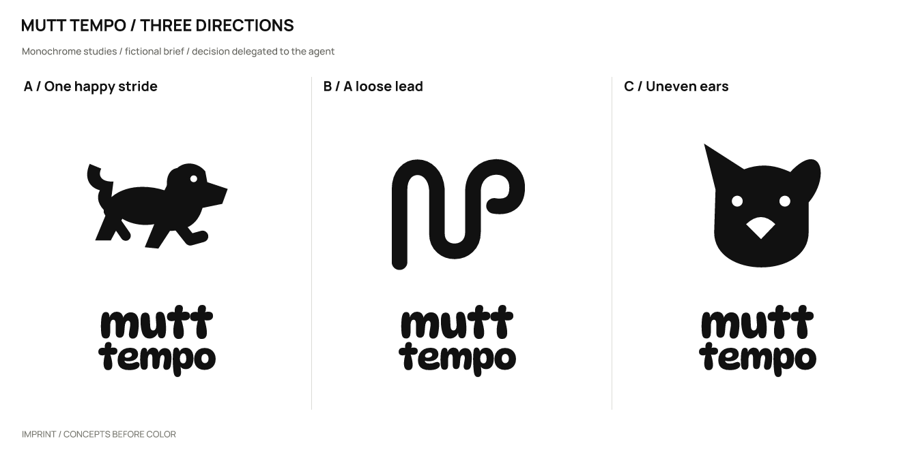
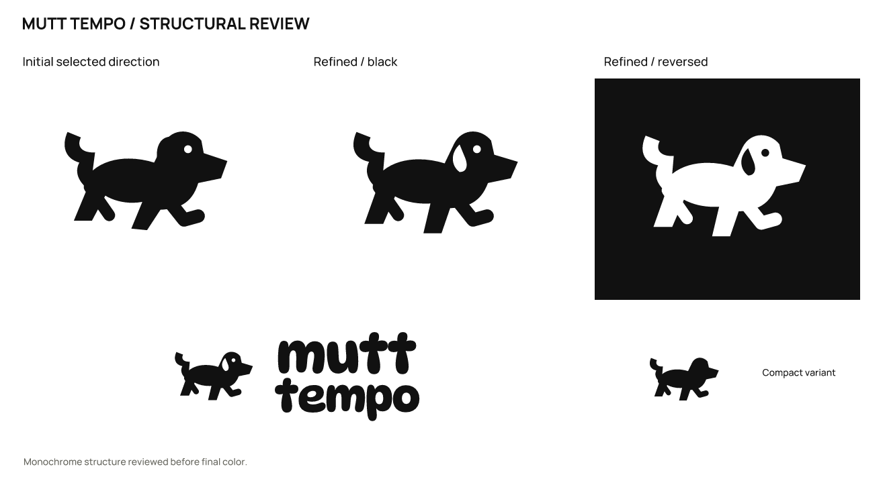

# Mutt Tempo · 城市遛犬服务

[English](README.md) | **简体中文**

> 虚拟简报，实际产出的设计练习；没有真实客户、受众测试或经营成效数据。

## 定位与命名

为忙碌的养犬者提供固定时段的街区遛犬服务，强调稳定节奏与狗的个性。

让每天的步子，回到适合它的节奏。

性格：有动作：身体前倾；俏皮：不对称耳朵；可靠：字标厚实而清楚。

避免：兽医十字、夸张尖牙、通用爪印。

命名领域：步伐与陪伴：风险是音乐类误读；一只不完美的狗：风险是过度幼稚；熟悉的路线：风险是像地图工具。

采用 **Mutt Tempo**，建议读法：mut TEM-poh。狗的个性和日常步伐之间有关系

| 候选 | 长处 / 意图 | 代价 / 风险 |
| --- | --- | --- |
| Mutt Tempo | 狗的个性和日常步伐之间有关系 | mutt 的口语感并非所有养犬者都喜欢 |
| Heel Company | 陪伴与行走的双意 | 可能误读为鞋履 |
| Around Again | 重复路线的亲近感 | 词组较普通 |

## 概念与精修

| 方向 | 可见关系 | 主要风险 |
| --- | --- | --- |
| A / 轻快的一步 | 长身体、前倾头部与抬起的脚表现一步。 | 小尺寸腿部可能粘连。 |
| B / 松弛的牵引绳 | 弯曲牵引绳围出开放的 m。 | 也像面条或一般回环。 |
| C / 不对称的耳朵 | 一立一垂的耳朵与宽鼻口。 | 宠物品牌常见正面头像。 |

采用 **A**：侧身迈步把日常节奏画成动作，比正面宠物头像更贴合遛犬；代价是腿部在小尺寸更复杂。

拉开主要腿部的间距，调整前伸脚，并在头部留出耳形内白；32/16 px 去掉耳部与眼睛细节。

## 使用与来源

- 主字色 `#472B1C`；浅底 `#FFE6AE`；强调色 `#EE9A3D`；辅助色 `#B79569`。浅底用深色版，深底用反白版。

- 字标使用 DynaPuff / RangePuddlefolk。这是许可字体的排字与转曲，不是原创字体；字体、OFL 和来源见 [fonts](fonts/)。文字编辑版需要安装随包字体。

- 完整 Logo 建议至少 **200 px 宽**，图形建议 **32 px 宽**起。图形推荐 32 px 起；16 px 仅为诊断，脸部细节不保留。

- 尺寸按画布宽度计算，保持纵横比。保留自带留白，外部再留至少图形宽度的 1/8；字标独用时外部留白至少大写字高的 1/2。不要拉伸、加阴影或挤压中文字。

- `sources/` 包含彩色 / 黑 / 白组合标志、转曲字标、图形，以及文字版字标和小尺寸图形；`exports/` 是透明 PNG；`previews/` 是成品与头像示意；`verification/` 是实际尺寸与检查结果。

## 检查与限制

已检查三个实际绘制的方向、精修前后、黑白反白、1024 / 256 / 64 / 32 / 16 px 图形、200 px 宽完整 Logo 和成品配色。文字版与转曲版在 2400 px 比较，轮廓覆盖 IoU 为 1.00000000。SVG 均可渲染、无内嵌位图；指定文字版以外的主文件无字体依赖。

名称初筛：Exa 触发限流后使用网页搜索，返回歌曲速度及犬类音乐等关键词匹配；未确认同名遛犬服务。

实际查询：`"Mutt Tempo"; "Mutt Tempo" dog walking`。日期 2026-10-02；初次 Exa 查询和后续网页检索记录见 [简报与检索记录](exploration/brief.json)。

[来源 1](https://www.runsforcookies.com/2015/12/national-mutt-day-and-tempo-run.html?m=0)

名称与图形可用性仍未验证：未做商标、域名、社交账号、完整外部图形相似性核查，也未模拟真人认读或记忆结果。

本轮为命名和 Logo 案例；完整品牌手册、真实产品应用、平台图标上架包不在范围内。由用户授权 agent 自行选择。

执行当前 [skills/imprint/SKILL.md](../../skills/imprint/SKILL.md)，SHA-256 `519e787cdf6277b2e9c5caeb64dbf3b3917a53bde0ee0dc433c4a35dd548fad3`。可编辑矢量见 [sources/](sources/)，记录见 [简报与检索记录](exploration/brief.json)。

[← 全部案例](../README.zh-CN.md) · [Imprint 主页](../../README.zh-CN.md)
