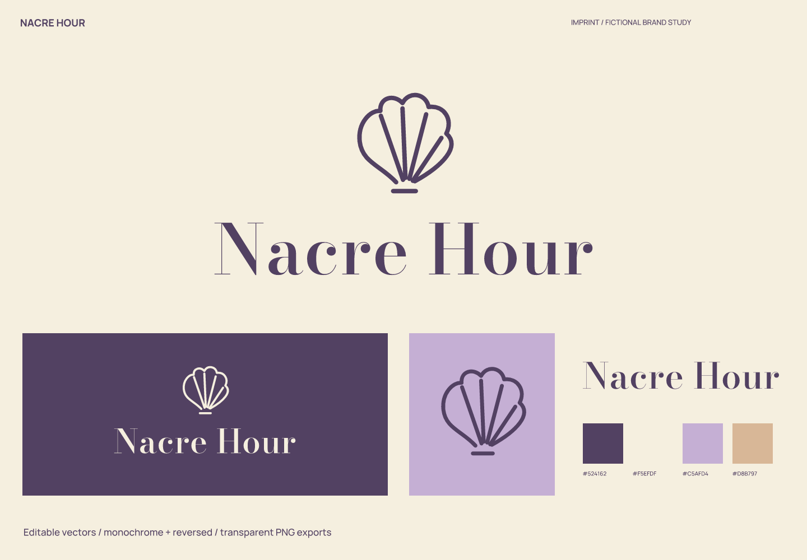
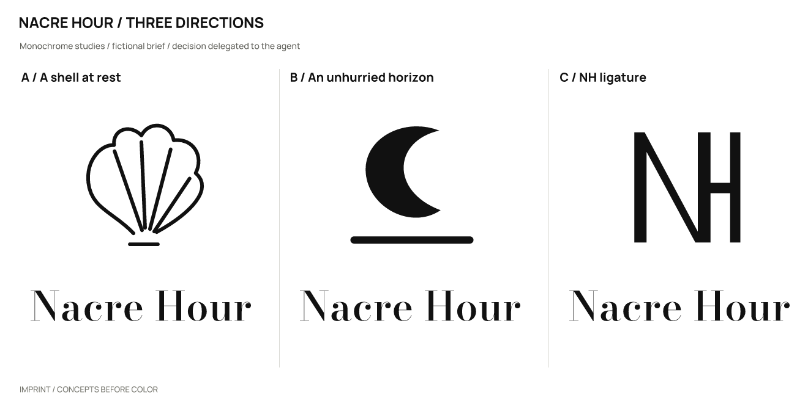
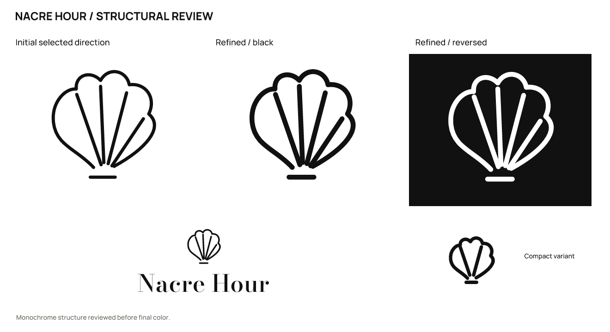

# Nacre Hour · 海边小旅馆

[English](README.md) | **简体中文**

> 虚拟品牌，真实产出的设计练习。产品、受众和定位为假设；不是客户项目，也没有经营或用户成效数据。

## 定位与名字

面向希望慢住几日的成年旅客，提供小规模海岸住宿与阅读空间。

给海边的一段安静时间一个形状。

**Nacre Hour**（建议读法：NAY-ker hour；本案读音建议）。珍珠母的材料感和 hour 的停留感共同指向海边慢住；属于设计意图。

品牌性格：轻：细长字形与宽阔内白；私密：壳的半包围关系；温润：浅紫与奶油色。

避免：棕榈落日模板、疗愈承诺、婚礼请柬式繁缛。

候选命名方向：海岸材料：Nacre Hour / Shell Interlude；居住节奏：Stay Slowly / Unhurried Rooms；边界光线：Pale Inlet / Window Tide。

| 候选 | 选择理由 / 优点 | 代价 / 风险 |
| --- | --- | --- |
| Nacre Hour | 材料和时间组合细腻 | nacre 发音与拼写需说明 |
| Pale Inlet | 海岸空间清楚 | 可能显得冷淡 |
| Stay Slowly | 语气友好 | 更像宣传语 |

## 图形选择与精修

| 方向 | 关系 | 主要风险 |
| --- | --- | --- |
| A / 静止的贝壳 | 扇形壳的扇骨收于短底座，留一侧开口。 | 贝壳是海岸类别常见元素。 |
| B / 从容的地平线 | 月形与低水平线构成一段停留。 | 容易变成泛用月亮标记。 |
| C / NH 连字 | N 与 H 共用一根柱与横线。 | 纯字母组合的亲近感较弱。 |

采用 **A**：扇形壳与海岸材料的名字相连，开放底部比封闭徽章轻；常见贝壳题材仍有类别相似风险。

实际精修：大尺寸保留四道扇骨，小版减为两道，增加线重；高对比衬线字标不宣称支持 16 px。

选择由用户授权 agent 自行决定；没有声称获得真实客户或受众的选择。图形由 SVG 路径直接构造；字标使用许可字体排字、调整间距后转曲，并非原创字体。

## 使用与文件

- 主图形 / 字色 `#524162`；浅底 `#F5EFDF`；强调色 `#C5AFD4`；辅助色 `#D8B797`。强调色用于色块或装饰，不能代替文字对比度检查。

- 字标字体：Bodoni Moda（随包名称 RangeLongAside）。字体文件、OFL 和来源见 [fonts](fonts/)。编辑文字版前安装随包字体；一般投放优先使用转曲版。

- 完整 Logo 建议画布宽度至少 **240 px**，图形独用建议 **32 px** 起；32/16 px 使用 `mark-small.svg`。尺寸按画布宽度计算，保持纵横比。

- 图形建议 32 px 以上；16 px 只作为诊断，不作为完整扇骨可辨识的承诺。

- 保留 SVG 自带留白，外部再留至少图形宽度的 1/8；不要拉伸、增加阴影、描边或把细字压进头像。深底用白色 / 浅色反白版本。

- `sources/`：图文组合、独立字标、独立图形的彩色 / 黑 / 白 SVG，以及文字版字标与小尺寸图形。

- `exports/`：透明背景 PNG。16 px 文件是实际诊断样本，只有达到上面的建议尺寸才作为推荐用法。

- `previews/`：配色与反白展示、头像示意。头像示意不等同于平台上架图标包。

- `verification/`：实际尺寸图、源文件映射、渲染与导出一致性结果。

## 已检查与仍未验证

已检查实际黑白概念、精修、大尺寸结构、256 / 64 / 32 / 16 px 图形、240 px 宽完整 Logo，以及成品的浅底 / 深底效果。字体文字版与转曲版在 2400 px 宽进行比较，轮廓覆盖 IoU 为 1.00000000。

11 份 SVG 均可渲染，无嵌入位图；除指定文字版外没有字体依赖。23 份正式 PNG 与最终 SVG 重新渲染结果逐字节一致。文件检查通过不代表所有测试尺寸都适合使用。

名称初筛（2026-10-02）：检索返回包含 nacre 与 hour 的钟表等内容，未取得可核实的同名旅宿结论。不得将低相关结果解释为可注册。

以下是实际搜索 / 复核入口；搜索结果只提供线索，不能证明没有冲突。

- 查询：`"Nacre Hour" hotel`；部分核查。[来源 1](https://chronodaily.com/petite-heure-minute-enamel-goats-of-alpine-time/) [来源 2](https://poetry.rainskit.com/blog/syrmian) [来源 3](https://slideum.com/doc/3616981/slide-1)

未完成：商标、域名和社交账号可用性；完整外部图形相似性核查；真实受众认读、听写与记忆测试；完整品牌系统和平台上架包。

本轮范围为命名与 Logo 案例，完整品牌手册、真实产品应用和平台图标包不在本轮交付范围。

本案例执行当前仓库的 [skills/imprint/SKILL.md](../../skills/imprint/SKILL.md)，SHA-256：`519e787cdf6277b2e9c5caeb64dbf3b3917a53bde0ee0dc433c4a35dd548fad3`。简报、命名、选择依据与检索记录见 [结构化记录](exploration/brief.json)；可编辑矢量见 [sources/](sources/)。

[← 全部案例](../README.zh-CN.md) · [Imprint 主页](../../README.zh-CN.md)
