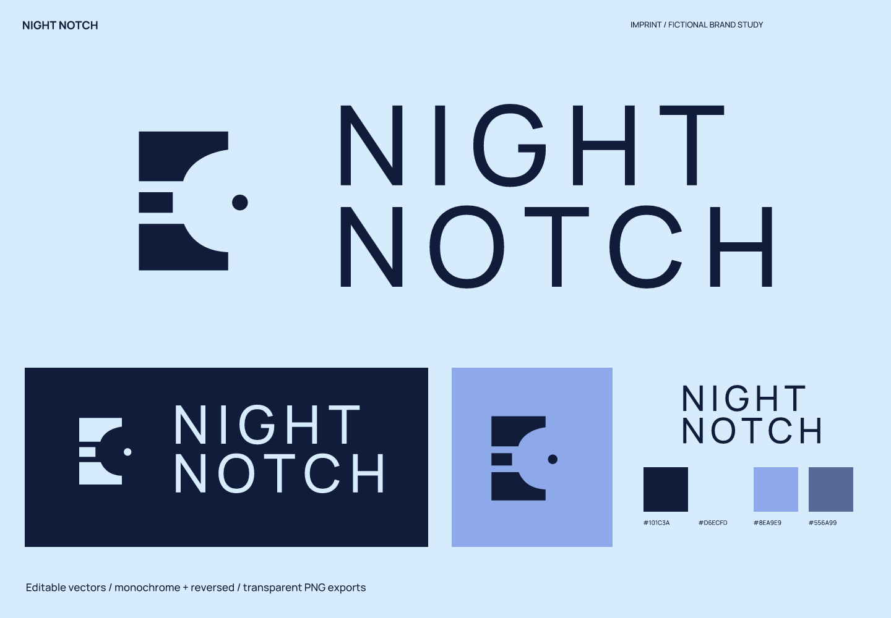
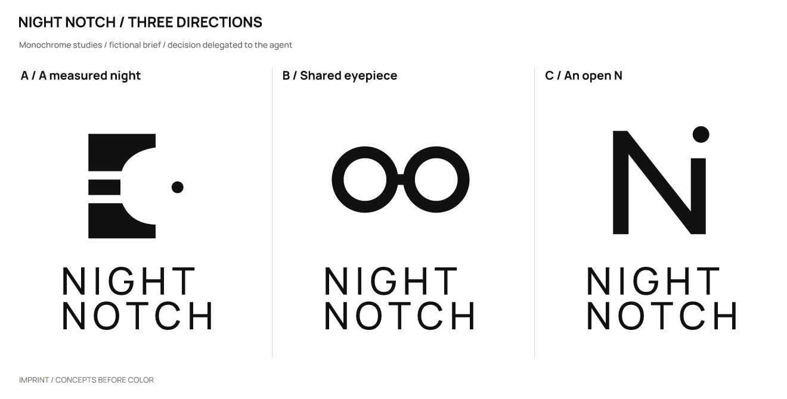
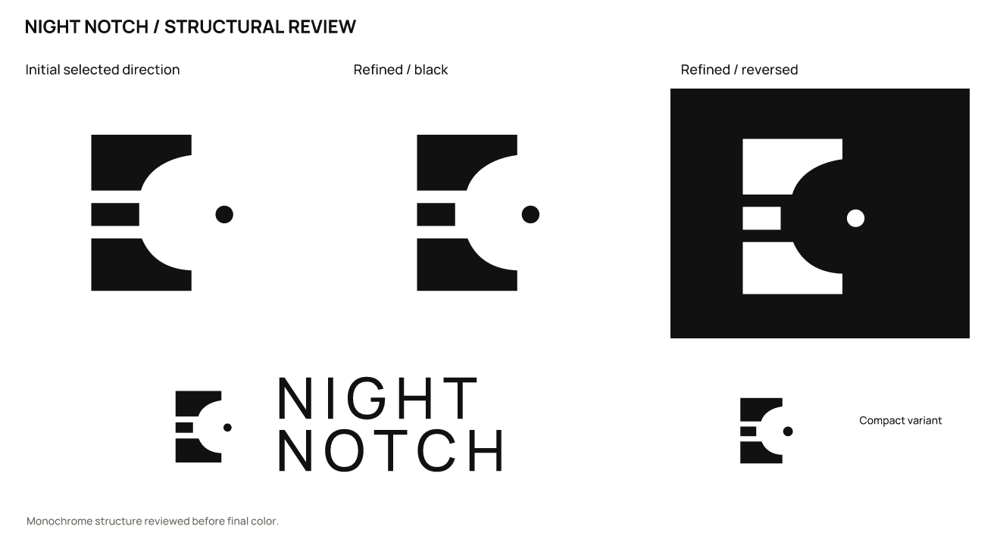

# Night Notch · Community stargazing

**English** | [简体中文](README.zh-CN.md)

> A fictional brief with actual design outputs. Products, audiences, and positioning are assumptions; there is no real client, audience testing, or business-outcome data.

## Positioning and naming

Small nighttime observing sessions and shared equipment for adults trying stargazing for the first time.

Positioning: **Look carefully at a small patch of sky, rather than collecting grand cosmic slogans.**

Personality: restrained, through whitespace and few star points; precise, through calibrated boundaries; approachable, through readable everyday words.

Avoid: spaceships, astrological healing claims, and gradient nebulae.

Naming territories: alignment in observation, expressing shared attention but risking an overly instrumental tone; marks left by the night, expressing memory but risking mysticism; stopping together, expressing participation but potentially weakening the astronomy connection.

Selected: **Night Notch** (night notch). A mark in the night, with a distinct rhythm from two short words.

| Candidate | Strengths / intention | Cost / risk |
| --- | --- | --- |
| Night Notch | A nighttime mark and a clear two-word rhythm. | The final consonants in “notch” need spoken-spelling tests. |
| Shared Meridian | A spatial sense of shared observation. | Longer and more geographical. |
| Afterglance | The lingering effect of looking. | A coined word whose spelling needs establishing. |

## Concepts and refinement

| Direction | Visual relationship | Main risk |
| --- | --- | --- |
| A / A measured night | Three calibrated segments frame a circular gap, with a point just outside it. | Could read as a calibration tool rather than astronomy. |
| B / Shared eyepiece | Two circular windows share a horizontal observation axis. | Strong eyewear or optics associations. |
| C / An open N | An N has an open corner, with a star point outside. | A relatively generic lettermark. |

Selected **A**: the broken scale and observation point have a more specific relationship than paired eyepieces and avoid a literal telescope icon. The trade-off is the need for an astronomy context.

Refinement: Shortened the middle segment and brought the dot closer to the gap. Slightly enlarged the dot at 32/16 px while keeping the rhythm.

The user authorized the agent to make the selection. This is not a real client or audience preference result. Symbols were constructed directly with SVG paths; wordmarks use licensed type with spacing adjustments and conversion to outlines, not an original typeface.

## Usage and files

- Primary ink `#101C3A`; light background `#D6ECFD`; accent `#8EA9E9`; supporting color `#556A99`. Use the dark version on light backgrounds and the reversed version on dark backgrounds.

- Wordmark: Manrope / RangeBody. This uses licensed type, spacing, and outlined glyphs; it is not an original typeface. Font files, OFL licenses, and provenance are in [fonts](fonts/). Install the bundled fonts before editing the text version; prefer outlined artwork for general use.

- Recommended full-logo canvas width: **220 px** or more. Standalone symbol: **16 px** or more. At 16 px, the basic gap and point remain. Prefer 32 px or above for the complete relationship.

- Sizes refer to canvas width; keep the aspect ratio. Preserve the SVG’s built-in whitespace and leave at least 1/8 of the symbol width outside it. For a standalone wordmark, leave at least half the capital-letter height outside it. Do not stretch, add shadows or outlines, or squeeze fine lettering into an avatar. Use white or light reversed artwork on dark backgrounds.

- `sources/`: color, black, and white logo compositions, outlined wordmarks and symbols, an editable text wordmark, and a small-size symbol.
- `exports/`: transparent PNGs. A 16 px export is a diagnostic sample; use it only where the recommendations above support that size.
- `previews/`: color and reversed presentations and avatar studies, not a platform submission icon package.
- `verification/`: actual-size images, source mappings, and rendering/export consistency results.

## Checks and limitations

Checked the three drawn monochrome directions, refinement, large-scale structure, 1024 / 256 / 64 / 32 / 16 px symbols, the full logo at 220 px wide, and final light/dark presentations. Text and outlined versions were compared at 2400 px width, with a contour-overlap IoU of 1.00000000.

The SVGs render without embedded bitmaps. Main assets have no font dependencies except the designated editable text version.

Name screening (2026-10-02): Results included wallpaper keywords, clothing descriptions, and the neighboring terms NIGHT (a song) and Notch (an artist). No same-name stargazing organization was confirmed, and availability was not verified.

Queries: `"Night Notch"; "Night Notch" astronomy`. Date: 2026-10-02. The initial Exa queries and subsequent web searches are recorded in the [brief and search log](exploration/brief.json).

[Source 1](https://audiomack.com/notch-6/song/night/) [Source 2](https://www.savana.com/details/sleep-set-2154542)

Still unverified: trademark, domain, and social-handle availability; a complete external visual-similarity review; and real audience reading, spoken-spelling, and recall tests. No simulated human recognition results are claimed.

This study covers naming and logo design. A full brand manual, real product applications, and platform submission icon packages are outside its scope.

Executed with [skills/imprint/SKILL.md](../../skills/imprint/SKILL.md), SHA-256: `519e787cdf6277b2e9c5caeb64dbf3b3917a53bde0ee0dc433c4a35dd548fad3`. See the [brief, decisions, and search records](exploration/brief.json) and [editable vectors](sources/).

[← All examples](../README.md) · [Imprint](../../README.md)
