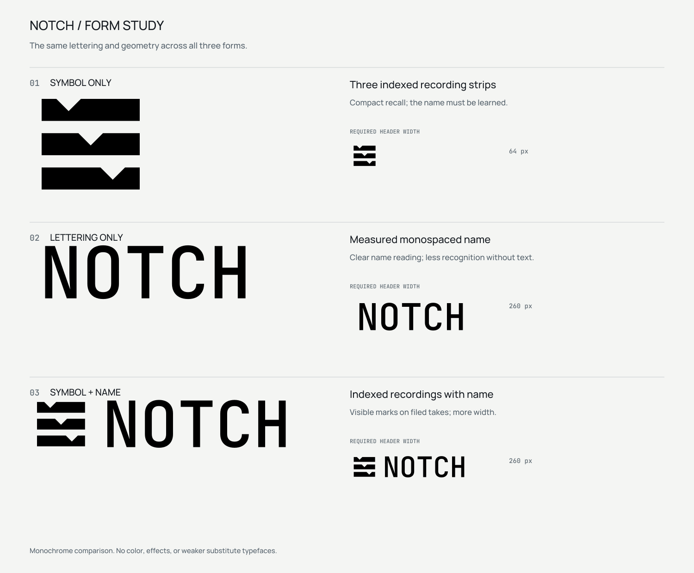
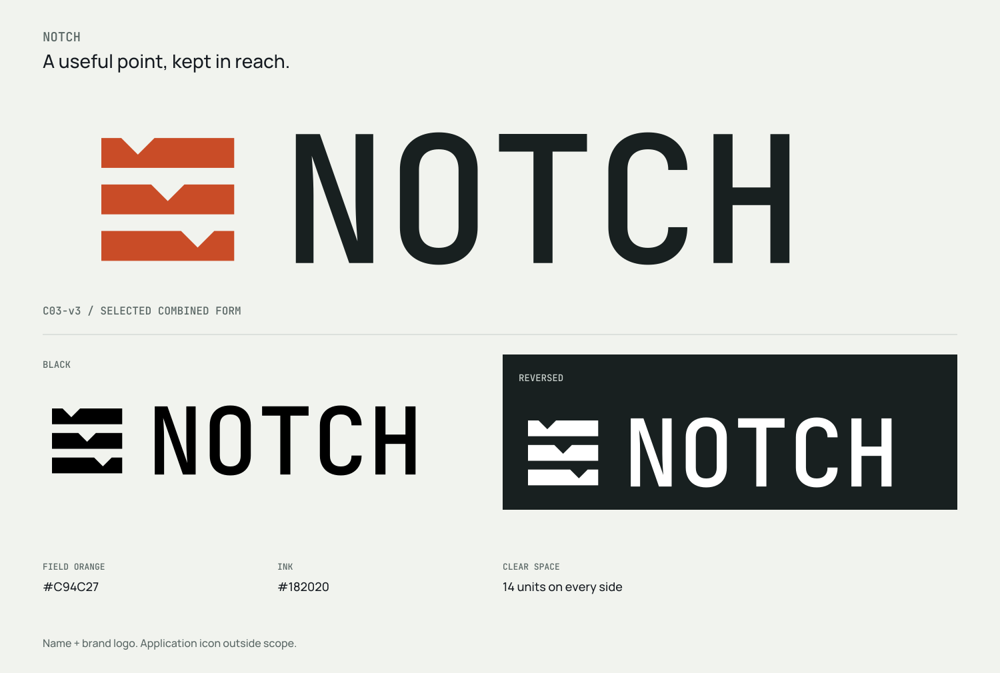
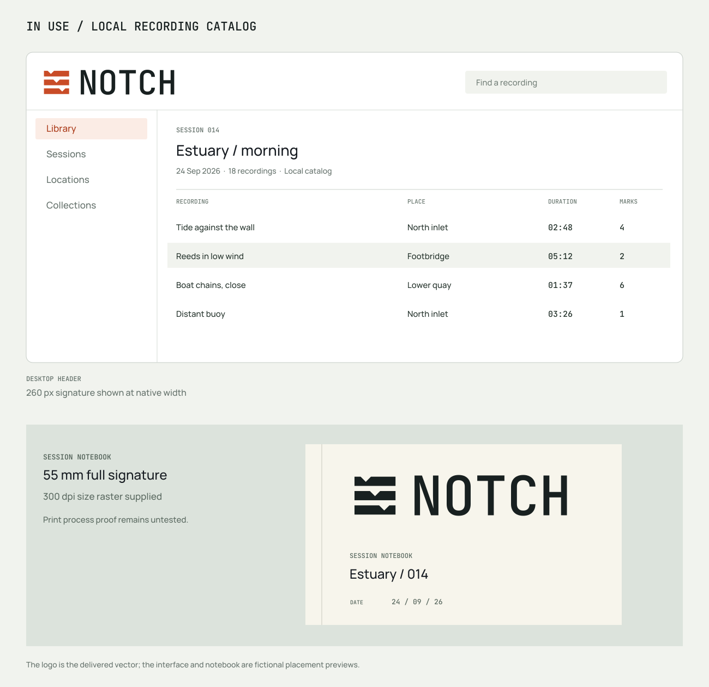

# Notch: from brief to identity

**English** | [简体中文](README.zh-CN.md) · [Imprint](https://github.com/Frost-96/imprint)

A fictional name-and-logo project for a desktop field-recording catalog, from the initial brief to editable artwork.

## Start with the brief

The tool helps independent sound designers organize takes, mark useful moments, and retrieve recordings by place and session. The requested identity needed to feel precise, practical, and compact.

- **Scope:** an English name and a brand logo.
- **Uses:** a desktop header at 260 px wide and a session notebook at 55 mm wide.
- **Visual direction:** measured typography and geometry, with a relationship to organizing recordings.
- **Form:** compare a symbol, lettering, and a symbol with the name before choosing.

Try a similar brief:

> Use Imprint to name and design a logo for a desktop tool that helps independent sound designers organize field recordings. It should feel precise, practical, and have a little personality. Start with naming directions, then help me compare visual approaches.

## Name the idea

| Candidate | Design rationale | Trade-off |
| --- | --- | --- |
| **Notch** | A concise existing word for a deliberate mark; connects to finding a point again | Could suggest audio filtering |
| Set Aside | A natural phrase for keeping a useful find | Could imply postponement and takes more space |
| Waypost | A dependable place to return to | Could be mistaken for navigation or travel |
| Takebook | A practical record of recorded takes | More descriptive and less individual |

**Notch** was selected for its brevity and relationship to marking a useful moment. The name is written “Notch”; the logo uses “NOTCH”. Say it as the English word “notch”, one syllable.

## Compare the forms

The study compares three forms, keeping the lettering consistent in both text-bearing options.

| Form | What it offers | What it gives up |
| --- | --- | --- |
| Symbol only | A compact mark of indexed recording strips | The name must be learned separately |
| Lettering only | Larger letters within the same width | The visible recording/mark relationship |
| **Symbol with name** · selected | Both the name and the marking idea | More horizontal space |

## Refine the chosen direction

An early direction used angular brackets, which felt too close to a generic link. Refinement led to **three equal-length recording strips, each with a V-shaped mark at a different point**, connecting the logo to the act of organizing and marking recordings.

## See it in context

The interface and notebook show how the identity could be used; both are mockups.

## Inspect the delivery

| File | Purpose |
| --- | --- |
| [Outlined master](source/master.svg) | Editable vector paths; no installed font required |
| [Text-editable source](source/text-editable.svg) | Live lettering; requires the bundled RangeTerminal font |
| Color: [SVG](exports/logo-color.svg) · [PNG](exports/logo-color.png) | Light backgrounds |
| Black: [SVG](exports/logo-black.svg) · [PNG](exports/logo-black.png) | Single-ink artwork |
| White: [SVG](exports/logo-white.svg) · [PNG](exports/logo-white.png) | Dark backgrounds; the PNG has a transparent canvas |
| [Usage notes](usage.txt) | Clear space, sizes, backgrounds, editing, and limits |
| [Font files and licenses](fonts/) | Renamed font instances and retained license notices |

PNG exports are **2048 × 522 px**. Preserve the SVG's proportions and canvas margins, and use the complete logo at a canvas width of at least **160 px**. The files contain the combined logo; app icons and favicons are not included.

## License

Project material is covered by the included [MIT license](LICENSE). Font files retain their [OFL notices and provenance](fonts/PROVENANCE.json). This is a fictional example; name and trademark availability have not been checked.
