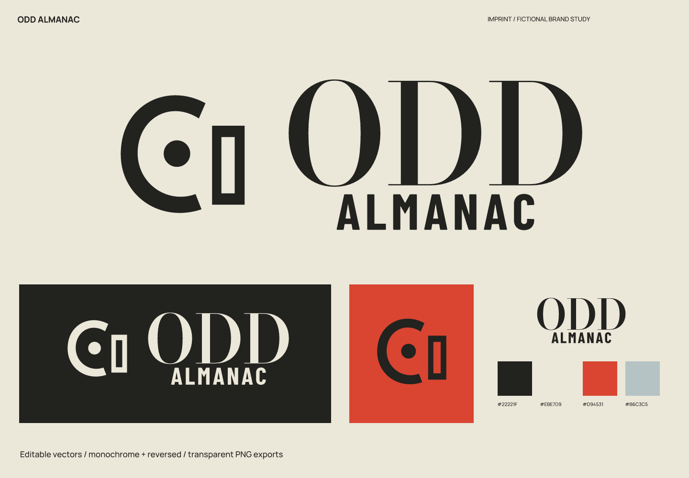
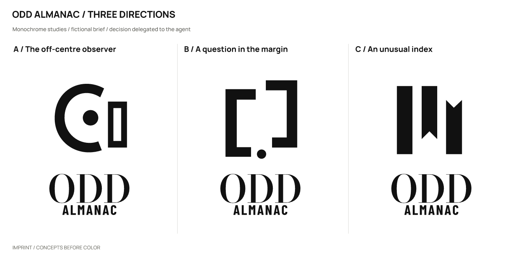
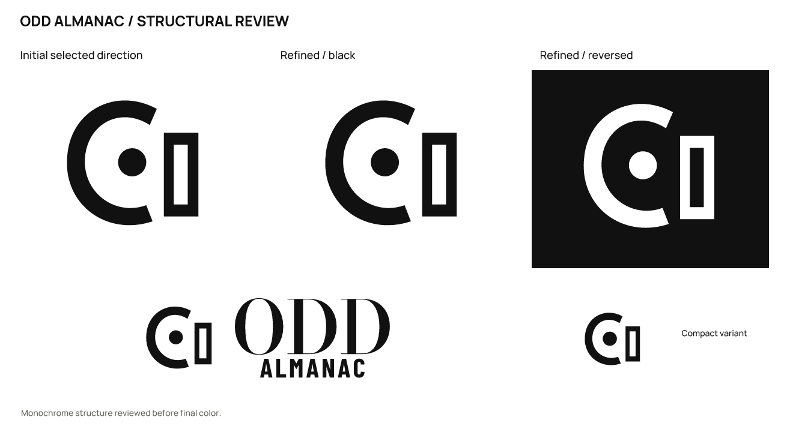

# Odd Almanac · Independent science zine

**English** | [简体中文](README.zh-CN.md)

> A fictional brief with actual design outputs. Products, audiences, and positioning are assumptions; there is no real client, audience testing, or business-outcome data.

## Positioning and naming

Illustrations and short essays about overlooked scientific questions for curious adults, without posing as an academic journal.

Positioning: **Take a serious look at the questions that go unnoticed.**

**Odd Almanac** (odd AWL-muh-nak) pairs unusual questions with orderly editing to express a curious editorial perspective.

Personality: curious, through an off-center observation point; editorial, through strong weight contrasts; without pretensions of authority, through deliberate asymmetry.

Avoid: pseudoscientific symbols, real-time news promises, and AI sparkle icons.

Naming territories: unusual records — Odd Almanac / Curious Ledger; the act of observing — Look Again Press / Sideways Notes; scattered questions — Loose Questions / Small Why.

| Candidate | Rationale / strengths | Cost / risk |
| --- | --- | --- |
| Odd Almanac | A distinct sound and editorial character. | “Almanac” is long to spell. |
| Look Again Press | A clear invitation to act. | Long, and sounds like a publishing group. |
| Small Why | Concise. | Slightly awkward English phrasing. |

## Concepts and refinement

| Direction | Visual relationship | Main risk |
| --- | --- | --- |
| A / The off-centre observer | An open circle surrounds an offset point, with a page-like right edge. | Could read as an eye or optical equipment. |
| B / A question in the margin | Offset spines create question-like negative space. | Needs a larger size to read. |
| C / An unusual index | Unequal bookmarks include one pointing the other way. | Resembles a file-management tool. |

Selected **A**: the off-center observation point meets the page boundary, giving it more editorial perspective than ordinary bookmarks.

Refinement: Moved the observation point slightly left to avoid crowding the page edge. Kept the open, incomplete enclosure.

The user authorized the agent to make the selection. This is not a real client or audience preference result. Symbols were constructed directly with SVG paths; wordmarks use licensed type with spacing adjustments and conversion to outlines, not an original typeface.

## Usage and files

- Primary ink `#22221F`; light background `#EBE7D9`; accent `#D94531`; supporting color `#B6C3C5`. Accents are for blocks or decoration and do not replace text-contrast checks.

- Wordmark: Bodoni Moda + Barlow Condensed. This uses licensed type, spacing, and outlined glyphs; it is not an original typeface. Font files, OFL licenses, and provenance are in [fonts](fonts/). Install the bundled fonts before editing the text version; prefer outlined artwork for general use.

- Recommended full-logo canvas width: **220 px** or more. Standalone symbol: **16 px** or more. Use the high-contrast ODD lettering at headline scale. The small mark is not a publication certification.

- Sizes refer to canvas width; keep the aspect ratio. Preserve the SVG’s built-in whitespace and leave at least 1/8 of the symbol width outside it. Use `mark-small.svg` at 32/16 px. Do not stretch, add shadows or outlines, or squeeze fine lettering into an avatar. Use white or light reversed artwork on dark backgrounds.

- `sources/`: color, black, and white logo compositions, outlined wordmarks and symbols, an editable text wordmark, and a small-size symbol.
- `exports/`: transparent PNGs. A 16 px export is a diagnostic sample; use it only where the recommendations above support that size.
- `previews/`: color and reversed presentations and avatar studies, not a platform submission icon package.
- `verification/`: actual-size images, source mappings, and rendering/export consistency results.

## Checks and limitations

Checked the three drawn monochrome directions, refinement, large-scale structure, 256 / 64 / 32 / 16 px symbols, the full logo at 220 px wide, and final light/dark presentations. Text and outlined versions were compared at 2400 px width, with a contour-overlap IoU of 1.00000000.

All 11 SVGs render without embedded bitmaps and have no font dependencies except the designated text version. All 23 final PNGs are byte-for-byte identical to fresh renders of the final SVGs. Passing file checks does not mean every tested size is suitable for use.

Name screening (2026-10-02): Results included the nearby book title The Odds Almanac and historical uses of “odd almanac.” No same-name modern magazine was confirmed; the adjacent publication title remains a lead for further checking.

These are the search and follow-up entry points used in the study. Results provide leads, not proof that no conflict exists.

- Query: `"Odd Almanac" magazine`; partial. [Source 1](https://www.books-by-isbn.com/0-695/0695814389-The-Odds-Almanac-James-A-Fix-David-Daughton-0-695-81438-9.html) [Source 2](https://newspaperarchive.com/marion-star-and-southern-real-estate-advertiser-apr-20-1870-p-1/) [Source 3](https://newspaperarchive.com/mills-county-tribune-dec-31-1909-p-1/)

Still unverified: trademark, domain, and social-handle availability; a complete external visual-similarity review; and real audience reading, spoken-spelling, and recall tests. No simulated human recognition results are claimed.

This study covers naming and logo design. A full brand manual, real product applications, and platform submission icon packages are outside its scope.

Executed with [skills/imprint/SKILL.md](../../skills/imprint/SKILL.md), SHA-256: `519e787cdf6277b2e9c5caeb64dbf3b3917a53bde0ee0dc433c4a35dd548fad3`. See the [brief, decisions, and search records](exploration/brief.json) and [editable vectors](sources/).

[← All examples](../README.md) · [Imprint](../../README.md)
