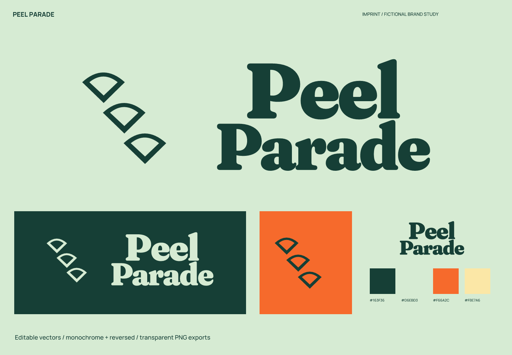
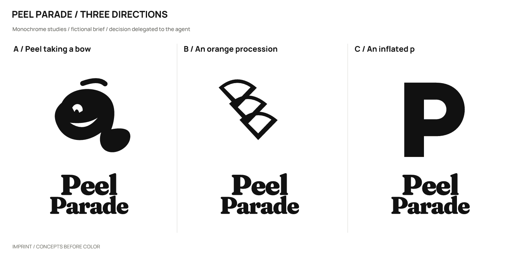
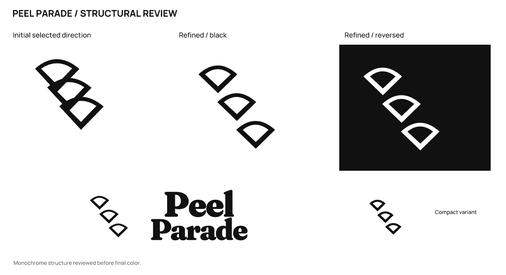

# Peel Parade · 柑橘气泡饮料

[English](README.md) | **简体中文**

> 虚拟品牌，真实产出的设计练习。产品、受众和定位为假设；不是客户项目，也没有经营或用户成效数据。

## 定位与名字

面向成年人聚餐和野餐的无酒精柑橘气泡饮概念，不包含营养或功能承诺。

让普通聚会多一点不拘谨。

**Peel Parade**（建议读法：peel puh-RAID）。让柑橘果皮组成一支行进队伍，呼应三枚依次展开的果瓣。

品牌性格：外向：大块饱满字形；俏皮：橘皮抬起的姿态；清爽：果色与薄荷底色。

避免：儿童药品气质、健康功效文案、3D 软糖材质进入核心标志。

候选命名方向：果皮的动作：Peel Parade / Zest March；聚会语言：Bring Bubbles / One More Orange；声音口感：Pip Pop / Fizzy Turn。

| 候选 | 选择理由 / 优点 | 代价 / 风险 |
| --- | --- | --- |
| Peel Parade | 头韵清楚、动作感强 | 较长，适合两行 |
| Bring Bubbles | 适合社交场景 | 品牌专属性弱 |
| Pip Pop | 短而好玩 | 容易接近现有儿童品牌用语 |

## 图形选择与精修

| 方向 | 关系 | 主要风险 |
| --- | --- | --- |
| A / 鞠躬的果皮 | 橘皮向一侧翻起，果肉里留一个眼神。 | 表情会随小尺寸简化。 |
| B / 柑橘的队列 | 三瓣沿同一曲线依次展开。 | 更像花或扇形装饰。 |
| C / 鼓起的 p | 粗大 p 的内白变成果瓣。 | 单字母标记语义较少。 |

采用 **B**：三瓣沿斜线依次排列，比面部角色更适合成年人的气泡饮品，也比单字母 p 更贴合 Parade。

实际精修：初稿果瓣相互碰接，缩小像链条；重排为三个独立果瓣，扩大内白并拉开间隔。

选择由用户授权 agent 自行决定；没有声称获得真实客户或受众的选择。图形由 SVG 路径直接构造；字标使用许可字体排字、调整间距后转曲，并非原创字体。

## 使用与文件

- 主图形 / 字色 `#163F36`；浅底 `#D6EBD3`；强调色 `#F66A2C`；辅助色 `#FBE7A6`。强调色用于色块或装饰，不能代替文字对比度检查。

- 字标字体：Fraunces 的固定轴实例 WallFrauncesBold。字体文件、OFL 和来源见 [fonts](fonts/)。编辑文字版前安装随包字体；一般投放优先使用转曲版。

- 完整 Logo 建议画布宽度至少 **180 px**，图形独用建议 **32 px** 起；32/16 px 使用 `mark-small.svg`。尺寸按画布宽度计算，保持纵横比。

- 16 px 为减细节版，完整果瓣轮廓在 32 px 以上更明确。

- 保留 SVG 自带留白，外部再留至少图形宽度的 1/8；不要拉伸、增加阴影、描边或把细字压进头像。深底用白色 / 浅色反白版本。

- `sources/`：图文组合、独立字标、独立图形的彩色 / 黑 / 白 SVG，以及文字版字标与小尺寸图形。

- `exports/`：透明背景 PNG。16 px 文件是实际诊断样本，只有达到上面的建议尺寸才作为推荐用法。

- `previews/`：配色与反白展示、头像示意。头像示意不等同于平台上架图标包。

- `verification/`：实际尺寸图、源文件映射、渲染与导出一致性结果。

## 已检查与仍未验证

已检查实际黑白概念、精修、大尺寸结构、256 / 64 / 32 / 16 px 图形、180 px 宽完整 Logo，以及成品的浅底 / 深底效果。字体文字版与转曲版在 2400 px 宽进行比较，轮廓覆盖 IoU 为 1.00000000。

11 份 SVG 均可渲染，无嵌入位图；除指定文字版外没有字体依赖。23 份正式 PNG 与最终 SVG 重新渲染结果逐字节一致。文件检查通过不代表所有测试尺寸都适合使用。

名称初筛（2026-10-02）：Peel Parade 是英国 Barnsley 的街名，检索还出现街上商铺改酒吧的报道。本案保留名称，明确没有验证饮料类品牌可用性。

以下是实际搜索 / 复核入口；搜索结果只提供线索，不能证明没有冲突。

- 查询：`"Peel Parade" drink`；部分核查。[来源 1](https://www.wearebarnsley.com/news/20840/plan-submitted-to-turn-empty-town-centre-shop-into-bar) [来源 2](https://www.thestar.co.uk/news/concerns-over-anti-social-behaviour-at-car-park-in-barnsley-444087) [来源 3](https://exa.ai/library/place/j4fkcwd4641)

未完成：商标、域名和社交账号可用性；完整外部图形相似性核查；真实受众认读、听写与记忆测试；完整品牌系统和平台上架包。

本轮范围为命名与 Logo 案例，完整品牌手册、真实产品应用和平台图标包不在本轮交付范围。

本案例执行当前仓库的 [skills/imprint/SKILL.md](../../skills/imprint/SKILL.md)，SHA-256：`519e787cdf6277b2e9c5caeb64dbf3b3917a53bde0ee0dc433c4a35dd548fad3`。简报、命名、选择依据与检索记录见 [结构化记录](exploration/brief.json)；可编辑矢量见 [sources/](sources/)。

[← 全部案例](../README.zh-CN.md) · [Imprint 主页](../../README.zh-CN.md)
