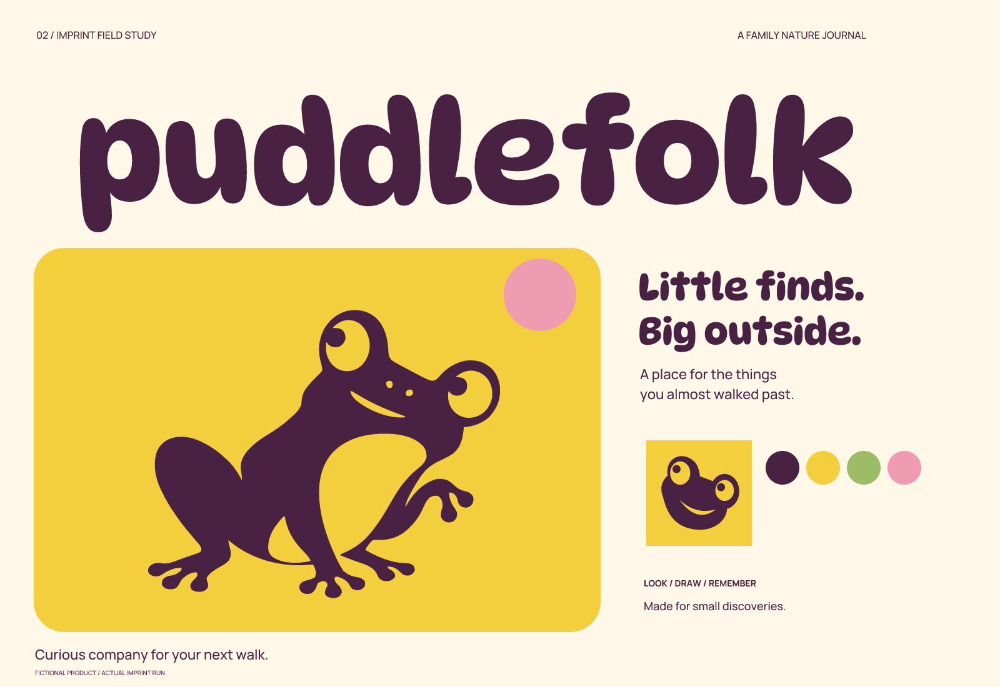

# Puddlefolk — 虚拟案例 / 实际执行

[English](README.md) | **简体中文**

亲子 / 有机角色 / 明亮拼色。本案例于 2026-10-02 使用 Imprint 实际完成；产品、人物、记录、文章均为虚构，不代表真实客户或上线产品。

## 简报与策略

产品：家长与儿童共用的自然观察小日志。面向有 6–10 岁儿童的家庭，短途散步与周末户外活动。

问题：一次散步中的小发现很快被忘记，照片缺少孩子自己的观察。

定位：**把散步时的小发现，留成孩子自己的观察册。**

价值范围：把小发现、画画与家人的一句话保存成可重看的观察册；不提供物种安全、可食用性或路线安全判断。

关键性格：好奇、友善、自在。使用场景：手机观察卡、家庭观察册、亲子活动贴纸。

## 命名过程

先提出三个命名方向、六个候选，再筛选三个短名单：Puddlefolk / Mosskip / Small Ramble。

- 小水洼旁的一群朋友：Puddlefolk / Pebble Parade
- 跳进眼前的小世界：Mosskip / Small Ramble
- 把发现揣进兜里：Pocket Wonder / Found Acorn

选择：Puddlefolk / PUD-uhl-fohk。水洼与伙伴的组合意象，适合亲子口头使用；长名称对极小尺寸不友好。

公开初筛：Puddlefolk 检索出现同名音乐内容，搜索结果可见，但目标页面未能进一步打开核验。Mosskip 出现游戏用户名；Small Ramble 出现其他类别商品线索。选择 Puddlefolk 是基于此次虚拟简报的语义贴合，并不表示名称独占。

以上是有限公开检索。部分证据仅来自搜索返回内容，未全部完成页面复核；没有做商标可用性结论。图形检索尝试未形成足够可视证据，外部图形相似性审核仍不完整。

- [Puddlefolk 同名音乐检索线索](https://music.amazon.fr/tracks/B0HBWTBV8J)
- [Mosskip 用户名线索](https://shotbow.net/forum/members/mosskip.3986458/)

## 黑白方向与修正

A：好奇的青蛙伙伴；B：蜗牛；C：上下聚拢的圆润字标。选择 A 的角色方向，配合清晰的一行字标。蜗牛的节奏偏慢；单独字标缺少适合小图标的记忆点。主 logo 是字标，角色是配套识别元素，并非必须处处捆绑。

先用内置图像生成工具生成黑白青蛙，再以 vtracer 转换为真实矢量路径，眼睛与腹部留白为空洞。保留原图和完整提示词。全身细节在小尺寸不成立，因此另画简化头像；保留不等高眼睛和倾斜姿态，16 px 去掉嘴部。DynaPuff 采用 wght 600、wdth 100 并调整字距。

查看 [三个黑白方向](exploration/concepts.png) 与 [最终黑白适配](exploration/refinement.png)。初始概念和最终源文件有意保留差异，以展示真实取舍。

## 颜色与字体

深莓紫承担轮廓和文字；明黄承载角色；叶绿表达户外环境；粉色只用于少量发现标记；奶油白留给观察内容。

| 角色 | 色值 |
| --- | --- |
| 主体 | `#492142` |
| 底色 | `#FFF8E8` |
| 强调 | `#F3CE3D` |
| 辅助 | `#9CBD66` |
| 点缀 | `#EF9CB2` |

字标基于 **DynaPuff**，信息字体为 Manrope；使用现有字体的字形与定制间距，不宣称从零设计字体。字体来源锁定到 Google Fonts 仓库提交 `9710da1eacb3be272583c3224dcb70f9da6eadbb`。`fonts/sources.json` 记录源 URL、原文件 SHA-256、实例轴值和修改后名称。静态实例重命名为 Range 系列，随包附原始 SIL Open Font License；字体授权以随附 OFL 为准。

## 使用与交付

完整字标建议至少 180 px 宽；全身角色至少 64 px，高密度界面优先头像；16 px 使用 app-icon-small。字标外部净空至少为总高度的 1/4，角色四周至少留出其画布宽度的 1/8。 这些最小值是本次渲染与目视检查的建议，并未经过受众实验。

- `sources/logo-*.svg`：主标志；color、black、white 三种。white 文件需要深色背景。
- `sources/wordmark-*.svg`：转曲字标；`wordmark-text.svg` 保留可编辑文字并嵌入字体，修改文字后仍需重新检查字距。
- `sources/mark-*.svg`：独立识别元素；`mark-small.svg` 是小尺寸适配。
- `sources/app-icon*.svg`：无预切圆角的通用方形图标，不是某个平台完整上架包。
- `exports/`：透明 PNG 标志，以及 1024、256、64、32、16 px 图标。
- `previews/`：视觉总览与一个真实生成的应用示意；界面不可操作。
- `verification/`：尺寸检查、源文件哈希、文字与转曲比对、导出一致性报告。
- `exploration/`：三个概念和黑白修正板。亲子案例另含图像生成原图与完整提示词。

不要拉伸、描边或给 logo 添加投影；不要把整体完整字标强缩到 16 px；避免将低对比的辅助色用于细小正文。SVG 中有基础图形和字形路径，核心标志未用嵌入位图冒充矢量。

## 验证结论与剩余问题

已检查 SVG 结构、实际渲染边界、黑白色值、透明背景、图标尺寸，以及文字版与转曲版的渲染对应；所有交付 PNG 均与对应 SVG 在相同尺寸重新渲染的结果逐字节一致。详见 [检查报告](verification/report.json)、[导出对应检查](verification/export-consistency.json)、[尺寸实图](verification/sizes.png)。

头像与全身版的面部细节有简化差异；后续若发展成长期角色系统，需要继续统一表情与动作规范。未做儿童理解度测试。

本次可以用来展示 skill 的流程和交付能力；不能把它表述为客户验证、商标批准或所有 agent 均已实测兼容。

[← 全部案例](../README.zh-CN.md) · [Imprint 主页](../../README.zh-CN.md)
