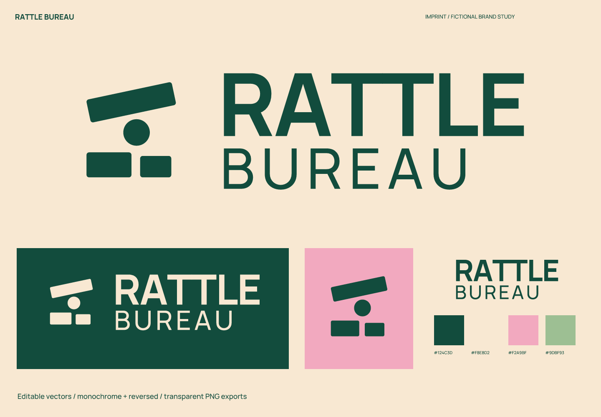
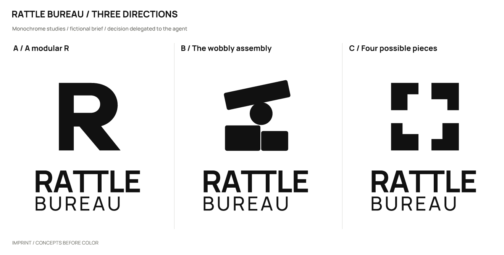
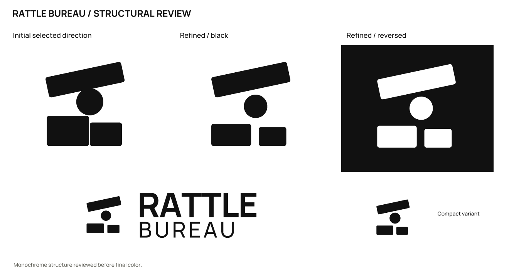

# Rattle Bureau · 木制构造玩具

[English](README.md) | **简体中文**

> 虚拟简报，实际产出的设计练习；没有真实客户、受众测试或经营成效数据。

## 定位与命名

为喜欢动手拼接的家庭设计可反复组合的木制零件，兼顾孩子与成人共同游戏。

把一张桌子变成可以不断重来的小工场。

性格：顽皮：错位但不凌乱；可构造：块面和圆轴；有秩序：文字保持明确层级。

避免：婴儿奶瓶、教育成效承诺、彩虹渐变。

命名领域：玩耍与事务所的反差：风险是成人办公品牌；零件的声音：风险是婴儿摇铃；不稳定的平衡：风险是质量差联想。

采用 **Rattle Bureau**，建议读法：RAT-uhl BYUR-oh。零件声响与一本正经事务所的反差

| 候选 | 长处 / 意图 | 代价 / 风险 |
| --- | --- | --- |
| Rattle Bureau | 零件声响与一本正经事务所的反差 | rattle 可能被理解为婴儿摇铃 |
| Odd Assembly | 允许异样组合 | 与已有 Swerve Assembly 在本组中过近 |
| Stackabout | 围绕叠放游戏的短新词 | 容易出现拼写变体 |

## 概念与精修

| 方向 | 可见关系 | 主要风险 |
| --- | --- | --- |
| A / 模块化 R | 圆孔、方柱与斜腿拼出 R。 | 单字母结构偏普通。 |
| B / 摇晃的组合 | 一根倾斜梁、圆轴与两块错位底座。 | 像平衡玩具，需要避免关节粘连。 |
| C / 四块可能的零件 | 四个缺口模块围出开放中心。 | 可被当作拼图图标。 |

采用 **B**：倾斜梁与圆轴、底座构成可重组的玩具关系；比单字母或拼图更有不稳定的趣味。

分开原先接触的梁、圆轴和底座，缩小中间圆，增加两块底座之间的空隙。

## 使用与来源

- 主字色 `#124C3D`；浅底 `#F8E8D2`；强调色 `#F2A9BF`；辅助色 `#9DBF93`。浅底用深色版，深底用反白版。

- 字标使用 Manrope / RangeBodyBold + RangeBody。这是许可字体的排字与转曲，不是原创字体；字体、OFL 和来源见 [fonts](fonts/)。文字编辑版需要安装随包字体。

- 完整 Logo 建议至少 **210 px 宽**，图形建议 **32 px 宽**起。图形推荐 32 px 起；16 px 的梁与圆间距较弱，仅作诊断。

- 尺寸按画布宽度计算，保持纵横比。保留自带留白，外部再留至少图形宽度的 1/8；字标独用时外部留白至少大写字高的 1/2。不要拉伸、加阴影或挤压中文字。

- `sources/` 包含彩色 / 黑 / 白组合标志、转曲字标、图形，以及文字版字标和小尺寸图形；`exports/` 是透明 PNG；`previews/` 是成品与头像示意；`verification/` 是实际尺寸与检查结果。

## 检查与限制

已检查三个实际绘制的方向、精修前后、黑白反白、1024 / 256 / 64 / 32 / 16 px 图形、210 px 宽完整 Logo 和成品配色。文字版与转曲版在 2400 px 比较，轮廓覆盖 IoU 为 1.00000000。SVG 均可渲染、无内嵌位图；指定文字版以外的主文件无字体依赖。

名称初筛：Exa 限流后网页检索返回摇铃玩具与标准机构的分词匹配，未取得可核实的同名玩具品牌结论。

实际查询：`"Rattle Bureau"; "Rattle Bureau" toys`。日期 2026-10-02；初次 Exa 查询和后续网页检索记录见 [简报与检索记录](exploration/brief.json)。

[来源 1](https://bis.gov.in/wp-content/uploads/2020/07/Draft_Product_Manual_Toys.pdf)

名称与图形可用性仍未验证：未做商标、域名、社交账号、完整外部图形相似性核查，也未模拟真人认读或记忆结果。

本轮为命名和 Logo 案例；完整品牌手册、真实产品应用、平台图标上架包不在范围内。由用户授权 agent 自行选择。

执行当前 [skills/imprint/SKILL.md](../../skills/imprint/SKILL.md)，SHA-256 `519e787cdf6277b2e9c5caeb64dbf3b3917a53bde0ee0dc433c4a35dd548fad3`。可编辑矢量见 [sources/](sources/)，记录见 [简报与检索记录](exploration/brief.json)。

[← 全部案例](../README.zh-CN.md) · [Imprint 主页](../../README.zh-CN.md)
