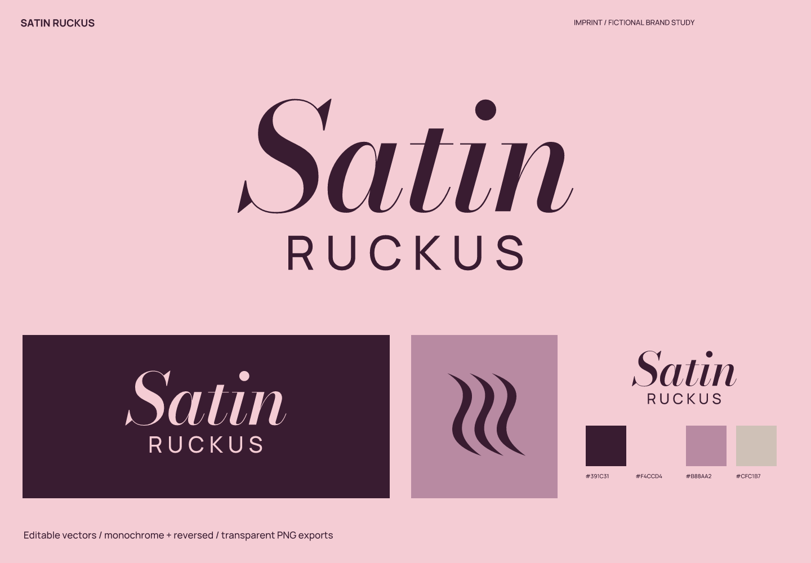
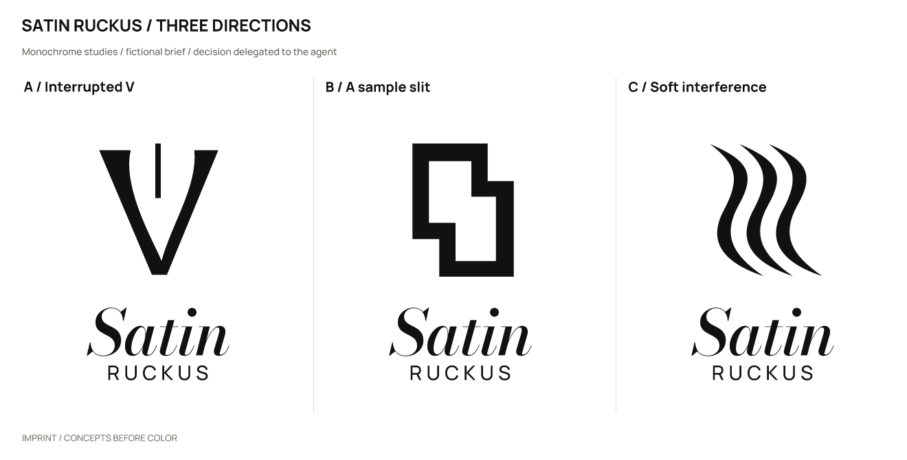
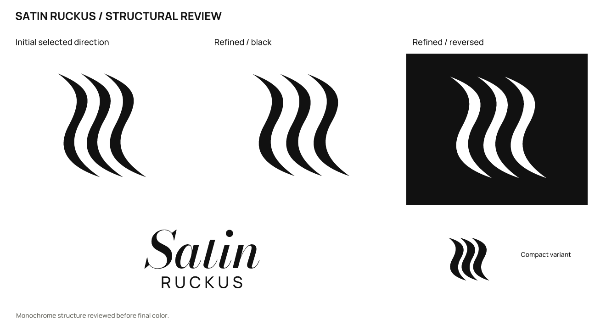

# Satin Ruckus · Independent fragrance studio

**English** | [简体中文](README.zh-CN.md)

> A fictional brief with actual design outputs. Products, audiences, and positioning are assumptions; there is no real client, audience testing, or business-outcome data.

## Positioning and naming

Small-batch fragrances organized around tactile contrasts, for adults who prefer scents that are not overly sweet.

Positioning: **Leave a restless grain within the softness.**

Personality: tactile contrast, placing soft and hard together; restraint, through a wordmark-led identity; experimental, through a local interruption rather than layers of decoration.

Avoid: female-body icons, generic flowers, and imitation luxury gold.

Naming territories: sensory contradiction, risking abstraction; material experiments, risking chemical-product associations; a private trace, risking excessive softness.

Selected: **Satin Ruckus** (SAT-in RUK-us). The contrast of satin softness and commotion describes the intended fragrance character, not the factual ingredients.

| Candidate | Strengths / intention | Cost / risk |
| --- | --- | --- |
| Satin Ruckus | Soft satin against commotion as a brand intention, not an ingredient claim. | The rough tone of “ruckus” needs audience fit and is not traditional luxury language. |
| Velvet Static | A tactile/noise contrast with character on its own. | Abstract, with possible music associations. |
| Scent Index | An orderly sampling impression. | Strongly descriptive. |
| Left on Skin | A personal trace left behind. | Longer and softer. |

AURA 03’s official fragrance copy already used “velvet static,” and a music artist used the name. The study changed to Satin Ruckus to avoid borrowing an existing expression from the same category.

## Concepts and refinement

| Direction | Visual relationship | Main risk |
| --- | --- | --- |
| A / Interrupted V | A soft curved V is cut by a straight edge. | The letter relationship weakened after the rename to Satin. |
| B / A sample slit | An abstract scent strip with an offset cut. | Resembles a price tag or ticket stub. |
| C / Soft interference | Three S-shaped folds of different widths. | An abstract pattern needs the wordmark to establish recognition. |

Selected **C / wordmark-led**: kept C’s soft/hard contrast, but the three folds were too close to a generic fragrance pattern. Italic Satin and widely spaced RUCKUS became the complete logo.

Refinement: Removed the symbol from the main logo and rearranged the two-line wordmark. Spaced out the auxiliary folds and explicitly classified them as decoration rather than a standalone brand identifier.

The user authorized the agent to make the selection. This is not a real client or audience preference result. Symbols were constructed directly with SVG paths; wordmarks use licensed type with spacing adjustments and conversion to outlines, not an original typeface.

## Usage and files

- Primary ink `#391C31`; light background `#F4CCD4`; accent `#B88AA2`; supporting color `#CFC1B7`. Use the dark version on light backgrounds and the reversed version on dark backgrounds.

- Wordmark: Bodoni Moda Italic / RangeLongAsideItalic, with Manrope. This uses licensed type, spacing, and outlined glyphs; it is not an original typeface. Font files, OFL licenses, and provenance are in [fonts](fonts/). Install the bundled fonts before editing the text version; prefer outlined artwork for general use.

- Recommended full-logo canvas width: **260 px** or more. Auxiliary pattern: **32 px** or more. The main logo starts at 260 px. Files named `mark-*` are an auxiliary pattern, recommended from 32 px; they must not replace the wordmark or serve as an independent favicon.

- Sizes refer to canvas width; keep the aspect ratio. Preserve the SVG’s built-in whitespace and leave at least 1/8 of the symbol width outside it. For a standalone wordmark, leave at least half the capital-letter height outside it. Do not stretch, add shadows or outlines, or squeeze fine lettering into an avatar. Use white or light reversed artwork on dark backgrounds.

- `sources/`: color, black, and white logo compositions, outlined wordmarks and symbols, an editable text wordmark, and a small-size symbol. For Satin Ruckus, `mark-*` files are decorative patterns rather than standalone logos.
- `exports/`: transparent PNGs. A 16 px export is a diagnostic sample; use it only where the recommendations above support that size.
- `previews/`: color and reversed presentations and avatar studies, not a platform submission icon package.
- `verification/`: actual-size images, source mappings, and rendering/export consistency results.

## Checks and limitations

Checked the three drawn monochrome directions, refinement, large-scale structure, 1024 / 256 / 64 / 32 / 16 px symbols, the full logo at 260 px wide, and final light/dark presentations. Text and outlined versions were compared at 2400 px width, with a contour-overlap IoU of 1.00000000.

The SVGs render without embedded bitmaps. Main assets have no font dependencies except the designated editable text version.

Name screening (2026-10-02): The old name Velvet Static appeared in AURA’s official fragrance copy, prompting the change. Searches for the replacement returned separate-word matches for satin clothing and Ruckus products, without establishing availability.

Queries: `"Satin Ruckus" perfume; "Satin Ruckus"`. Date: 2026-10-02. The initial Exa queries and subsequent web searches are recorded in the [brief and search log](exploration/brief.json).

[Source 1](https://www.aurabyangelo.com/products/aura-03-fragrance)

Still unverified: trademark, domain, and social-handle availability; a complete external visual-similarity review; and real audience reading, spoken-spelling, and recall tests. No simulated human recognition results are claimed.

This study covers naming and logo design. A full brand manual, real product applications, and platform submission icon packages are outside its scope.

Executed with [skills/imprint/SKILL.md](../../skills/imprint/SKILL.md), SHA-256: `519e787cdf6277b2e9c5caeb64dbf3b3917a53bde0ee0dc433c4a35dd548fad3`. See the [brief, decisions, and search records](exploration/brief.json) and [editable vectors](sources/).

[← All examples](../README.md) · [Imprint](../../README.md)
