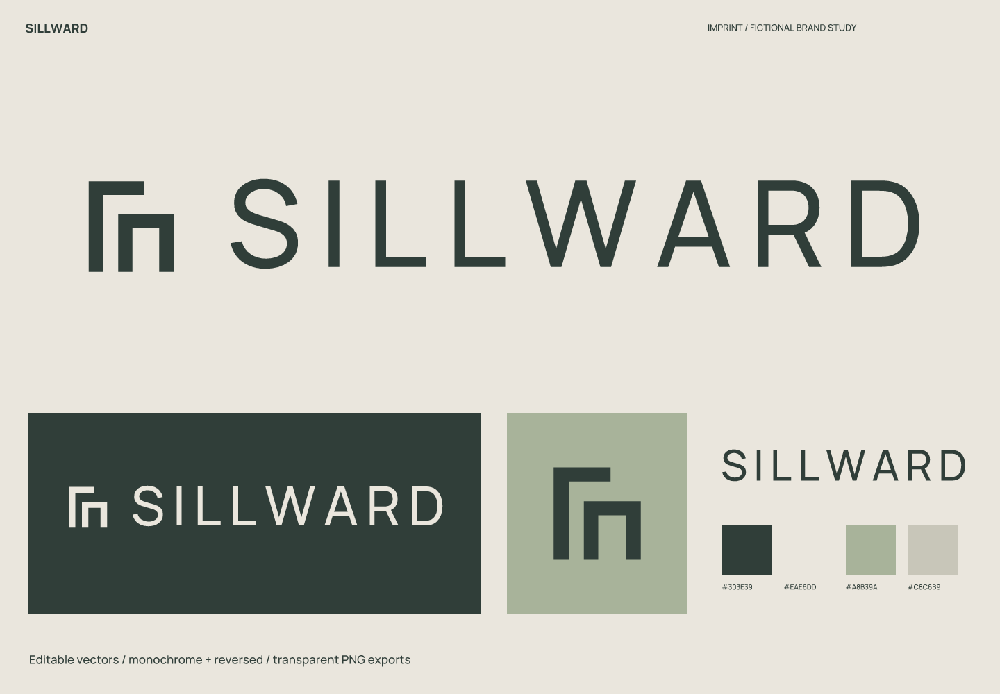
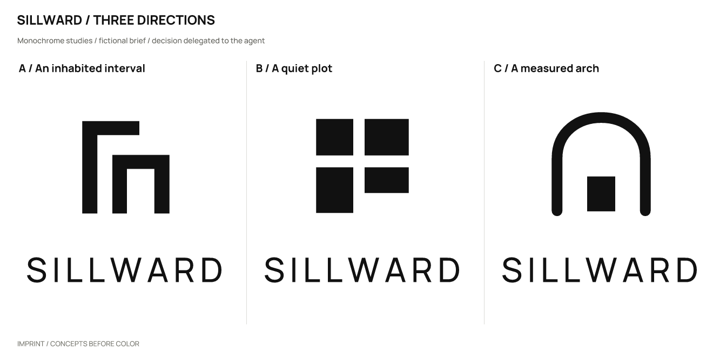
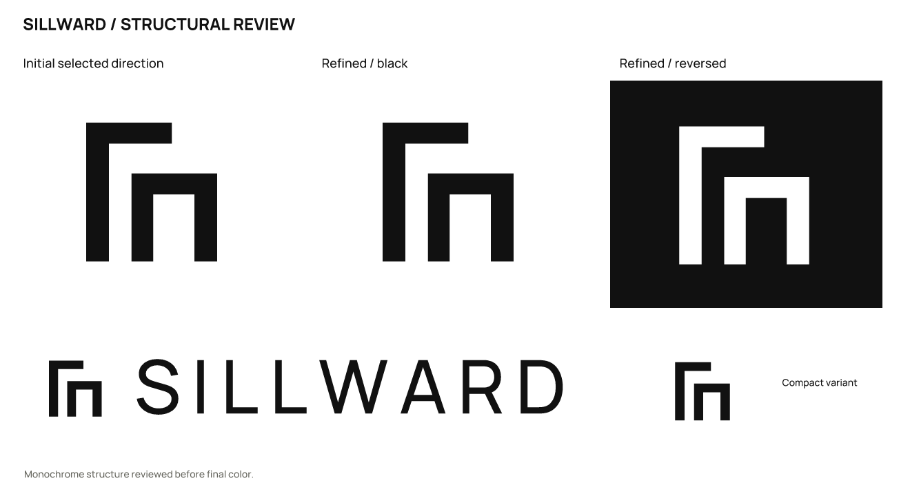

# Sillward · Small architecture practice

**English** | [简体中文](README.zh-CN.md)

> A fictional brief with actual design outputs. Products, audiences, and positioning are assumptions; there is no real client, audience testing, or business-outcome data.

## Positioning and naming

Renovations of existing homes for individual owners, improving everyday living by reorganizing daylight and space.

Positioning: **Make more room for living within what is already there.**

**Sillward** (SILL-werd) is coined from “sill” and a directional suffix. It intends a movement toward the window and everyday space, without claiming an established etymology.

Personality: considered, through whitespace and strict boundaries; spatial, through openings and offset planes; quiet, through wide letter spacing and a monochrome foundation.

Avoid: skyscraper silhouettes, invented awards, and luxury property gold.

Naming territories: settled ground — Still Acre / Quiet Plot; room to spare — Room Between / Extra Threshold; renovation — Open Measure / Second Plan; replacement after screening — Sillward.

| Candidate | Rationale / strengths | Cost / risk |
| --- | --- | --- |
| Sillward | A coined combination of “sill” and direction, suggesting windows and everyday space. | Still Acres Developments works in an adjacent residential category, prompting the change. Sillward is compact but needs recognition as a new word. |
| Still Acre | Calm and spatial. | “Acre” is not a familiar local unit. |
| Room Between | A fitting sense of negative space. | Long and easily mistaken for an article title. |
| Open Measure | Suggests a method. | Leans toward surveying services. |

The adjacent residential services of Still Acres Developments prompted the move away from Still Acre. The new word needs to build recognition.

## Concepts and refinement

| Direction | Visual relationship | Main risk |
| --- | --- | --- |
| A / An inhabited interval | Two offset planes frame a gap one could enter. | An abstract structure needs the full name to build recognition. |
| B / A quiet plot | Four plots of unequal width leave a gap for daylight. | Resembles a window-based software logo. |
| C / A measured arch | A controlled arch spans a separate base. | Resembles a stone or window-and-door company. |

Selected **A**: offset walls create an enterable gap, with fewer software associations than the window tiles and a closer connection to residential adaptation than an arch.

Refinement: Changed the wordmark to SILLWARD after screening. Kept the two planes at different heights, aligning the baseline and lower whitespace.

The user authorized the agent to make the selection. This is not a real client or audience preference result. Symbols were constructed directly with SVG paths; wordmarks use licensed type with spacing adjustments and conversion to outlines, not an original typeface.

## Usage and files

- Primary ink `#303E39`; light background `#EAE6DD`; accent `#A8B39A`; supporting color `#C8C6B9`. Accents are for blocks or decoration and do not replace text-contrast checks.

- Wordmark: Manrope (bundled as RangeBody). This uses licensed type, spacing, and outlined glyphs; it is not an original typeface. Font files, OFL licenses, and provenance are in [fonts](fonts/). Install the bundled fonts before editing the text version; prefer outlined artwork for general use.

- Recommended full-logo canvas width: **240 px** or more. Standalone symbol: **16 px** or more. Prefer the full wordmark for drawing titles and website headers. Establish the brand context before using the symbol alone.

- Sizes refer to canvas width; keep the aspect ratio. Preserve the SVG’s built-in whitespace and leave at least 1/8 of the symbol width outside it. Use `mark-small.svg` at 32/16 px. Do not stretch, add shadows or outlines, or squeeze fine lettering into an avatar. Use white or light reversed artwork on dark backgrounds.

- `sources/`: color, black, and white logo compositions, outlined wordmarks and symbols, an editable text wordmark, and a small-size symbol.
- `exports/`: transparent PNGs. A 16 px export is a diagnostic sample; use it only where the recommendations above support that size.
- `previews/`: color and reversed presentations and avatar studies, not a platform submission icon package.
- `verification/`: actual-size images, source mappings, and rendering/export consistency results.

## Checks and limitations

Checked the three drawn monochrome directions, refinement, large-scale structure, 256 / 64 / 32 / 16 px symbols, the full logo at 240 px wide, and final light/dark presentations. Text and outlined versions were compared at 2400 px width, with a contour-overlap IoU of 0.99999432.

All 11 SVGs render without embedded bitmaps and have no font dependencies except the designated text version. All 23 final PNGs are byte-for-byte identical to fresh renders of the final SVGs. Passing file checks does not mean every tested size is suitable for use.

Name screening (2026-10-02): The public Still Acres Developments website covers housing development, adjacent to the initial practice brief, so Still Acre was abandoned. Searches did not establish a verified architecture brand called Sillward.

These are the search and follow-up entry points used in the study. Results provide leads, not proof that no conflict exists.

- Query: `"Still Acre" architecture`; partial. [Source 1](https://www.stillacresdevelopments.com/) [Source 2](https://www.stillacresdevelopments.com/post/interested-in-partnering-in-a-residential-development-as-a-landowner) [Source 3](https://www.stillacresdevelopments.com/post/a-life-rooted-in-connection)

- Query: `Still Acres Developments website`; partial. [Source 1](https://www.stillacresdevelopments.com/)

- Query: `"Sillward" architecture; "Sillward"`; partial. No citable page was obtained.

Still unverified: trademark, domain, and social-handle availability; a complete external visual-similarity review; and real audience reading, spoken-spelling, and recall tests. No simulated human recognition results are claimed.

This study covers naming and logo design. A full brand manual, real product applications, and platform submission icon packages are outside its scope.

Executed with [skills/imprint/SKILL.md](../../skills/imprint/SKILL.md), SHA-256: `519e787cdf6277b2e9c5caeb64dbf3b3917a53bde0ee0dc433c4a35dd548fad3`. See the [brief, decisions, and search records](exploration/brief.json) and [editable vectors](sources/).

[← All examples](../README.md) · [Imprint](../../README.md)
