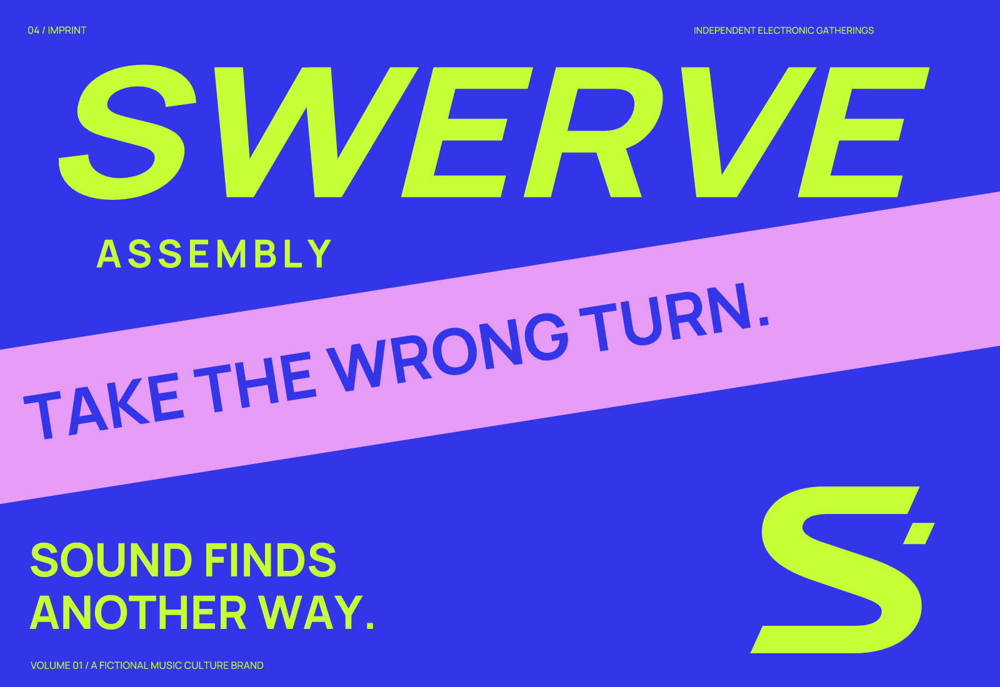

# Swerve Assembly

**English** | [简体中文](README.zh-CN.md)

**Underground electronic music / wide slanted lettering / acid colors**

A fictional brand study actually completed with Imprint on 2026-10-02. Products, people, activities, objects, records, articles, traces, interface examples, and UI are invented. They do not represent a real client, running software, or a launched physical product.

## Brief and positioning

Product: underground electronic-music listening events and an independent release brand for adult listeners and small independent music makers.

Positioning: **A place to gather around the turns in a rhythm.**

The brief assumes English naming and communication; multilingual brand localization was not completed. These are strategic choices, not market facts established through audience research.

Personality and visible decisions: restless → skewed wide lettering; collective → retain the full Assembly name; audacious → large crops and opposing colors.

Avoid: generic lightning bolts, metallic gaming logos, and corporate industrial authority.

## Naming exploration and trade-offs

- Offbeat: Offmeter / Side Pulse.
- Collective surprise: Jolt Choir / Swerve Assembly.
- Unravelling time: Ravel Hour / Loose Measure.

| Candidate | Specific strengths | Main cost | Decision |
| --- | --- | --- | --- |
| Swerve Assembly | Strong action and clear collective meaning. | “Swerve” has a spelling learning cost; “Assembly” is long. | Adopted as a fictional name. |
| Jolt Choir | Short and surprising. | Can suggest a choir; related usage results already exist. | Kept for comparison, not selected. |
| Ravel Hour | Time and unravelling associations. | The composer association affects positioning. | Kept for comparison, not selected. |

Selected spelling: **Swerve Assembly**; suggested pronunciation: SWURV uh-SEM-blee. Swerve conveys movement away from a fixed route; Assembly conveys gathering. This is the brand intention for the study, not a claim to a unique etymology.

Conflicting or weak candidates were not presented as final recommendations merely to fill a shortlist. The table retains the selection and rejection reasons.

Preliminary screening: Offmeter had music-related uses. Exact and category searches for Swerve Assembly mainly returned robotic-assembly meanings. Jolt Choir produced choir-related results; Ravel Hour readily entered the composer context. None of this establishes exclusive use of the selected name.

Search date: 2026-10-02. Queries: `"Offmeter"`; `"Jolt Choir"`; `"Swerve Assembly"`; `"Ravel Hour" music`; `"Swerve Assembly" music label events`. General search and some Exa follow-ups were used. Some destination pages were represented only by search snippets and were not reviewed individually. Domain, social-handle, trademark-registration, and audience spoken-spelling checks were not performed.

- [Offmeter music-use lead](https://soundcloud.com/deqwan-offmeter-chapman)
- [Swerve assembly as a robotics term](https://docs.wcproducts.com/welcome/gearboxes/wcp-swerve-x/misc/changelog)

## Concepts and construction

A: an S-shaped turn with an offset short segment; B: displaced beat bars; C: an ordinary two-line group wordmark. A was selected because its silhouette is more compact than the beat bars and extends into turning lines on a poster. An isolated S can resemble other lettermarks, so the full name is needed to build recognition.

Kept unequal endpoints and the separate short segment. The wordmark starts from Manrope 750, with changes to spacing, horizontal proportion, and slant. The monochrome structure stands without color. The minimum full-wordmark width was raised to 320 px to retain ASSEMBLY’s readability.

See the [three monochrome directions](exploration/concepts.png), [final monochrome refinement](exploration/refinement.png), and [actual-size images](verification/sizes.png). Initial concepts and final sources intentionally retain differences to show the decisions made. In developer-tool cases, files marked retired document abandoned names and symbols and are not final assets.

## Color and typography

Blue-violet supports large backgrounds and graphics; acid yellow-green carries the main contrast; pale violet supports diagonal bands and flowing lines; dark ink and a pale ground serve ordinary information. The saturated treatment suits music communication rather than an industrial black-and-orange order.

| Role | HEX |
| --- | --- |
| Primary text / outline | `#191440` |
| Background | `#EDEEFF` |
| Accent | `#C6FF36` |
| Supporting | `#E69CF6` |
| Music field color | `#3336E8` |

The wordmark uses a static Manrope instance, with both editable text and outlined sources. Manrope supplies ordinary information text; JetBrains Mono supplies code, state, and event text in the two developer-tool studies. Bundled fonts retain their respective SIL Open Font Licenses. Instances are renamed RangeBody, RangeBodyBold, and RangeTerminal as applicable. Source URLs, hashes, and axes are in `fonts/sources.json`, with licenses alongside them. Static instances come from a pinned Google Fonts commit; modifying a font does not mean designing it from scratch.

## Usage and deliverables

Leave at least one quarter of the full wordmark’s canvas height around it, and at least 32/256 of canvas width around the standalone mark. The minimum recommended full-logo width is **320 px**. These recommendations come from rendering and visual inspection, not audience experiments. Sizes refer to the canvas rather than the visible artwork; small-size support does not establish recall.

- `sources/logo-*.svg`: the main logo in color, black, and white. White artwork requires a dark background.
- `sources/wordmark-*.svg`: separate outlined lettering. Swerve Assembly and Wire Accord also include `wordmark-text.svg`.
- `sources/mark-*.svg` and `mark-small.svg`: standalone marks and the small-size adaptation.
- `sources/app-icon*.svg`: generic square icons without pre-cut rounded corners, not a complete platform submission package.
- `exports/`: transparent logo PNGs and icons at 1024, 256, 64, 32, and 16 px. Logo PNGs are 1200 px wide, with a separate minimum-size full logo. The 32/16 px icon exports use the small source.
- `previews/`: an identity overview and an application mockup; interfaces are not functional.
- `verification/`: size checks, source hashes, applicable text/outline comparisons, and export consistency reports.
- `exploration/`: three concepts, monochrome refinement, and retained earlier versions.

Keep proportions and internal whitespace. Do not stretch, outline, or add shadows to the logo, force the full wordmark into 16 px, or use low-contrast supporting colors for small body text. Core logos use shapes and letter paths, not embedded bitmaps masquerading as editable vectors. Pixel symbols are more stable when aligned to whole pixels.

## Verification and remaining limitations

All final source SVGs were rendered. Checks covered the absence of embedded bitmaps in core vector artwork, clipping at transparent asset edges, black/white values, icon dimensions, and opaque backgrounds. In this four-case batch, the two font-based wordmarks were compared with their outlined versions at 2400 px width; font-text comparison does not apply to the two hand-drawn wordmarks. Every final PNG is byte-for-byte identical to a fresh render of its SVG at the same size.

Visual inspection covered large artwork, application scenes, black/white and reversed versions, and icons at 256, 64, 32, and 16 px. The 1024 px icons were checked for dimensions and source correspondence; the source symbols were also inspected at large size. Reports: [structure and rendering](verification/report.json), [PNG correspondence](verification/export-consistency.json).

An isolated S does not guarantee distinctiveness; a comprehensive visual-similarity review was not completed. At 16 px the main silhouette and short segment remain separate, but detail is weaker than at 32 px.

External visual screening produced only a few category references and search leads, without a complete visual-similarity review. No claim is made of absolute originality, name clearance, or demonstrated market recognition. These limits do not prevent the delivered files from showing the design process.

[← All examples](../README.md) · [Imprint](../../README.md)
