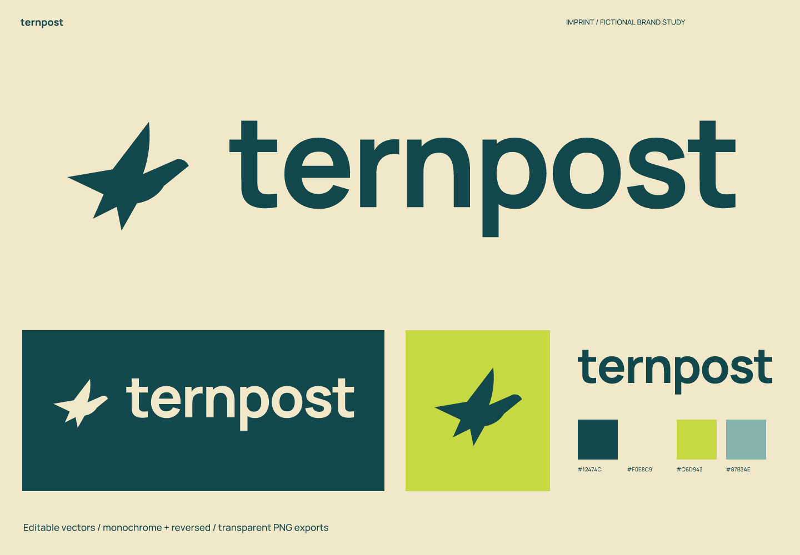
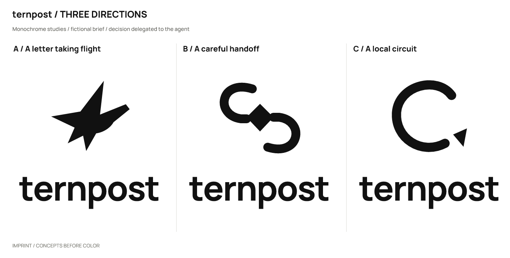
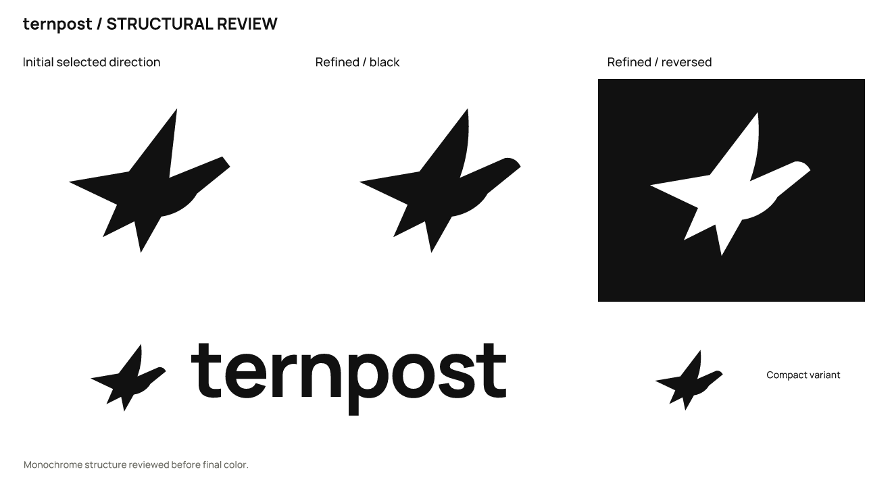

# Ternpost · 街区自行车配送

[English](README.md) | **简体中文**

> 虚拟品牌，真实产出的设计练习。产品、受众和定位为假设；不是客户项目，也没有经营或用户成效数据。

## 定位与名字

为附近商铺与居民提供预约自行车取送服务；可靠的短途交接是核心。

让一件小东西，有人认真送到。

**Ternpost**（建议读法：TURN-post）。燕鸥与投递组合，意图是邻里间轻快、直接的递送。

品牌性格：敏捷：上扬鸟翼；可靠：稳固下半部轮廓；邻里感：圆角但不幼稚的字形。

避免：全球运输承诺、飞机与速度线堆叠、极限时效数字。

候选命名方向：递送的鸟：Ternpost / Wren Relay；街区交接：Next Door Run / Local Hand；行程的线：Roundroute / Little Circuit。

| 候选 | 选择理由 / 优点 | 代价 / 风险 |
| --- | --- | --- |
| Ternpost | 紧凑、具体的鸟意象 | 可能听成 turnpost |
| Wren Relay | 轻巧而有接力意味 | wren 听写难 |
| Little Circuit | 短途闭环明确 | 偏电子技术 |

## 图形选择与精修

| 方向 | 关系 | 主要风险 |
| --- | --- | --- |
| A / 起飞的信 | 上扬翼面与分叉尾部组成一只侧飞鸟。 | 可能被读成纸飞机。 |
| B / 仔细的交接 | 两段包围线之间保留一枚包裹。 | 像无穷或同步符号。 |
| C / 街区的环线 | 开放环线末端指向一点。 | 可直接被当作导航按钮。 |

采用 **A**：上扬翼与分叉尾建立动作，较交接和环线方向更有具体主体。

实际精修：用曲线舒展翼面和头部转折，减少纸飞机般的硬折；保留短尾与长翼的重量差。

选择由用户授权 agent 自行决定；没有声称获得真实客户或受众的选择。图形由 SVG 路径直接构造；字标使用许可字体排字、调整间距后转曲，并非原创字体。

## 使用与文件

- 主图形 / 字色 `#12474C`；浅底 `#F0E8C9`；强调色 `#C6D943`；辅助色 `#87B3AE`。强调色用于色块或装饰，不能代替文字对比度检查。

- 字标字体：Manrope（随包名称 RangeBodyBold）。字体文件、OFL 和来源见 [fonts](fonts/)。编辑文字版前安装随包字体；一般投放优先使用转曲版。

- 完整 Logo 建议画布宽度至少 **190 px**，图形独用建议 **16 px** 起；32/16 px 使用 `mark-small.svg`。尺寸按画布宽度计算，保持纵横比。

- 单色鸟轮廓仍可能被读成纸飞机；这是待受众测试的判断，不是识别测试结论。

- 保留 SVG 自带留白，外部再留至少图形宽度的 1/8；不要拉伸、增加阴影、描边或把细字压进头像。深底用白色 / 浅色反白版本。

- `sources/`：图文组合、独立字标、独立图形的彩色 / 黑 / 白 SVG，以及文字版字标与小尺寸图形。

- `exports/`：透明背景 PNG。16 px 文件是实际诊断样本，只有达到上面的建议尺寸才作为推荐用法。

- `previews/`：配色与反白展示、头像示意。头像示意不等同于平台上架图标包。

- `verification/`：实际尺寸图、源文件映射、渲染与导出一致性结果。

## 已检查与仍未验证

已检查实际黑白概念、精修、大尺寸结构、256 / 64 / 32 / 16 px 图形、190 px 宽完整 Logo，以及成品的浅底 / 深底效果。字体文字版与转曲版在 2400 px 宽进行比较，轮廓覆盖 IoU 为 1.00000000。

11 份 SVG 均可渲染，无嵌入位图；除指定文字版外没有字体依赖。23 份正式 PNG 与最终 SVG 重新渲染结果逐字节一致。文件检查通过不代表所有测试尺寸都适合使用。

名称初筛（2026-10-02）：检索出现 InPost 等模糊匹配，不能用来证明 Ternpost 存在冲突或可用。鸟形也未完成外部相似性核查。

以下是实际搜索 / 复核入口；搜索结果只提供线索，不能证明没有冲突。

- 查询：`"Ternpost" delivery`；部分核查。[来源 1](https://inpost.co.uk/tracking) [来源 2](https://inpost.co.uk/send) [来源 3](https://inpost.co.uk/)

未完成：商标、域名和社交账号可用性；完整外部图形相似性核查；真实受众认读、听写与记忆测试；完整品牌系统和平台上架包。

本轮范围为命名与 Logo 案例，完整品牌手册、真实产品应用和平台图标包不在本轮交付范围。

本案例执行当前仓库的 [skills/imprint/SKILL.md](../../skills/imprint/SKILL.md)，SHA-256：`519e787cdf6277b2e9c5caeb64dbf3b3917a53bde0ee0dc433c4a35dd548fad3`。简报、命名、选择依据与检索记录见 [结构化记录](exploration/brief.json)；可编辑矢量见 [sources/](sources/)。

[← 全部案例](../README.zh-CN.md) · [Imprint 主页](../../README.zh-CN.md)
