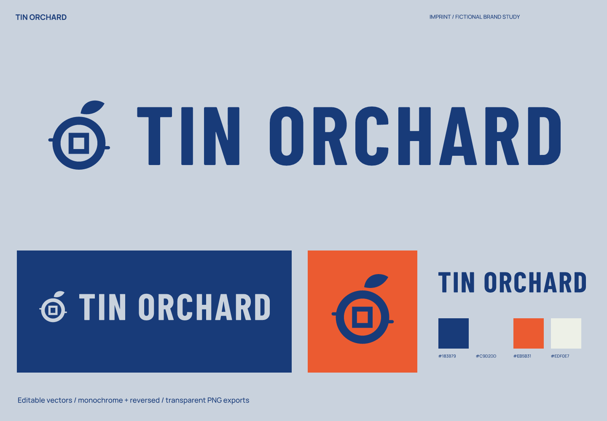
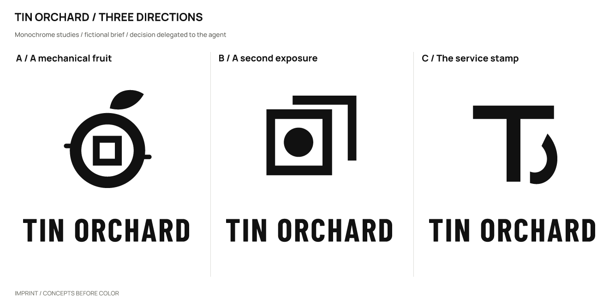
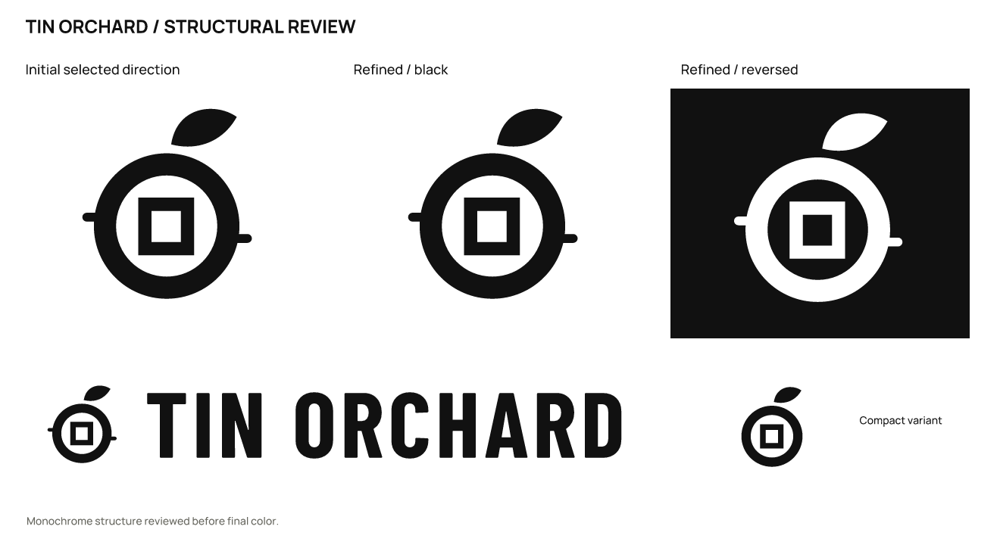

# Tin Orchard · Film camera repair

**English** | [简体中文](README.zh-CN.md)

> A fictional brief with actual design outputs. Products, audiences, and positioning are assumptions; there is no real client, audience testing, or business-outcome data.

## Positioning and naming

Inspection, repair, and maintenance classes for people using older cameras: extending an object’s use rather than selling a nostalgia filter.

Positioning: **Let old machines keep producing new photographs.**

**Tin Orchard** (tin OR-cherd) contrasts metal with an orchard, linking mechanical repair to continued growth and use.

Personality: mechanical, through circles and joints; alive, through an angled leaf; dependable, through compact equipment-label lettering.

Avoid: promises of perfect restoration, stock camera silhouettes, and retro noise hiding the structure.

Naming territories: machines growing again — Tin Orchard / Metal Bloom; light after repair — Second Exposure / Light Again; order on the workbench — Frame Bench / Small Shutter Works.

| Candidate | Rationale / strengths | Cost / risk |
| --- | --- | --- |
| Tin Orchard | Strong contrast between material and growth. | Does not directly say repair. |
| Second Exposure | Clear photography context. | A common photographic term. |
| Frame Bench | Clear tool association. | Relatively generic. |

## Concepts and refinement

| Direction | Visual relationship | Main risk |
| --- | --- | --- |
| A / A mechanical fruit | A segmented lens barrel meets an angled leaf. | Segments may merge into a gear at small sizes. |
| B / A second exposure | Two offset frames share a circular focus. | Generic photography imagery lacks the name’s character. |
| C / The service stamp | A tool plate contains a T and an open ring. | Clearly mechanical, but lacks the living metaphor. |

Selected **A**: the mechanical ring and leaf connect repair with continued use, fitting Tin Orchard better than a frame.

Refinement: Removed the thin side joints from the small version. Kept the outer ring, square internal structure, and angled leaf, avoiding the look of a noisy vintage-camera sticker.

The user authorized the agent to make the selection. This is not a real client or audience preference result. Symbols were constructed directly with SVG paths; wordmarks use licensed type with spacing adjustments and conversion to outlines, not an original typeface.

## Usage and files

- Primary ink `#183B79`; light background `#C9D2DD`; accent `#EB5B31`; supporting color `#EDF0E7`. Accents are for blocks or decoration and do not replace text-contrast checks.

- Wordmark: Barlow Condensed (bundled as RangeBayward). This uses licensed type, spacing, and outlined glyphs; it is not an original typeface. Font files, OFL licenses, and provenance are in [fonts](fonts/). Install the bundled fonts before editing the text version; prefer outlined artwork for general use.

- Recommended full-logo canvas width: **200 px** or more. Standalone symbol: **32 px** or more. The inner square opening is weak at 16 px. Use 32 px or above for the standalone mark.

- Sizes refer to canvas width; keep the aspect ratio. Preserve the SVG’s built-in whitespace and leave at least 1/8 of the symbol width outside it. Use `mark-small.svg` at 32/16 px. Do not stretch, add shadows or outlines, or squeeze fine lettering into an avatar. Use white or light reversed artwork on dark backgrounds.

- `sources/`: color, black, and white logo compositions, outlined wordmarks and symbols, an editable text wordmark, and a small-size symbol.
- `exports/`: transparent PNGs. A 16 px export is a diagnostic sample; use it only where the recommendations above support that size.
- `previews/`: color and reversed presentations and avatar studies, not a platform submission icon package.
- `verification/`: actual-size images, source mappings, and rendering/export consistency results.

## Checks and limitations

Checked the three drawn monochrome directions, refinement, large-scale structure, 256 / 64 / 32 / 16 px symbols, the full logo at 200 px wide, and final light/dark presentations. Text and outlined versions were compared at 2400 px width, with a contour-overlap IoU of 1.00000000.

All 11 SVGs render without embedded bitmaps and have no font dependencies except the designated text version. All 23 final PNGs are byte-for-byte identical to fresh renders of the final SVGs. Passing file checks does not mean every tested size is suitable for use.

Name screening (2026-10-02): Results were mostly metal containers and historical text; no same-name camera-repair brand was verified. The mechanical fruit is a design relationship in this study, not proof of originality.

These are the search and follow-up entry points used in the study. Results provide leads, not proof that no conflict exists.

- Query: `"Tin Orchard" camera`; partial. [Source 1](https://trove.nla.gov.au/newspaper/article/10457738) [Source 2](https://www.ebid.net/uk/for-sale/a-collector-s-tin-orchard-workers-double-devon-toffee-17-x-10-cm-fair-188148074.htm) [Source 3](https://bigjims.co.nz/tin-orchard-round-cake-l/)

Still unverified: trademark, domain, and social-handle availability; a complete external visual-similarity review; and real audience reading, spoken-spelling, and recall tests. No simulated human recognition results are claimed.

This study covers naming and logo design. A full brand manual, real product applications, and platform submission icon packages are outside its scope.

Executed with [skills/imprint/SKILL.md](../../skills/imprint/SKILL.md), SHA-256: `519e787cdf6277b2e9c5caeb64dbf3b3917a53bde0ee0dc433c4a35dd548fad3`. See the [brief, decisions, and search records](exploration/brief.json) and [editable vectors](sources/).

[← All examples](../README.md) · [Imprint](../../README.md)
