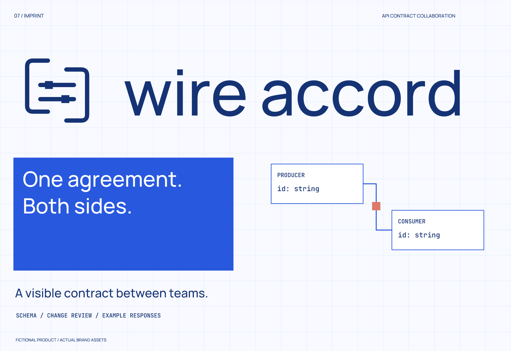

# Wire Accord

[English](README.md) | **简体中文**

**开发工具 / 技术图解 / 蓝白协作**

虚拟产品，实际完成的 Imprint 品牌案例。产品、用户、活动、陶器、trace、接口示例及 UI 均为创作设定；不表示真实客户、真实运行软件或实体产品上市。

## 简报与定位

产品：API 契约审阅、字段变更与示例响应协作空间的品牌概念。面向需要对齐接口的前端、后端开发者。

定位：**同一份约定，让两边看见同一个字段。**

本案以英语名称和传播为假定范围，未完成多语言本地化。以下为策略选择，不是经过受众实验确认的市场事实。

性格与可见决策：明确 → 连通的结构图；协作 → 成对端点；有分寸 → 细网格与克制的密集信息。

应避免：通用发光 AI 球体、具象船舶插画、安全认证承诺。

## 命名探索与取舍

- 共同约定：Wire Accord / Common Field
- 团队间的传递：Schema Ferry / Draftport
- 可见的变更：Delta Sheet / Field Margin

| 候选 | 具体优势 | 主要成本 | 决策 |
| --- | --- | --- | --- |
| Wire Accord | 双边约定意图清晰，读写自然 | Accord 有其他软件使用，完整名称仍需进一步核查 | 采用为虚拟名称 |
| Schema Ferry | 技术词与交付关系贴近 | 发现同领域现有项目 | 冲突退出 |
| Delta Sheet | 变更信息易理解 | 描述性很强，不足以支撑独立名称 | 质量退出 |

选定书写为 **Wire Accord**；读音提示：WIRE uh-KORD。Wire 关联接口交换，Accord 关联共同约定；完整名称应保留，不单用 Accord。

本案没有为了凑齐三名而将冲突或过弱候选包装成最终推荐；表格保留实际筛选过程与退出理由。

初筛结果：Schema Ferry 命中同领域 schema_ferry Ruby gem，退出；DraftPort 已是软件产品；Delta Sheet 过于接近技术文档术语。Wire Accord 的精确、合写和软件查询多为语义匹配；Accord Project 属于相邻软件语境，保留潜在混淆风险，尚无法律可用性结论。

检索日期：2026-10-02。实际查询：`"Schema Ferry"`；`"Draftport"`；`"Wire Accord"`；`"Schema Ferry" API`；`"Schemaferry"`；`"Delta Sheet" software API`；`"Wire Accord" API`；`"Wire Accord" software`；`"Wireaccord"`。使用通用搜索与部分 Exa 补查；一些目标页面仅得到搜索摘要，尚未逐页完成复核。域名、社交账号、商标注册与受众听写测试未执行。

- [schema_ferry 同领域项目文档](https://rubydoc.info/gems/schema_ferry)
- [DraftPort 现有产品](https://draftport.app/)
- [Accord Project 相邻语境](https://docs.accordproject.org/docs/accordproject/)
- [Delta Sheet 术语例子](https://www.infineon.com/dgdl/xc164CM-CS_deltasheet_1.0D3.pdf?fileId=db3a304412b407950112b40c11e60a20)

## 概念与构造

A 是错位边框中的两条字段轨道；B 是搬运中的文档；C 是名称首字母。选择 A：同一组字段处在两边的边界内，能直接延伸成契约对照图。B 更接近通用文件工具，C 的字母组合缺少用途线索。

Schema Ferry 在深入检索时发现 schema_ferry 软件，改选 Wire Accord；标记的策略仍是两方约定，因此保留概念并扩大边框与字段线的间隔，消除初稿粘连。32/16 px 版加粗线条；在 16 px 下不要求读出字段节点。

查看 [三个黑白方向](exploration/concepts.png)、[最终黑白结构](exploration/refinement.png)、[实际尺寸图](verification/sizes.png)。开发案例的 retired 文件记录已放弃的名称与图形，不属于最终资产。

## 颜色与排版

深蓝承载文字；明蓝用于交互与共同约定；淡蓝区分结构分组；小面积陶红只提示待确认的变更。网格是版式辅助，应用界面中收敛为对齐与连接关系。

| 角色 | HEX |
| --- | --- |
| 主文字 / 轮廓 | `#153374` |
| 底色 | `#F8FAFF` |
| 强调 | `#2858DE` |
| 辅助 | `#DCE8FC` |
| 变更提示 | `#DE7968` |

字标基于 Manrope 的静态实例，并提供文字可编辑源与转曲版。 常规信息使用 Manrope；两个开发工具的代码、状态与事件信息使用 JetBrains Mono。全部随附字体依据各自 SIL Open Font License 分发。实例分别改名为 RangeBody、RangeBodyBold、RangeTerminal；原始来源、哈希、轴值见 `fonts/sources.json`，许可正文同目录保存。静态实例来自固定 Google Fonts 提交，修改字体不等于从零设计字体。

## 使用与交付文件

组合标志净空至少为图形标记宽度的 1/4；完整 logo 至少 260 px，标记建议 32 px 以上。 完整 logo 的最低建议宽度为 **260 px**；图标提供 1024、256、64、32、16 px。尺寸值描述画布，不是可见图形的宽度。小尺寸支持不表示受众一定能记住图标。

- `sources/logo-*.svg`：完整主标志，color / black / white。
- `sources/wordmark-*.svg`：单独字标；音乐、API 案例另有 `wordmark-text.svg`。
- `sources/mark-*.svg` 与 `mark-small.svg`：独立标记及小尺寸版。
- `sources/app-icon*.svg`：完整通用方形图标。32 / 16 px 导出采用 small 文件，不是平台特定上架包。
- `exports/`：1200 px 透明 PNG 标志、最低尺寸完整标志和五档图标。
- `previews/`：品牌总览与一个实际生成的应用示意。
- `verification/`：精确源文件哈希、边界、黑白色值、字体比对与导出对应检查。
- `exploration/`：选择过程、黑白构造及部分修正前版本。

保持比例与内侧留白；不要把字标强缩到 16 px；white 版本放在深色背景；浅辅助色不承担细小正文；不要给核心标志随意加阴影或描边。像素标记使用整像素定位更稳定。

## 实际验证与局限

已渲染全部最终源 SVG，检查核心矢量中没有嵌入位图、透明资产未触边裁切、黑白色值准确、图标尺寸与不透明底色正确。两种字体字标的文字版与转曲版在 2400 px 宽度下比对；另外两种自绘字标不适用字体文字比对。所有正式 PNG 导出已与对应 SVG 同尺寸重新渲染逐字节对比一致。

已目视检查大图、使用场景、黑白/反白及 256、64、32、16 px 图标；1024 px 图标完成尺寸与源对应检查，源标记亦在大图中检查。报告：[结构与渲染](verification/report.json)、[PNG 对应](verification/export-consistency.json)。

括号、轨道和无衬线字体在开发工具中常见，这套品牌的辨识更多来自组合。16 px 字段节点细节弱，32 px 以上更适合独立展示。界面只展示一次虚拟审阅，未执行契约验证或 mock 服务。

外部图形初筛只获得少量类别参考与搜索线索，未形成完整的可视排重证据；不宣称标志绝对原创、名称获准使用或具备真实市场辨识度。这些限制不影响交付文件本身用于展示本次设计流程。

[← 全部案例](../README.zh-CN.md) · [Imprint 主页](../../README.zh-CN.md)
