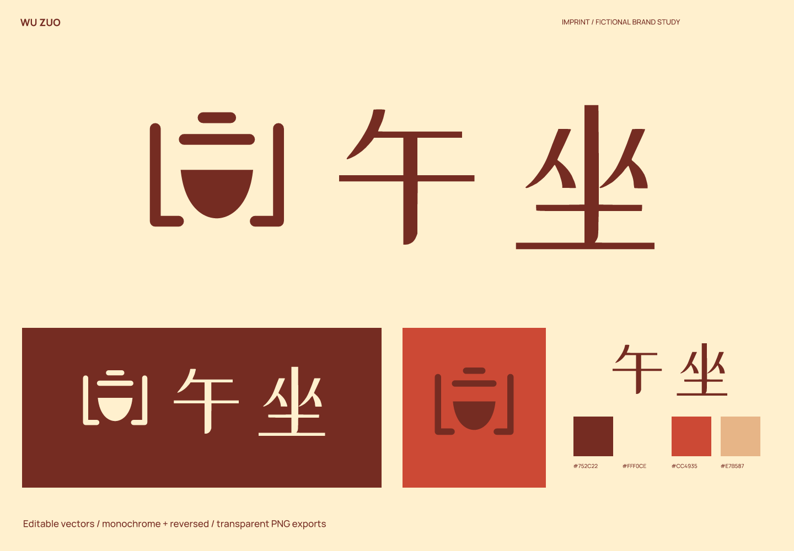
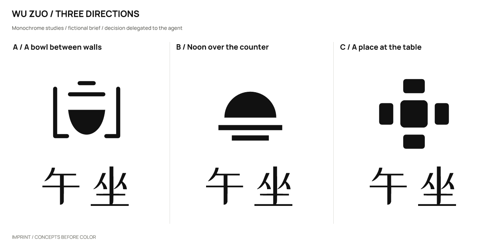
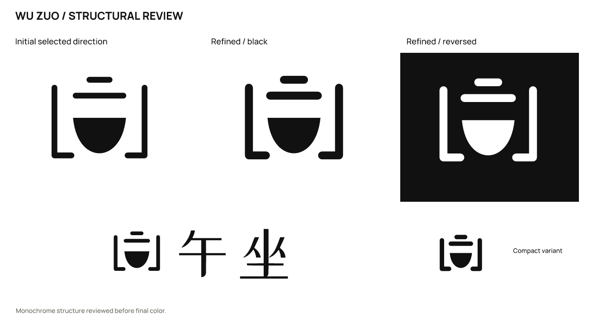

# 午坐 · 街坊午餐店

[English](README.md) | **简体中文**

> 虚拟品牌，真实产出的设计练习。产品、受众和定位为假设；不是客户项目，也没有经营或用户成效数据。

## 定位与名字

为附近工作者与居民提供少量现做饭菜；午休时坐下来吃一顿完整的饭。

给午间的一顿饭，留一个坐下来的地方。

**午坐**（建议读法：wǔ zuò）。午间坐下来吃饭；与座位和共享空间相连，不声称来自某一古诗。

品牌性格：亲近：中文名字与可读字形；利落：粗细有秩序，不做复古杂货铺；有烟火气：碗与窄巷的空间关系。

避免：网红火焰图形、假书法、精致餐厅距离感。

候选命名方向：日常时刻：午巷 / 半晌食；熟悉座位：邻座饭 / 同桌里；家常器物：碗边 / 一勺正好；复核后的替代方向：午坐。

| 候选 | 选择理由 / 优点 | 代价 / 风险 |
| --- | --- | --- |
| 午坐 | 午间坐下来吃饭；与座位和共享空间相连，不声称来自某一古诗。 | 初筛出现同类餐厅辰午巷，退出午巷；午坐保留午间停留意图，听写需与无座区分。 |
| 午巷 | 短、中文画面清楚 | 需说明餐饮品类 |
| 半晌食 | 口语与吃饭有关 | 部分地区读音和理解不同 |
| 邻座饭 | 共享就餐明确 | 更像品类描述 |

初筛出现同类餐厅辰午巷，退出午巷；午坐保留午间停留意图，听写需与无座区分。

## 图形选择与精修

| 方向 | 关系 | 主要风险 |
| --- | --- | --- |
| A / 两墙之间的一只碗 | 碗在两道巷墙之间；碗口与入口共享开口。 | 细竖线在缩小后易粘连。 |
| B / 柜台上的正午 | 午间的半圆和一条长柜台。 | 像日出住宿品牌，餐饮关系偏弱。 |
| C / 桌边的一个位置 | 四个座位围成一个开放中心。 | 较像家具或社区空间标志。 |

采用 **A**：边界和碗共同表达坐下来的一餐；比日出方向更贴合餐饮，比座位网格更有物件特征。

实际精修：加粗巷墙，让它和碗的重量更接近；名字换为午坐后保留空间包围关系。

选择由用户授权 agent 自行决定；没有声称获得真实客户或受众的选择。图形由 SVG 路径直接构造；字标使用许可字体排字、调整间距后转曲，并非原创字体。

## 使用与文件

- 主图形 / 字色 `#752C22`；浅底 `#FFF0CE`；强调色 `#CC4935`；辅助色 `#E7B587`。强调色用于色块或装饰，不能代替文字对比度检查。

- 字标字体：站酷小薇体（ZCOOL XiaoWei）。字体文件、OFL 和来源见 [fonts](fonts/)。编辑文字版前安装随包字体；一般投放优先使用转曲版。

- 完整 Logo 建议画布宽度至少 **140 px**，图形独用建议 **16 px** 起；32/16 px 使用 `mark-small.svg`。尺寸按画布宽度计算，保持纵横比。

- 完整中文字标优先用于门头和菜单；小头像只用碗与边界，不强缩汉字。

- 保留 SVG 自带留白，外部再留至少图形宽度的 1/8；不要拉伸、增加阴影、描边或把细字压进头像。深底用白色 / 浅色反白版本。

- `sources/`：图文组合、独立字标、独立图形的彩色 / 黑 / 白 SVG，以及文字版字标与小尺寸图形。

- `exports/`：透明背景 PNG。16 px 文件是实际诊断样本，只有达到上面的建议尺寸才作为推荐用法。

- `previews/`：配色与反白展示、头像示意。头像示意不等同于平台上架图标包。

- `verification/`：实际尺寸图、源文件映射、渲染与导出一致性结果。

## 已检查与仍未验证

已检查实际黑白概念、精修、大尺寸结构、256 / 64 / 32 / 16 px 图形、140 px 宽完整 Logo，以及成品的浅底 / 深底效果。字体文字版与转曲版在 2400 px 宽进行比较，轮廓覆盖 IoU 为 0.99999731。

11 份 SVG 均可渲染，无嵌入位图；除指定文字版外没有字体依赖。23 份正式 PNG 与最终 SVG 重新渲染结果逐字节一致。文件检查通过不代表所有测试尺寸都适合使用。

名称初筛（2026-10-02）：初始名午巷的检索出现餐厅辰午巷的目录线索，因同类近似而主动改名。午坐的检索出现诗题页；未据此主张词源，也未验证餐饮名称可用性。

以下是实际搜索 / 复核入口；搜索结果只提供线索，不能证明没有冲突。

- 查询：`"午巷" 餐饮`；部分核查。[来源 1](https://exa.ai/library/place/45lc1r89drl) [来源 2](https://cn.feinfood.com/card/%E6%84%8F%E5%A4%A7%E5%88%A9/%E4%BD%9B%E7%BD%97%E4%BC%A6%E8%90%A8/Ristorante%20Mr%C2%B7Z%28%E8%BE%B0%E5%8D%88%E5%B7%B7%29.xhtml) [来源 3](https://gongshang.mingluji.com/jiangsu/navigator/%E9%87%91%E5%9D%9B%E5%B8%82%E6%B2%B3%E5%A4%B4%E5%9B%BD%E5%BA%86%E5%BA%9F%E5%B7%A5%E4%B8%9A%E6%B2%B9%E5%8A%A0%E5%B7%A5%E5%8E%82)

- 查询：`"午坐" 餐厅 品牌；"午坐"`；部分核查。[来源 1](https://www.cidianwang.com/gushiwen/5/6ec05353925.htm) [来源 2](https://www.cidianwang.com/gushiwen/9/d410642729.htm)

未完成：商标、域名和社交账号可用性；完整外部图形相似性核查；真实受众认读、听写与记忆测试；完整品牌系统和平台上架包。

本轮范围为命名与 Logo 案例，完整品牌手册、真实产品应用和平台图标包不在本轮交付范围。

本案例执行当前仓库的 [skills/imprint/SKILL.md](../../skills/imprint/SKILL.md)，SHA-256：`519e787cdf6277b2e9c5caeb64dbf3b3917a53bde0ee0dc433c4a35dd548fad3`。简报、命名、选择依据与检索记录见 [结构化记录](exploration/brief.json)；可编辑矢量见 [sources/](sources/)。

[← 全部案例](../README.zh-CN.md) · [Imprint 主页](../../README.zh-CN.md)
